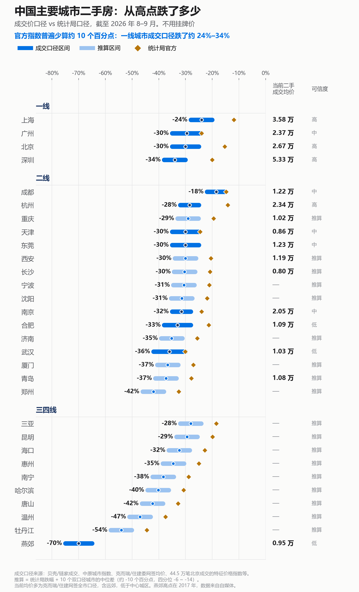
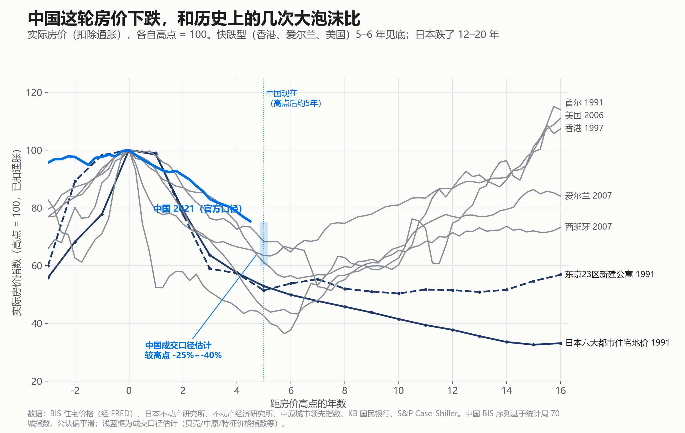
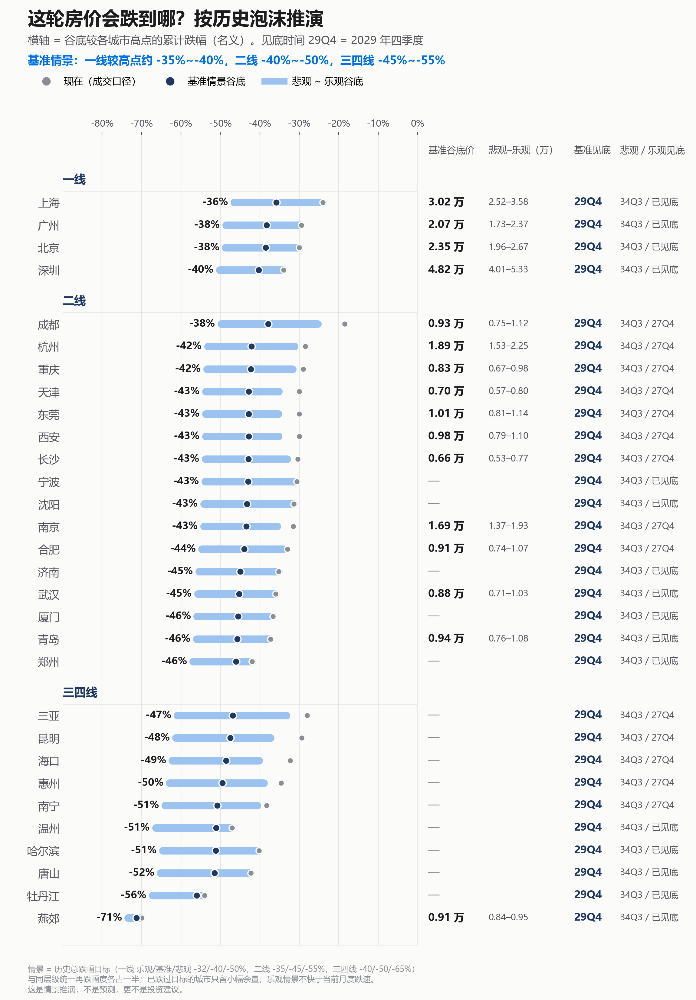
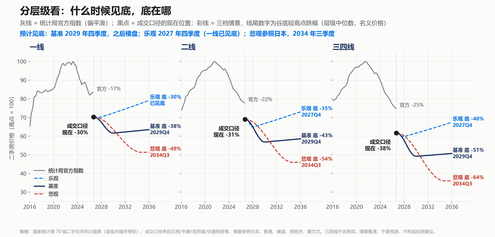

[toc]

# 问题

提问者：**<a href="https://www.zhihu.com/people/bu-tao-65-98">不逃</a>**
提问时间: 2024-9-19 9:39:2
总回答数: 250
总访问量: 2924343

房价最终会降到什么地步？

# 回答

回答者： **<a href="https://www.zhihu.com/people/shuai-bi-xin">姜醒</a>**
回答时间: 2026-10-11 9:51:59
点赞总数: 324
评论总数: 74
收藏总数: 373
喜欢总数：9

Opus5.5 Fast跑了一个长任务，多源数据交叉验证 + 历史泡沫类比推演，大家凑合着看：

（如果有朋友有更精确的数据来源，方便在评论区提供的话，我再重新更新作图。欢迎提供任何数据来源）

___

 **TLDR：（以下为非官方口径）** 

\-目前 **一线跌了约 24%–34%（统计局口径 17%），主要二线 28%–37%，普通三四线约 35%–45%。** 环京、临深这类靠投资客撑起来的盘已经跌了 60%–75%。

\-最新的二手成交均价：深圳约 5.3 万、上海 3.6 万、北京 2.7 万、广州和杭州 2.4 万，多数二线城市在 1 万上下。

\-参照日本、香港、美国等泡沫推演， **Baseline基准情景是 2029 年四季度见底** 。谷底较高点跌幅推演为： **一线约 -36% 到 -40%，二线 -38% 到 -46%，普通三四线 -47% 到 -56%。** 

\-如果悲观情景推演：走日本的路子， **要到 2034 年三季度才见底，推演跌幅：一线约 -47% 到 -50%，普通三四线 -60% 到 -67%。其中投资型三四线更可能是变成有价无市，失去流动性。** 

___

___

 **数据来源：** 

 **官方统计** 

-   国家统计局 70 城房价月度发布，2015-01 到 2026-08，例如 8 月解读：[国家统计局城市司高级统计师杨彩芳解读2026年8月份商品住宅销售价格变动情况统计数据 - 国家统计局](https://www.stats.gov.cn/sj/sjjd/202609/t20260915_1965303.html)
-   统计局 70 城历史数据集（2011–2020，已抽查和官方一致）：[https://github.com/hugohe3/70cityprice](https://github.com/hugohe3/70cityprice)

 **成交数据（核心）** 

-   北京 44.5 万笔二手成交（我用它做了质量调整后的价格指数）：[https://github.com/muziyongshixin/beijing-housing-dashboard](https://github.com/muziyongshixin/beijing-housing-dashboard)
-   中原地产城市指数（京沪深广，到 2024-05）、乐有家（深圳）、普睿数智（上海）、杭州贝壳网签、南京备案、克而瑞各城市网签均价。每个数字的具体链接在 Excel 的"成交数据明细"表

 **交叉验证和机构估算** 

-   券商对统计局各层级"较高点累计下跌"的测算（和我的链乘结果一致）：[https://news.china.com/socialgd/10000169/20260919/49752329\_all.html](https://news.china.com/socialgd/10000169/20260919/49752329_all.html)
-   虎嗅对 8 月 70 城数据的分析（成都、重庆核对用）：[https://www.huxiu.com/article/4892852.html](https://www.huxiu.com/article/4892852.html)
-   AMRO、高盛、Oxford Economics、Morgan Stanley 对真实跌幅的估算

 **历史类比** 

-   BIS 各国住宅价格（经 FRED）：[https://www.bis.org/statistics/pp\_selected.htm](https://www.bis.org/statistics/pp_selected.htm) 、[https://fred.stlouisfed.org/series/QCNR628BIS](https://fred.stlouisfed.org/series/QCNR628BIS)
-   日本：不動産経済研究所新建公寓均价 [首都圏 新築分譲マンション市場動向](https://www.fudousankeizai.co.jp/60th/shuto-data.html) ；东京房价收入比 [不動産マーケット情報：新築マンションのお買い時感は強まっているの？｜不動産購入・不動産売却なら三井住友トラスト不動産](https://smtrc.jp/useful/knowledge/market/2014_08.html)
-   香港：差饷物业估价署售价指数 [https://www.rvd.gov.hk/doc/en/statistics/his\_data\_4.xls](https://www.rvd.gov.hk/doc/en/statistics/his_data_4.xls) 、中原城市领先指数 [中原城市指數 CCI｜樓價資訊｜中原地產](https://hk.centanet.com/CCI/CCI)
-   美国：S&P Case-Shiller [https://fred.stlouisfed.org/series/CSUSHPINSA](https://fred.stlouisfed.org/series/CSUSHPINSA)
-   海南 1993（任泽平团队报告）：[https://download.caixin.com/upload/ziliao/fangchanpm.pdf](https://download.caixin.com/upload/ziliao/fangchanpm.pdf)

 **估值和政策** 

-   城市房价收入比、租金回报率：[https://www.numbeo.com/property-investment/rankings.jsp?title=2026](https://www.numbeo.com/property-investment/rankings.jsp?title=2026) ；35 城房价收入比 [中国房地产报：房价收入比显著回落 居民购房压力有效缓解](https://m.cls.cn/detail/1753374)
-   2026-09-29 首套房贷贴息：[新华鲜报丨财政“真金白银”发力 居民房贷可享贴息](https://www.news.cn/20260929/b18fe265ec0d4f5680959ccba53892b2/c.html)
-   5 年期 LPR 维持 3.5%：[​9月最新LPR出炉，连续16个月“按兵不动”！ | 每日经济新闻](https://www.mrjjxw.com/articles/2026-09-20/4586489.html)

  

原文地址：[(姜醒)房价最终会降到什么地步？](https://www.zhihu.com/question/667562389/answer/2092553027085456263) 

