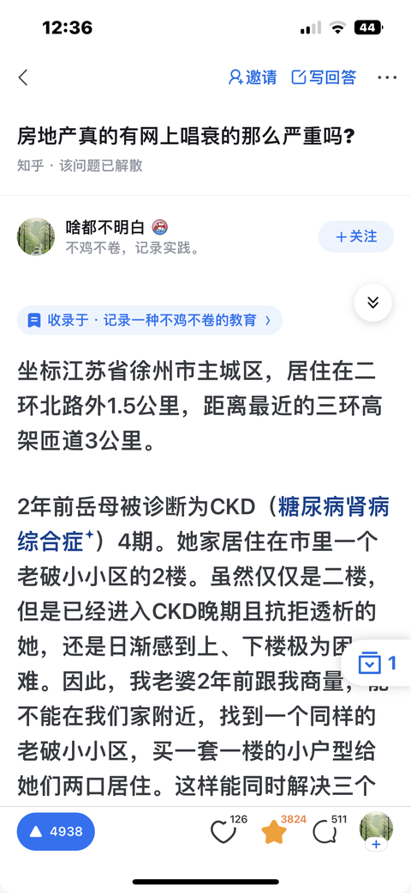

[toc]

# 问题

提问者：**<a href="https://www.zhihu.com/people/kong-qi-32-39">空气</a>**
提问时间: 2025-4-10 17:27:43
总回答数: 604
总访问量: 6426552

网络上都嚷嚷着不买房，房地产不行了。

为什么线下似乎不是这样，坐标三线城市，我身边好多朋友结婚还是会买房，甚至跑到省会去买房，当然，我所知道的都不是全款。而且，我所在城市楼盘还是很火热啊，一完工就被抢光了。

我不理解，是身边统计学出现的误差吗？？

# 回答

回答者： **<a href="https://www.zhihu.com/people/sha-du-bu-ming-bai-32">啥都不明白</a>**
回答时间: 2025-12-26 11:51:54
点赞总数: 5750
评论总数: 551
收藏总数: 4567
喜欢总数：151

坐标江苏省徐州市主城区，居住在二环北路外1.5公里，距离最近的三环高架匝道3公里。

2年前岳母被诊断为CKD（糖尿病肾病综合症）4期。她家居住在市里一个老破小小区的2楼。虽然仅仅是二楼，但是已经进入CKD晚期且抗拒透析的她，还是日渐感到上、下楼极为困难。因此，我老婆2年前跟我商量，能不能在我们家附近，找到一个同样的老破小小区，买一套一楼的小户型给她们两口居住。这样能同时解决三个问题：（1）不用爬楼，（2）离可以透析的三甲医院只有1km的距离，以后她愿意透析了，方便往来医院，（3）离我家、我老婆单位很近，距离我父亲家也很近（500米以内），这样方便我们照顾两边老人。

虽然我跟老婆、孩子住在100㎡+房子里，但当我们打算给老人买小户型养老房，也只能在附近的老旧小区里选择。新楼盘是不敢考虑的。因为现有的财力也仅仅允许全款买套小房子。这件事情我们在2023年就给岳父岳母商量过。她们表示同意。但也表示，没有钱资助我们为她们买房子。我们当时跟老人说，不用她们的帮助，我们买到房子后，会自行装修、添置家用。她们今后拎包入住即可。

这件事从2023年说起后，我就开始收集房源信息。比如，这些条件是要全部兼具的才可以进入“候选池”：

-   Condition 1：以我们自己家 or 老婆单位的半径<1.5km（这是电动自行车5分钟的车程，或汽车2分钟的车程，或步行20分钟的路程）。
-   Condition 2：房子位于老破小小区 and 近几年没有拆迁计划（如何确定有没有拆迁计划，我们用了2个办法，一是随机走访小区的居民，直接询问；二是在本地规划局的留言区，直接问相关部门，等待回复）。
-   Condition 3：必须是1楼（底层），如果有一个小院子，则优先考虑。
-   Condition 4：面积不低于40㎡，但是也不能超过50㎡。不能太小是因为不能少于她们之前居住的2楼。否则，心理上、视觉上会有“憋屈”的感觉。不能太大是因为买不起。

上述4个条件全部满足的，才能进入候选。这时，我们发现能够满足条件的候选房源并不多。以至于，“只有几套符合条件的，价格上又贵得离谱，以至于没得选”。为此，我们必须想办法收集到更多的房源信息。为此，想了3种办法：

-   Way 1：搞清楚几家房产APP的关系，比如一些APP虽然名字不同，但使用的都是“贝壳网”的数据。然后，删除同一数据源的，保留下不同房源数据库的几个APP；
-   Way 2：找到满足Condition 1&2的小区附近的私人房产中介，去请她们帮助关注“候选池”的房源。满足Condition 1&2的小区一共有3个，由于私人中介彼此之间都是信息共享的，所以每一个小区附近找到了3家中介，加起来一共有9家中介为我们提供信息。虽然这9家只是附近中介公司数量的1/3，但由于彼此之间的信息共享，所以我们认为这样已经不会遗漏掉重要房源了；
-   Way 3：找到满足Condition 1&2的小区的（1）张贴栏；（2）电线杆；（3）小区房前屋后，去收集业主自己张贴出来的售房信息。

通过上面的操作，能够进入候选池的房源，从一开始的3套，增加到12套。这样，我们就拥有了一个动态的“候选池”。于是，开始分析池内房源的单价。

然后，我们开始分析单价是否是“合理”的：

1.  由于满足Con1&Con2的老小区紧密相邻，且户型、建筑年代相似。所以，我们先假设3个老小区各自之间是同质的，没有显著差异。因此，就计算出来自这3个老旧小区的总共12套房源的单价的算术平均数。这个价格是11000元/㎡。
2.  接着，我们把这12套房源的实际单价，逐一与算术平均数相减，得出样本单价与平均数之间的离差。并把离差排序。分析离差最大的前30%的房子的具体情况。
3.  经过分析，我们发现，离差最大且为正值的那30%的房源（4套），之所以单价高，是因为拥有不同于其他候选池房源的特点：

-   有独立的院子（但是院子面积不计入房产证）
-   最近5年内有装修

4. 我们又分析了离差为负数的30%的房源（4套），推测为什么低于均价。发现原因大概是：

-   面积极小
-   未装修或毛坯状态
-   没有院子

5.经过了3与4的步骤，我们分别定义3为：“候选池中条件好的房子（P1）”和“候选池中条件不好的房子（P2）”。然后，我们把离差为正的那4套房源（P1），和离差为负的4套房源（P2），各自又求了单价的算术平均数。这样，我们就得到了“这类小区符合条件的老旧小户型房子里，好一点的，和差一点的，各自的市场平均单价”（P1单价大概在12000多，P2单价最低可以下探到9500多，中间有大概3000元的差值）。

6. 此后，我们再继续寻找房源时，就以P1均价和P2均价，作为我们谈价格的起点。同时，我们又发现，房源的数据源，不仅仅包括之前说的主流APP、中介、自售三个渠道。很多中介经纪人，开始利用抖音、快手等直播工具，宣传推广各类房源。这时，我们的信息源又增加了一个“短视频平台”。

2023的春天，我跟老婆在经过了上述一番笨办法之后，明白了一件事情：总价太高，无法全款购买养老房。因为，候选池里的那些老破小，最低要40万，而且是房子的状况相对最差的。最高需要60万。平均价格也要在50万左右。全款买这样一个房子，我们有些负担不起。

因此，“给老人买养老房”这件事情就搁置了下来。直到一年后的2024年春天，我们又开始跟踪前一年代售的那十几套住房的房价。这时，我们吃惊地发现，里面有高达2/3（9套）住房仍然在挂牌出售。只成交了3套。我们对成交的这3套进行了分析，发现各自的特点是：

-   价格最低的一套房子
-   户型最小的一套房子
-   学区指标没有用过的一套房子

售出的这三套房子，呈现出2个特点：刚需（孩子上学）和最重要的，便宜。接着，我们对剩下的没有出手的9套房源的价格进行了追溯。这9套房源里，有7套房源在最近的一年中有降价操作。最少的降价了一次，最多的，每2个月降价一次。在降价的幅度上，最少的每次降价5k左右，最多的，每次降价20k左右。

我们认为这是相比较2023年，这一年过去了，市场上对二手房的观望态度，以及整个市场对房产的悲观预期，导致持房者也开始沉不住气了，主动降价。鉴于降价者（7套）对比维持原价者（2套）在数量上的绝对优势，我们猜测，房价会在可见的近期进一步下探。于是，在2024年春天，我跟老婆决定，趁着老年人身体还好，我们再观望一段时间。

到了2024年9月份，原先维持原价的2套房源中，有1套开始跳水。业主把挂牌价从一开始的48万，首次降价2万出售。接着，到了11月中旬，连续6次降价，幅度从20k到3k不等。到了那年的年底，该套房源已经从48万的挂牌价，降低了10万元，到了38万。

为了搞清楚这是单一、偶发情况，还是具有普遍性，我们立即查看了这一年中已经降价的另外7套房源。发现在过去半年中，全部出现了各自2-4次的继续降价的现象。这时，我们注意到其中一套43平方的房源，从一开始挂牌时的48万元，也降低了10万，最新牌价是38万元。

此时，已经是2025年的1月。我们开始对这套房源的用户“Views”（浏览次数）和“Action”（看房次数）数据做跟踪。也就是说，我们开始隔几天就查看一次这套房源最近一周被查看的次数，以及被中介公司带领去实地查看的人数。又过了一个月，我们发现，即便业主在一年内已经连续降价10万，但与此前相比，views数据逐渐上升（表明更多的人对这套降价房感兴趣），但是看房人数却没有增加。因此，我跟老婆判断这时候潜在购买者的心理是“观望”。

我们觉得可以出手了，因为下探后的房价，进入到了我们的接受区间。到了2月1日，我们请中介带我们看房。发现这是一套几乎毛坯的旧房子，一楼一室一厅还带有一个8.5平米的院子和2个阳台。这个院子和阳台，都没有计入房产证。老婆私下对这套房子比较满意，认为经过改造，可以成为理想中的养老房。

因此，我们开始做讲价前的准备功课。主要是按照普通标准，计算硬装的预算。同时，把离差为正、为负的那几套房源的基本情况又整理了一遍，把主要数据打印出来。

在见业主那天，我摆出了几个事实：

1.  业主的房子最近大幅降价，但是仍没有售出，甚至看房人数都没有增加。说明市场上对这套房子感兴趣，能成为可能购买者的人并不多。反而大家都在因降价行为而采取了观望的态度。观望的结果是，降价行为叫好不叫座。所以，虽然看上去降价了，但是与房屋的现状来说，还是在高价位徘徊。所以，降价并不吸引人，只能让人产生更多的降价期待；
2.  现状是毛坯房，在本地装修的话，最基本的硬装成本（工+料）也要4万以上。也就是说，虽然一些同类住房售价高一些，但因为人家是已经装修好的，可以拎包居住。而我们自己还要另外花钱装修。购房成本并没有降低。所以，请业主不要再强调“我已经降价10万”这个点了。因为每一栋房子都有自己的真实价值。业主的降价行为，没有触及到房子的真实价值。
3.  我们从APP数据里得知，业主在某APP挂出这套房子已经1年+6个月了。一直没有成交。同时，我们从中介那里得知，业主出售这套房子的原因是，打算在城市东区（这里是西区，距离东区16公里）购买一套新的住房。老房子卖不掉，新房子就买不起。
4.  结论是：业主赶紧卖出去这套房子，（1）有了现金，可以区选新房子了；（2）就算卖给我们再便宜些，也能在现金到手后，选购新房子时，跟新房子业主讨价还价，把“少卖的钱”，再赚回来；（3）展示了小区里那些常年卖不出去的房源，告诉业主，房市的大时代已经过去了，现在不再谈任何与“当初的挂牌价”和“我毕竟已经降价10万”的话题。就事论事，我们愿意真诚谈判，满意了当场签合同。

最终，我们以34万元的价格（比最新价格低了4万），买到了这套房证面积43㎡（后来在办理新房证时，重新调取资料勘验测量，面积调整为将近46㎡），2个3.5平方米的阳台、1个8㎡的小院，房证外的额外还有小十几个平方面积的小房子。均价只有7000多元。

今年2月份开始装修，5月份有一位在小区做安装防盗网生意的师傅，来我们家安装阳台金刚砂窗。问我们多少钱买下的这套房子。当我告诉他34万时，他不禁唏嘘。他告诉我说，他是湖北十堰来我们这里做防盗网生意的。早在2019年（6年前），他就看中了这套房子。那时，房源已经在中介上挂牌了。当时，他跟老婆一起来跟房主谈价钱，房主坚持60万一口价。单价大概1.39万。现在，竟然被我已当初价格的将近一半（最初挂牌价的56%）买到了。

唉，这真是时代的一个小插曲。好在，我跟老婆比较运气。分别在2016年12月份本地房价开始起飞的前夜，购买到自己喜欢的复式房子。又在9年后的2025年，了房地产大潮已经退去的沙滩上，捡到了“拦腰斩”的便宜养老房。现在老人已经入住，我们再也不用每周跑十几里路去看望老人了。

说到这里，我又想起了一开始装修时，一位帮我清运建筑垃圾的年轻人。他问我这套房子多少钱买的。我告诉他之后，他跟我说，自己在2019年在市东区以138万买了一套140平的新房子。现在市场价格只有86万元了。而自己跟老婆，每个月要还大几千的贷款。疫情3年，他们的生意——本地建材市场的一家高端生活空间馆也不得不停业。从此一蹶不振，再也没有财力去重振他的生意。两口子只能以各种方式赚钱养家、还贷。而他自己，送货，搬运，美团，闪购，什么都要做。

小伙子跟我聊天时，我甚至闻到他身上用着的淡淡的男性香水的味道。相比这位老板的生活一直是精致考究的。可是，这好闻的香味，与他一身工装，背着砖头混凝土块的现状极具反差。我在想，几年前，他也是起码小富，也可能是中富的老板呀。大时代下，我们每一个人都无法停下脚步。每个人都很辛苦。

  

原文地址：[(啥都不明白)房地产真的有网上唱衰的那么严重吗?](https://www.zhihu.com/question/1893716777789260758/answer/1987853114024431683) 

# 评论

1. <a href="https://www.zhihu.com/people/liu-eric-6-78">小刘鸭埃里克</a> (<small title="北京">2025-12-26 14:24:47</small>): 哥们儿，你们这统计学用得好，很有参考意义，棒
   - **啥都不明白** (<small title="江苏">2025-12-26 14:25:28</small>): ［哇］
   - <a href="https://www.zhihu.com/people/fcyj">阿健</a> (<small title="回复于 2025-12-27 7:18:50/安徽"> ✉️:啥都不明白</small>): 看文章时我也觉得他一定是学过统计学的……
   - <a href="https://www.zhihu.com/people/jwang128">阳光咖啡馆</a> (<small title="福建">2025-12-27 10:44:30</small>): 感觉是做科研的，思路清楚，方法科学，实操精准。
   - <a href="https://www.zhihu.com/people/feng-zhi-zi-14-43">Kumar</a> (<small title="回复于 2025-12-27 10:57:58/上海"> ✉️:阳光咖啡馆</small>): 至少是理科出身
   - <a href="https://www.zhihu.com/people/wu-yu-wu-tu">无鱼无徒</a> (<small title="江苏">2025-12-27 12:26:32</small>): 思路清晰
   - <a href="https://www.zhihu.com/people/guang-zhi-zi-84-63">光之子</a> (<small title="广东">2025-12-31 10:8:19</small>): 他一顿操作猛如虎，舞得我们读者眼花缭乱
2. <a href="https://www.zhihu.com/people/qing-zhu-feng-yun-93">登山镐</a> (<small title="江苏">2025-12-26 21:3:54</small>): ［捂脸］老哥这种肯研究的态度，干啥都能成功的
   - <a href="https://www.zhihu.com/people/zai-de-86">好大一只猫</a> (<small title="江苏">2025-12-27 9:50:11</small>): 确实，老哥条理清晰，做事进退得当，一定是个高情商的人
   - <a href="https://www.zhihu.com/people/liu-miao-67">自给自足</a> (<small title="回复于 2025-12-27 10:47:29/陕西"> ✉️:好大一只猫</small>): 这位兄弟情商高不高不好猜，但是夫妻俩都是非常理性的人，包括最后谈价格也是用理性说服了对方的感性
   - <a href="https://www.zhihu.com/people/sheng-min-79">知乎用户vvM45W</a> (<small title="回复于 2025-12-29 13:42:42/北京"> ✉️:自给自足</small>): 他很有条理，其实我买东西也会这么做，但是让我写出来，我觉得好难
   - <a href="https://www.zhihu.com/people/tchknight">tchknight</a> (<small title="回复于 2025-12-29 16:26:29/上海"> ✉️:好大一只猫</small>): 情商高不高不清楚，但理性可以是确定的。
   - <a href="https://www.zhihu.com/people/liu-miao-67">自给自足</a> (<small title="回复于 2025-12-29 19:29:30/陕西"> ✉️:知乎用户vvM45W</small>): 这位兄弟可不光是有条理，他和妻子完全是按照数据分析的逻辑去做决策的，夫妻俩不但理论扎实，执行力也很强，从头到尾对需求的判断，数据收集，买入决策，价格谈判都是非常理性的。不客气的讲，99%的夫妻做不到
   - <a href="https://www.zhihu.com/people/cao-zhou-li">曹舟力</a> (<small title="浙江">2026-10-17 6:17:26</small>): 这里爽文的感觉不是他一个人，而是他们一对夫妻
3. <a href="https://www.zhihu.com/people/xie-lun-50">二十弦</a> (<small title="湖南">2025-12-27 0:56:15</small>): 真正将统计学知识用到了实处！很好的一篇文章，也为我日后选房提供了思路参考，感谢您的辛苦和无私［爱］
   - <a href="https://www.zhihu.com/people/losestyle">losestyle</a> (<small title="江苏">2025-12-27 7:3:53</small>): 你在家也这么说话吗？
   - <a href="https://www.zhihu.com/people/17-9-33-53">Penny Zhang</a> (<small title="回复于 2025-12-27 7:48:14/河北"> ✉️:losestyle</small>): 你在家怎么说话大家倒是知道了
   - <a href="https://www.zhihu.com/people/yuan-yuan-71-15-44">快思诚001</a> (<small title="回复于 2025-12-27 9:11:0/江苏"> ✉️:losestyle</small>): 他说的哪里有问题了？莫名其妙问这么个话［魔性笑］
4. <a href="https://www.zhihu.com/people/qia-qia-21-82">卡卡</a> (<small title="山西">2025-12-27 9:19:44</small>): 兄弟有很明显的统计学痕迹。确实是这样，我们在做决策的时候，用好统计学就会好很多，牛！
5. <a href="https://www.zhihu.com/people/bu-yuan-tou-lu-xing-ming-de-spike">三鲜热河天</a> (<small title="江苏">2026-10-18 16:1:21</small>): 非常难得理性分析文章
6. <a href="https://www.zhihu.com/people/lai-qu-zi-ru-65">来去自如</a> (<small title="湖北">2026-10-18 17:42:1</small>): 感觉其实就是一个因为买房至贫的案例。
7. <a href="https://www.zhihu.com/people/cui-jia-xin-96">Jesse Cui</a> (<small title="北京">2026-10-18 4:40:56</small>): 这分析能力很强了，而且是对自己家庭有掌控权，父母23年给我买了一套200万的婚房，我当时各种劝不让买，但家里人觉得快结婚了必须得有房子，给我极限施压，我也没争得过，现在亏了30+了，当时要是有话语权就不会如此
8. <a href="https://www.zhihu.com/people/cai-wei-min-92">ajeremiad</a> (<small title="浙江">2026-10-18 10:11:47</small>): 标记学习了
9. <a href="https://www.zhihu.com/people/gongtao81">常山幽悠闲</a> (<small title="四川">2026-10-18 9:1:43</small>): 学到了，多谢作者的无私分享👍👍👍👍👍👍
10. <a href="https://www.zhihu.com/people/peng-jun-8-54">彭军</a> (<small title="江苏">2026-10-18 18:17:19</small>): 理性的买房人，赞［大笑］
11. <a href="https://www.zhihu.com/people/shuang-ma-fei-teng-76">逍遥王爷</a> (<small title="江苏">2025-12-27 7:2:44</small>): 从今往后，除了极少数的一二线城市，剩下的地方，房子都失去了保值的能力，回归到正常的市场价值。以后房子大部分的房子没有投资功能，只要买，就接受它的慢慢降价。
    - **啥都不明白** (<small title="江苏">2025-12-27 7:7:49</small>): 嗯，我同意且完全同意您的看法。所以，就我文章中的买房经历来说，满足“很小，很近，方便养老，够用”的前提下，花最少的钱买房就已经足够了。多花钱，就是风险与慢亏了。这套房子周边是三甲医院和地铁站，又有一个小院子供老人休息、养花。我们已经很满意、知足了。
    - <a href="https://www.zhihu.com/people/cao-xiao-liu-21">不想游泳的鱼</a> (<small title="回复于 2025-12-27 7:49:31/江苏"> ✉️:啥都不明白</small>): 8平方小院挺好的，晒晒太阳种种花
    - <a href="https://www.zhihu.com/people/shuang-ma-fei-teng-76">逍遥王爷</a> (<small title="回复于 2025-12-27 9:55:34/江苏"> ✉️:啥都不明白</small>): 其实房子回归到居住的属性来说，在任何时候买房子，只要能接受房子买到手以后会的慢慢降价，都是合适的。不要再做梦的幻想房子自己住了几十年还能再挣钱，那样的时机一去不复返了。
    - <a href="https://www.zhihu.com/people/qia-mi-er-52">卡米尔</a> (<small title="山东">2025-12-27 10:38:19</small>): 仅以居住功能来讲，老房子逐年贬值才是正常的
    - <a href="https://www.zhihu.com/people/41-98-86-5-85">赴川</a> (<small title="北京">2025-12-28 8:43:5</small>): 应该限制在极少数一线城市的核心地带。上海我不熟，至少北广深的房价这两年跌幅触目惊心，房东会主动给降房租，晚买房半年可能省的钱比五年工资都多
12. <a href="https://www.zhihu.com/people/ben-niao-xian-fei-yi-dian-da-lao-guan">笨鸟先飞一电大老关</a> (<small title="安徽">2025-12-26 18:24:56</small>): 有理论，有数据  
 
对买房极具学习参考价值［赞］🌹  
 
谢谢大神［赞］
13. <a href="https://www.zhihu.com/people/chen-chun-peng-10">东山文参</a> (<small title="广东">2026-10-17 16:23:54</small>): 如果所有的房地产交易参与者都能像答主这样客观分析市场厘清个人需求，那才是完全竞争市场
14. <a href="https://www.zhihu.com/people/a-fan-66-11-78">Afine</a> (<small title="山东">2026-10-17 6:20:47</small>): ［赞］好好学习，尤其是学好数学，真的能赚大钱（省了就是赚了）！
15. <a href="https://www.zhihu.com/people/li-fei-70-65">李非</a> (<small title="江苏">2026-10-17 10:30:6</small>): 不错，我就不一样了，只看不买，想住租一年才几万块，首付豆够我租10年以上［感谢］
16. <a href="https://www.zhihu.com/people/chen-xi-87-23-97">微生之光</a> (<small title="江苏">2025-12-26 23:8:14</small>): 细致又理性！感觉都不太像一个正统徐州人，有点像上海人［doge］
    - <a href="https://www.zhihu.com/people/fcyj">阿健</a> (<small title="安徽">2025-12-27 7:19:55</small>): 你这个属于刻板印象，徐州也有人才，也有理性的人，上海也有大把的糊涂蛋，总体而言都是严格遵循二八定律！！
    - <a href="https://www.zhihu.com/people/wang-meng-meng-59">金水汪汪</a> (<small title="江苏">2025-12-27 8:27:15</small>): 是的，我就是徐州人，这位老哥非常不徐州，但非常优秀，非常赞！
    - <a href="https://www.zhihu.com/people/shuai-qi-de-xiao-ma-la-la-la">帅气的小马啦啦啦</a> (<small title="广东">2025-12-27 9:55:39</small>): 徐州人急性子多点，毕竟人口大市，优质人才也挺多
    - <a href="https://www.zhihu.com/people/liu-de-hua-74-48">漢文帝</a> (<small title="江苏">2025-12-28 6:54:40</small>): 哈哈，都condition1，way1了，很难想象老哥出去对小贩说“给俺来两笼肉包子，两碗辣汤，四个馍馍”的场景［捂脸］［捂脸］［捂脸］
    - <a href="https://www.zhihu.com/people/gu-yu-36-22">谷雨</a> (<small title="江苏">2025-12-29 10:21:8</small>): 你这是带有强烈的地域偏见了［捂脸］，徐州地处五省通衢，南北要冲，自古兵家必争，当地人性格大多数既有南方人的细腻、精明、务实，也有北方人豪爽、果敢、热情。  
 
ps:徐州男人都很帅［酷］
    - <a href="https://www.zhihu.com/people/chen-xi-87-23-97">微生之光</a> (<small title="回复于 2025-12-29 15:12:30/江苏"> ✉️:谷雨</small>): 我说的可能不到位，我是说正常徐州人不会说conditon啥的，很少。
    - <a href="https://www.zhihu.com/people/tchknight">tchknight</a> (<small title="回复于 2025-12-29 16:30:20/上海"> ✉️:谷雨</small>): 中原交通要塞
    - <a href="https://www.zhihu.com/people/wang-shi-ru-feng-26-34">网事如风</a> (<small title="江苏">2025-12-30 12:4:37</small>): 别小瞧徐州人好吗。咋说，也得有一大部分人头脑比较好用
    - **啥都不明白** (<small title="回复于 2025-12-31 21:42:25/江苏"> ✉️:漢文帝</small>): ［大笑］［大笑］
17. <a href="https://www.zhihu.com/people/xin-xian-ying-huang-gua">机智大狸子</a> (<small title="河南">2026-10-17 15:37:43</small>): 楼主已经做了很有水平的统计分析，很理性的决策，结果还是在买房这件事上亏了钱，只能说神通不敌天数啊。
    - <a href="https://www.zhihu.com/people/guo-jia-zheng-12">郭嘉正</a> (<small title="山西">2026-10-18 10:7:34</small>): 这个结果已经很好了，既满足了实际需求，价格又在可承受范围内，晚点买可能会更便宜，但也可能买不到这么合适的了，这已经是现有条件下的最优解了
18. <a href="https://www.zhihu.com/people/fang-zen-98">黑大白</a> (<small title="河南">2026-10-17 8:16:46</small>): 看吧 这才叫逻辑
19. <a href="https://www.zhihu.com/people/liu-xin-81-23-28">留心看世界</a> (<small title="天津">2026-10-17 8:15:18</small>): 答主思考问题理性严谨，做事认真，逻辑清晰，很羡慕有这样思维方式和执行能力的人。［赞］［赞］［赞］
20. <a href="https://www.zhihu.com/people/te-si-la-dian-dian-quan">特斯拉电电圈</a> (<small title="山东">2025-12-27 4:17:34</small>): 答主能不能讲讲老婆的事情。两口子能一起搜集数据并讨论比较少见［发呆］哪怕是耐心听都算难得了
    - <a href="https://www.zhihu.com/people/ji-qi-mao-63-18">机器猫</a> (<small title="广东">2025-12-27 9:41:13</small>): 不用猜，是给岳母买房
    - <a href="https://www.zhihu.com/people/te-si-la-dian-dian-quan">特斯拉电电圈</a> (<small title="回复于 2025-12-27 11:52:31/山东"> ✉️:机器猫</small>): 猜啥［好奇］文章开头就说了是买给岳父母两口住的
    - <a href="https://www.zhihu.com/people/jiang-wu-98">江无</a> (<small title="回复于 2025-12-27 15:15:28/上海"> ✉️:机器猫</small>): 他是褒贬女性呢，可能生活中接触到的女人以感性居多
    - <a href="https://www.zhihu.com/people/nuan-xin-88-5">天恒</a> (<small title="河南">2026-1-1 17:14:43</small>): 考虑一下你自己的问题吧，什么锅配什么盖
    - <a href="https://www.zhihu.com/people/te-si-la-dian-dian-quan">特斯拉电电圈</a> (<small title="回复于 2026-1-1 23:37:52/山东"> ✉️:天恒</small>): 有啥问题［好奇］
    - <a href="https://www.zhihu.com/people/rong-zhi-79-10">光年</a> (<small title="四川">2026-10-17 17:17:43</small>): 耐心听都遇不到的话 可能是物以类聚了
21. <a href="https://www.zhihu.com/people/dang-si-qi">当寺麒</a> (<small title="江西">2025-12-27 9:1:50</small>): ［捂脸］我看答案中的例子很多都是19年买的 其实之后早点愿意卖 也不会亏甚至可以赚 当然拖到25年甚至更久就没有办法了  
 
另外说答主买贵了也没有必要，34万现在连一辆顶配小米yu7 max都买不到，难不成车之后会跌价就没人买了？又不是340万。
22. <a href="https://www.zhihu.com/people/35-91-9-88">三千往事阁</a> (<small title="新疆">2026-10-17 18:51:17</small>): 可以不用外文吗
    - **啥都不明白** (<small title="江苏">2026-10-17 18:53:0</small>): 所以，这篇文章的价值因此就归零了？
23. <a href="https://www.zhihu.com/people/shui-zi-67">水子</a> (<small title="广东">2025-12-27 9:0:39</small>): 有理有据，逻辑严密，本想关注，才发现早已关注，唯有再次点赞感谢！
    - **啥都不明白** (<small title="江苏">2025-12-27 9:4:54</small>): 谢谢！
24. <a href="https://www.zhihu.com/people/le-xing-tian-xia-85">乐行天下</a> (<small title="天津">2026-10-17 7:39:21</small>): 房子只要装修的好，80平也有120的感觉
25. <a href="https://www.zhihu.com/people/shan-xia-ren-18">安闲生</a> (<small title="浙江">2025-12-26 21:50:59</small>): 这样的文章才是知乎存在的真正意义。  
 
兄弟，牛［赞］［赞］［赞］
26. <a href="https://www.zhihu.com/people/wu-mou-ren-24-36">吴某人</a> (<small title="天津">2025-12-28 20:44:57</small>): 19年，我爱人要出国，她的首套资格没用，我也是列举了几个条件，给能负担的起的房子根据自己需求做了加权，算出了评分。最终买了一套，去年出手时候，赔了大概4成房价，如果没出手，今天出手，估计赔掉5成多［捂脸］。今年年初，我们置换，去年过年时候，我计算了目标小区的过去十年的成交房价，根据不同的房子属性，列举了几个条件，做了回归曲线，根据这个把能够看得上的房子，一一约出来，跟房东砍了价，最终买了一套，目前浮亏10-15%［尴尬］。我说这些的意思是…这东西算也没什么卵用
    - **啥都不明白** (<small title="江苏">2025-12-28 22:45:42</small>): 嗯，我同意。所以，如您所见，我也只进行了简单的分析，没有回归也没做什么相关分析。因为，最重要的还是“时机巧了，条件凑齐了”。文中的数据分析，都是在满足上述两个前提的情况进行的。所以，看上去“见效”了。我这么说，您能理解我的意思吧。
    - <a href="https://www.zhihu.com/people/wu-mou-ren-24-36">吴某人</a> (<small title="回复于 2025-12-29 7:2:0/天津"> ✉️:啥都不明白</small>): 嗯，是的，只是发发牢骚。计算能大致看出来目前卖的哪套合适自己情况，但是没法预测走势［大哭］
    - <a href="https://www.zhihu.com/people/you-you-5-81-67">坚守初心</a> (<small title="河南">2026-1-1 9:7:33</small>): 有句话，货买当下值。按这经济形式房价下降肯定的，自住的没必要去关注降了多少，只是一个数字而已，没意义。新房还一房一价呢，二手房价格相差肯定大，挂牌价和过往的成交价只能给个参考。有个人顶层挂16万，无人问津，10万有人看了，5万看的人和有意向的人就多了，最后7万成交。看抖音有个挂160万的，最后报价110，两天卖出去。其实对于买房也一样，楼主的买房经历很经典，值得所有买房的借鉴。买卖不就是双方博弈的结果嘛，找到共同的契合点就成了。
27. <a href="https://www.zhihu.com/people/hero-wan">Hero.Wan</a> (<small title="天津">2025-12-27 9:29:1</small>): 从文字中感到非常细致理智客观，从事实出发！我是隔壁永城的，徐州发展真好！
    - **啥都不明白** (<small title="江苏">2025-12-27 9:45:51</small>): 算是半个老乡了，祝好～
    - <a href="https://www.zhihu.com/people/vivianhsu_1920">情意结</a> (<small title="回复于 2025-12-28 8:17:22/安徽"> ✉️:啥都不明白</small>): 淮北的，经常去徐州玩［捂嘴］
    - <a href="https://www.zhihu.com/people/zhang-zhi-yuan-87-97-54">行善语善心善</a> (<small title="回复于 2025-12-31 18:39:15/河北"> ✉️:啥都不明白</small>): 俺济宁的，［爱］［爱］［爱］
    - **啥都不明白** (<small title="回复于 2025-12-31 18:40:9/江苏"> ✉️:行善语善心善</small>): 我籍贯济宁市［飙泪笑］越河附近
28. <a href="https://www.zhihu.com/people/49-93-43-23-40">欢生</a> (<small title="江苏">2025-12-27 7:46:55</small>): 2020年底来苏州，当时房挂牌价300万，现在200以内。  
 
当时挂牌价500万，现在400以内，估计想成交，350左右。  
 
普遍跌一百万，同样的房源，现在可以少出一百万，算上利息200万。  
 
五年前买的，现在不离婚都算真爱。普通人扛不住这种还贷款的压力。
    - <a href="https://www.zhihu.com/people/49-93-43-23-40">欢生</a> (<small title="江苏">2025-12-27 7:50:2</small>): 当时还要求两年社保，20023年底被催买房，硬生生拖到现在。27年底买。首付多点，月供少。每个月拿一千改善生活，提高质量。
    - <a href="https://www.zhihu.com/people/chen-can-bi">陈灿必</a> (<small title="广东">2025-12-27 14:5:11</small>): 苏州算好了，大把地方腰斩甚至打4折
    - <a href="https://www.zhihu.com/people/zhu-bin-he-54">知乎用户PmHccf</a> (<small title="江苏">2025-12-28 11:54:33</small>): 南京有话说［捂脸］
29. <a href="https://www.zhihu.com/people/hua-tian-xia-zhi-da-ji-ye-74">滑天下之大稽也</a> (<small title="辽宁">2026-10-17 13:16:31</small>): 我只能说你这种分析能力，没几个宰得到你。
30. <a href="https://www.zhihu.com/people/tai-hu-ling-shan">太湖灵山</a> (<small title="江苏">2025-12-27 3:17:10</small>): 86/138=0.6231884058，你已经在幸运线附近动手了！（0.632121）  
 
答主的耐心程度和用功行为，可以写篇论文，有关二手房价市场
    - <a href="https://www.zhihu.com/people/qu-ge-ming-21-35">扁豆馅月饼</a> (<small title="浙江">2025-12-27 8:7:50</small>): 没看不明白，幸运线是什么？0.618？
    - <a href="https://www.zhihu.com/people/qu-shui-liu-shang-39-11">曲水流觞</a> (<small title="回复于 2025-12-27 8:28:39/江苏"> ✉️:扁豆馅月饼</small>): 1-1/e=0.6321
    - <a href="https://www.zhihu.com/people/yan-wu-21-26">风中一抹云</a> (<small title="回复于 2025-12-27 9:53:20/黑龙江"> ✉️:扁豆馅月饼</small>): 我猜是房价市场行情的一条触底线，在这价位附近买算是抄底，如果要追求低于这个价位才买，可能会触底反弹
    - <a href="https://www.zhihu.com/people/tai-hu-ling-shan">太湖灵山</a> (<small title="回复于 2025-12-27 11:51:23/江苏"> ✉️:扁豆馅月饼</small>): 🎯 “至少成功一次”的概率
 
  
 
这个数字代表了在大量重复的、低概率随机事件中，“至少发生一次” 的极限概率。
    - <a href="https://www.zhihu.com/people/chen-can-bi">陈灿必</a> (<small title="广东">2025-12-27 14:4:8</small>): 我记得知乎曾经有人提过，如果相亲了5个，里面条件第三好的对象，大概率也是你未来相亲50个里面的最好的那一批对象
31. <a href="https://www.zhihu.com/people/zhao-bing-dian-16">断章</a> (<small title="湖北">2025-12-27 10:25:59</small>): 老乡很棒！房子是用来住的，不是炒的，家人住着方便开心比什么都好！
32. <a href="https://www.zhihu.com/people/clytze-li">clytze li</a> (<small title="广东">2025-12-27 8:48:32</small>): 喜欢你的生活态度，喜欢你的文风，踏踏实实
33. <a href="https://www.zhihu.com/people/jhdhndh-yuane">山河树海</a> (<small title="山东">2026-10-17 16:45:54</small>): 刚需，买就买了，这种房子房价会一直下降的。
34. <a href="https://www.zhihu.com/people/xuan-ya-75-93">momo</a> (<small title="黑龙江">2026-10-17 18:6:11</small>): 你这三十四万的房子税费和装修分别多少钱，你们同小区类似户型米数一个月挂多少钱往外租
    - **啥都不明白** (<small title="中国香港">2026-10-17 18:8:26</small>): 税5000，装修4万。没有研究过租金。因为目的就是单纯的给老人买养老房。冗余信息会影响决策。
    - <a href="https://www.zhihu.com/people/xuan-ya-75-93">momo</a> (<small title="回复于 2026-10-17 18:49:29/黑龙江"> ✉️:啥都不明白</small>): 你只看到了降多少，所以你觉得这房子买的对，但是从你需求到真正落实买完，这个时间段价格差，其实和一部分认为未来还会跌的人心中的，你的购房价和他们的目标价，这二者是一个意思，虽然你会讲，我有需求，而且等待得到了实惠，所以你认为自己做的没错，但是你若干年前一样也有需求啊，若干年后在他人眼中也会降价得到实惠啊，所以你现在所谓的这房子买的没问题，跟电视剧里陈清泉的解释权在我没有区别，要想公正衡量房价就是用租售比回报率，而目前看房价整体来讲还是偏高的
    - **啥都不明白** (<small title="回复于 2026-10-17 18:50:37/江苏"> ✉️:momo</small>): ？
    - **啥都不明白** (<small title="回复于 2026-10-17 18:52:3/江苏"> ✉️:momo</small>): 朋友，仅仅是30多万的总房款。不必那么纠结吧。一辆好点的车都不止这个数了。
    - <a href="https://www.zhihu.com/people/xuan-ya-75-93">momo</a> (<small title="回复于 2026-10-17 19:6:52/黑龙江"> ✉️:啥都不明白</small>): 这话有点儿言不由衷了吧，毕竟很多长辈拿不出来这笔钱，很多人也买不起比这更好的房子不是吗
    - **啥都不明白** (<small title="回复于 2026-10-17 19:16:13/江苏"> ✉️:momo</small>): 这个小房子，是我跟老婆全款买给老人的。并且，以他们的年龄跟健康状况，是租不到房子的。所以，“有能力买”和“必须买”这两个条件兼具，就买了。就是这样一个单纯的事情。如果您有另外的真知灼见，欢迎您专门写一篇文章，详细讲述出来，而不必在评论区以只言片语的方式来碎片化讨论。因为这样是低效且不经济的。这样，您若完整写出自己的观点，方法，步骤，也能向我这样，帮助到社区里的其他朋友。
    - <a href="https://www.zhihu.com/people/xuan-ya-75-93">momo</a> (<small title="回复于 2026-10-18 5:0:19/黑龙江"> ✉️:啥都不明白</small>): 不是很多人都有能力像你一样可以把一件简单的事情写得那么长，你用这么长的文字描写，就想表达你买的这套房子是从高点降下来的，在这个时候他人的一句房子可能还会降，你就摆出一副无所谓啊，这点儿钱还不够买个好一点的车，而你又自曝长辈没有经济能力支援，你们自身也只能纠结于这个价位的房产，看来你的生活和在你口中轻描淡写的好一点的车的距离还是不小的，为了凸显自己买房得到的便宜，又拿出其他不相干的人进行对比，还不忘补充一句自己16年之前买的所谓复式，在我这种不发达的北方地区九几年我们都是分的楼房，虽然现在变成了老破小，但当年几乎没花钱的房子都变成了单价过万的学区房，我身边所有亲戚都是09年之前新区扩建买的新房或者期房，当年三千六的内部价，11年就涨到八千，16年稳定在一万二，22年高点成交价一万五六，小区最高的一套成交两万三，二百六十多平，现在成交价一样一万二三，只有那些没有价值的房子才会像你买的这个一样降价甩卖，所谓的复式还有跃层之流是我们这种不发达地区二十年前流行的小众房屋格局，在十多年前就已经销声匿迹，这种房子在二十年后的现在都是打折也无人问津的，可能在你眼中都成了绝版的豪华户型，一开始我并没有完整看你这么长的网络回答，刚才我仔细一看，你写的这么长的东西不就是二手房网站上鼠标点击下筛选就可以么，可能你觉得大多数人都和自己一样对互联网操作还不熟悉吧，如果你觉得你写的东西有用，你可以多写，写一篇连载的二手房互联网操作指南更好。
    - <a href="https://www.zhihu.com/people/xuan-ya-75-93">momo</a> (<small title="回复于 2026-10-18 5:4:45/黑龙江"> ✉️:啥都不明白</small>): 噢对，你所谓的年龄健康状况租不到房子，可能你们那边比较发达，房东在租房子之后会定期回访服务租户，我们这种北方落后地区的房东更看重房租，收钱之外就什么都不管了
    - **啥都不明白** (<small title="回复于 2026-10-18 6:56:1/江苏"> ✉️:momo</small>): 华为设计海思芯片，全部过程也只是用鼠标在屏幕上不断的点呀点的。
    - <a href="https://www.zhihu.com/people/xuan-ya-75-93">momo</a> (<small title="回复于 2026-10-18 19:18:8/黑龙江"> ✉️:啥都不明白</small>): 安卓变鸿蒙改个名字就好了
    - **啥都不明白** (<small title="回复于 2026-10-18 20:22:9/江苏"> ✉️:momo</small>): 哦。。。原来是这样的。
35. <a href="https://www.zhihu.com/people/shan-shi-li-qi">异形难骟</a> (<small title="上海">2026-10-17 11:7:58</small>): 徐州房子太多了 24年初我去北边西边转了一圈全是房子 虽然有周边六县人口但是还是不够 24年初在可能是彭城地铁站有地产展销会 说明当时徐州库存很多 我也是又等了大半年给家人置换的
36. <a href="https://www.zhihu.com/people/su-xiao-bei1911">苏小北</a> (<small title="江苏">2025-12-28 22:6:33</small>): 感谢你提供的一整套科学理性可复制的购房思路，我准备把我的实际情况和你的购房策略喂给AI，然后让它帮我做一个判断和购房最优方案，还在观望2026年徐州房地产的促消费政策。［爱］
    - **啥都不明白** (<small title="江苏">2025-12-28 22:35:55</small>): 您这个办法好！不过，别忘记确认AI检索的web页面是否全部真实存在，因为偶尔会有幻觉。
    - <a href="https://www.zhihu.com/people/xiao-ying-tao-29-52">小樱桃</a> (<small title="上海">2025-12-31 17:7:55</small>): 怎么答主的购房策略喂给ai
    - <a href="https://www.zhihu.com/people/su-xiao-bei1911">苏小北</a> (<small title="回复于 2026-1-1 17:56:42/江苏"> ✉️:小樱桃</small>): 就是这种统计学思路，划分类比，对比分析之类的，AI联网可以抓取到一些房源信息，但是不一定对，需要自己去贝壳等二手房交易平台自行核对。
37. <a href="https://www.zhihu.com/people/vda-pang">好大一棵树</a> (<small title="浙江">2025-12-29 12:53:57</small>): 我有一套二线城市老城区20年的多层顶楼，赠送大露台和阁楼，有一楼车库，房产证面积160。房子质量挺好，原来是房产公司解决内部员工住房用的，所以顶楼有的那些个漏水渗水一概没有，当年就是妥妥的顶跃大户型。小区原先相同户型其他楼层成交的普遍在一万到一万二，当时我挂一万，有看的但都是意向不坚决。后来又个意向挺明确的，诚心诚意和我讲价，我们当时很果断就直接降价2000给卖掉了。对方也很满意，因为对方家里人口多，又买不起大户型新房，而且我装修已经把顶跃最费钱的硬装部分给解决了，重新粉刷一下即可。23年的事情。
 
上次闲着没事看了下二手房成交数据，发现更好地段更新小区的三楼小户型成交价只有8000。而我这个小区当初挂着的另外几套还挂着，降了好几千。庆幸当初的果断。
38. <a href="https://www.zhihu.com/people/huang-peng-51">HP101</a> (<small title="江苏">2025-12-28 8:9:58</small>): 不管怎么说，给老铁点赞，百善孝为先！
39. <a href="https://www.zhihu.com/people/67-66-7-5-71">铁血</a> (<small title="广东">2025-12-27 7:38:34</small>): 楼主也不要炫耀，你可能比原房主更惨
    - **啥都不明白** (<small title="江苏">2025-12-27 7:42:4</small>): 呵呵，我们跟您们最大的不同，是我们相信国家的进步与发展。
40. <a href="https://www.zhihu.com/people/yi-ge-wu-zhi-de-ren-73-63">一个无知的人</a> (<small title="江苏">2025-12-26 17:9:27</small>): 现在什么价格了，回头来看是不是还是买早了?
    - <a href="https://www.zhihu.com/people/shi-li-wang-88">蓟丘之貉</a> (<small title="北京">2025-12-26 17:21:54</small>): 达到自己的心理价位，又算是刚需，早点儿晚点儿无所谓了
    - **啥都不明白** (<small title="江苏">2025-12-26 17:46:47</small>): 买房子这类重大消费，不可能以“抄底”的想法入场。只能说，在自己可以接受的区间就可以。
    - **啥都不明白** (<small title="回复于 2025-12-26 17:48:32/江苏"> ✉️:蓟丘之貉</small>): 对的。
    - <a href="https://www.zhihu.com/people/64-13-83-77-82">随便转转</a> (<small title="山西">2025-12-26 20:29:8</small>): 肯定又掉价了。但应该掉的不太多。至少还没突破答主的心理极限。盲估不超过15%。
    - **啥都不明白** (<small title="回复于 2025-12-26 22:41:19/江苏"> ✉️:随便转转</small>): 额，为啥我觉得您这样说，有些阴阳了？买这套房子的目的不是为了抄底，是给老人养老的。价格我能承担，老人顺利入住，这就已经完美实现目标了呀。
    - <a href="https://www.zhihu.com/people/zhu-tao-25-99">小蝌蚪</a> (<small title="回复于 2025-12-26 23:40:33/江苏"> ✉️:啥都不明白</small>): 我上周我买了，103平方180万，房东315万买的，她房子卖给我，还倒欠银行13万
    - <a href="https://www.zhihu.com/people/whail">whail</a> (<small title="上海">2025-12-27 0:15:35</small>): 你这种心态不适合买房买车。
    - <a href="https://www.zhihu.com/people/xi-mu-88-58">析木</a> (<small title="浙江">2025-12-27 6:11:21</small>): 早买早享受，晚买享折扣。房子回归消费品属性就是这样的
    - <a href="https://www.zhihu.com/people/si-ji-chang-chun-95-15">三季</a> (<small title="辽宁">2025-12-27 7:0:11</small>): 再晚点老人没了直接不用买了是吧
    - <a href="https://www.zhihu.com/people/pan-song-49">水番君</a> (<small title="安徽">2025-12-27 7:43:17</small>): 价格可能是更低了，但不会让答主后悔买早了，因为这是消费行为，除非仅隔一年大降价，比如十几二十万，几万块钱降幅无所谓
    - <a href="https://www.zhihu.com/people/64-13-83-77-82">随便转转</a> (<small title="回复于 2025-12-27 8:11:55/山西"> ✉️:啥都不明白</small>): 我只是针对层主说的。而且强调目前的价格离你的购买价格并不远。可能是你误解了。况且现在都是AI，可以轻松查到徐州市各个主城区二手房价格。例如鼓楼区二手房价格在4000～7000。
    - <a href="https://www.zhihu.com/people/li-tian-ge">紫炎龙</a> (<small title="江苏">2025-12-27 8:42:16</small>): 又不是投资，自用的房子，满足自己。心理价位就可以了。
    - <a href="https://www.zhihu.com/people/96hcmr">知乎用户96HCMr</a> (<small title="回复于 2025-12-27 9:5:28/河南"> ✉️:随便转转</small>): 重要的是，流动性，后续再次交易的流动性
    - <a href="https://www.zhihu.com/people/zhu-chao-jie-50">老先生去也</a> (<small title="江苏">2025-12-27 9:40:20</small>): 我的原则是买过的东西不看价
    - <a href="https://www.zhihu.com/people/dong-fang-yi-xiao">轩辕曜</a> (<small title="湖北">2025-12-27 10:53:10</small>): 那他妈妈等得起吗？那路上节约的时间，照顾双方老人，之间的照应，更好的生活质量，值多少钱呢？
    - <a href="https://www.zhihu.com/people/bu-neng-han-you-te-shu-zi-fu-14">不能含有特殊字符</a> (<small title="回复于 2025-12-27 15:21:54/山东"> ✉️:随便转转</small>): 这么便宜了吗
    - <a href="https://www.zhihu.com/people/rainrational">rainrational</a> (<small title="北京">2025-12-28 11:17:32</small>): 为了给老人用的，能全款承受的范围内最早买对老人越好。
    - <a href="https://www.zhihu.com/people/yi-ge-wu-zhi-de-ren-73-63">一个无知的人</a> (<small title="回复于 2025-12-29 15:32:43/江苏"> ✉️:rainrational</small>): 租不也行嘛？
    - <a href="https://www.zhihu.com/people/yi-ge-wu-zhi-de-ren-73-63">一个无知的人</a> (<small title="回复于 2025-12-29 15:33:12/江苏"> ✉️:轩辕曜</small>): 租不行嘛？
    - <a href="https://www.zhihu.com/people/yi-ge-wu-zhi-de-ren-73-63">一个无知的人</a> (<small title="回复于 2025-12-29 15:33:29/江苏"> ✉️:老先生去也</small>): 确实，后悔也没用
    - <a href="https://www.zhihu.com/people/yi-ge-wu-zhi-de-ren-73-63">一个无知的人</a> (<small title="回复于 2025-12-29 15:34:34/江苏"> ✉️:紫炎龙</small>): 说是这么说，就像前几年贷款买房现在亏了一百多万的自住刚需，如果当年选择租房子，现在生活会不会不一样呢
    - <a href="https://www.zhihu.com/people/yi-ge-wu-zhi-de-ren-73-63">一个无知的人</a> (<small title="回复于 2025-12-29 15:36:42/江苏"> ✉️:水番君</small>): ［捂脸］所以我就是问问现在什么价了嘛
    - <a href="https://www.zhihu.com/people/yi-ge-wu-zhi-de-ren-73-63">一个无知的人</a> (<small title="回复于 2025-12-29 15:37:39/江苏"> ✉️:三季</small>): 答主不是说了身体还行，而且租房子不行?
    - <a href="https://www.zhihu.com/people/yi-ge-wu-zhi-de-ren-73-63">一个无知的人</a> (<small title="回复于 2025-12-29 15:38:9/江苏"> ✉️:whail</small>): 租房不行嘛
    - <a href="https://www.zhihu.com/people/whail">whail</a> (<small title="回复于 2025-12-29 16:18:43/上海"> ✉️:一个无知的人</small>): 也许行。但很有可能租赁合同一签完就后悔。
    - <a href="https://www.zhihu.com/people/yi-ge-wu-zhi-de-ren-73-63">一个无知的人</a> (<small title="回复于 2025-12-29 16:51:19/江苏"> ✉️:whail</small>): 租房后悔还能换
    - <a href="https://www.zhihu.com/people/whail">whail</a> (<small title="回复于 2025-12-29 17:6:30/上海"> ✉️:一个无知的人</small>): 损失押金。建议住酒店，不喜欢第二天就换。
    - <a href="https://www.zhihu.com/people/yi-ge-wu-zhi-de-ren-73-63">一个无知的人</a> (<small title="回复于 2025-12-30 13:33:9/江苏"> ✉️:whail</small>): 确实可以，现在很多租房价格还没有酒店便宜，租房价格也得跌
    - <a href="https://www.zhihu.com/people/rainrational">rainrational</a> (<small title="回复于 2025-12-30 19:33:20/北京"> ✉️:一个无知的人</small>): 首先，很多房主不愿租房给老人，人在房子里磕碰了可能有纠纷，人在房子里死了会影响以后出租。其次，就算房主愿意租给老人，也不能自己随便装修，给老人住的房子需要适老化的软硬装才能住得舒服。再次，房主可能由于种种原因将房子出租一段时间就不出租了，老人刚适应了新环境就要搬家会非常难受。所以力所能及的情况下买房就是比租房好得多，把住房当消费就不要看短期的房价了。
    - <a href="https://www.zhihu.com/people/yi-ge-wu-zhi-de-ren-73-63">一个无知的人</a> (<small title="回复于 2025-12-31 9:45:10/江苏"> ✉️:rainrational</small>): 只要价钱到位没有租不到的房子，就好像买了房子如果老人故去了，卖的低于市场价肯定也卖的出去
    - <a href="https://www.zhihu.com/people/rainrational">rainrational</a> (<small title="回复于 2025-12-31 17:34:8/北京"> ✉️:一个无知的人</small>): 可以高价租房，可以签买卖不破租赁的长租协议，可以装修租的房子，只要钱到位都好说，但没必要做，仅仅因为房价大概率还跌。能够全款买得起就买，让老人住得安心舒心。现在打车租车都很方便又便宜，为什么大家还买车，汽车价格肯定下跌，一年下来贬值也不少啊？就是用得更方便舒服啊。
    - <a href="https://www.zhihu.com/people/yi-ge-wu-zhi-de-ren-73-63">一个无知的人</a> (<small title="回复于 2025-12-31 19:36:57/江苏"> ✉️:rainrational</small>): 主要是现在买车便宜
    - <a href="https://www.zhihu.com/people/you-you-5-81-67">坚守初心</a> (<small title="回复于 2026-1-1 9:9:37/河南"> ✉️:小蝌蚪</small>): 欠13万还算少的，我们老家房子高峰期八九千上万，现在高层也就两三千，1800成交的也有，都是赔几十万。
    - <a href="https://www.zhihu.com/people/ming-yue-yi-jiu-101">明月依旧101</a> (<small title="回复于 2026-10-17 14:12:55/江苏"> ✉️:轩辕曜</small>): 是的，为十万八万等几年不值得，这房总价低，涨跌都有限，我们这里前两天看到一套房前两年810万，现价270万卖，这才叫酸爽［大笑］，
41. <a href="https://www.zhihu.com/people/yue-zhao-hua-lin-25-27">月照花林</a> (<small title="山东">2025-12-27 4:17:47</small>): 你去干中介，比那帮人强！😃
42. <a href="https://www.zhihu.com/people/ling-mian-86">盖亚</a> (<small title="湖南">2025-12-27 13:16:15</small>): 这个调研的思路可以迁移到大部分需要大笔开销的事情上，比如买车还有租房，感谢答主分享［赞同］［赞同］［赞同］
    - **啥都不明白** (<small title="江苏">2025-12-27 13:18:47</small>): 哎，也谢谢你的阅读～
    - <a href="https://www.zhihu.com/people/ling-mian-86">盖亚</a> (<small title="回复于 2025-12-27 14:21:34/湖南"> ✉️:啥都不明白</small>): ［感谢］
43. <a href="https://www.zhihu.com/people/3-72-1-41">金陵小老头</a> (<small title="北京">2026-1-1 16:27:27</small>): 徐州北区已经是相对便宜的地方了，东西南都更贵  
 
可就是这样，很多人还是在前几年死挺着价格不卖  
 
最后不得不腰斩才能出手
44. <a href="https://www.zhihu.com/people/quan-lei-70">权磊</a> (<small title="江苏">2025-12-27 10:52:59</small>): 哇。第一次在知乎上看到徐州老乡
    - <a href="https://www.zhihu.com/people/xing-xing-luo-zai-ni-tou-shang-30">星星落在你头上</a> (<small title="江苏">2025-12-30 23:48:46</small>): 集合下
45. <a href="https://www.zhihu.com/people/ta-xue-wu-hen-49-98">小雨滴</a> (<small title="广东">2025-12-27 11:20:52</small>): 很理性负责的操作！祝健康和幸福常相伴！
    - **啥都不明白** (<small title="江苏">2025-12-27 11:23:32</small>): 谢谢您的祝福！也祝您顺遂安康。
46. <a href="https://www.zhihu.com/people/rou-bao-zi-41-41">建筑从业人员</a> (<small title="陕西">2025-12-27 5:3:43</small>): 厉害，做了这么多分析，最后选了一套不错的房子［感谢］［感谢］［感谢］［感谢］［感谢］［感谢］
47. <a href="https://www.zhihu.com/people/ze-rong-kun-91">小贼</a> (<small title="山东">2025-12-27 7:37:42</small>): 太长了没耐心看完，但感觉像做了个买房论文，或者买房调查报告
    - **啥都不明白** (<small title="江苏">2025-12-27 7:44:46</small>): 嗯。等您有购房需求时，会回来的。
    - <a href="https://www.zhihu.com/people/lydiazhuang-766">三秀石泉</a> (<small title="回复于 2025-12-28 8:11:48/上海"> ✉️:啥都不明白</small>): 感觉写的已经非常简化了，只提了思路和概括，根本没写细节。就是一篇可以参考学习的方法论而已。现在的人，连这样一段文字都看不进去了［捂脸］
    - **啥都不明白** (<small title="回复于 2025-12-28 9:24:39/江苏"> ✉️:三秀石泉</small>): 嗯，我看了一下。本文3000多字。比普通的本科论文的字数少多了［飙泪笑］
48. <a href="https://www.zhihu.com/people/chi-se-li-ming-96-35">赤晖黑</a> (<small title="安徽">2025-12-27 9:29:32</small>): 有理有据，逻辑清晰，好贴子
49. <a href="https://www.zhihu.com/people/taoyuanfeimengzhong">桃源非梦中</a> (<small title="山西">2025-12-26 15:24:12</small>): 好认真！
50. <a href="https://www.zhihu.com/people/xie-dan-9">谢丹</a> (<small title="四川">2026-1-2 20:46:17</small>): 应该先试试租一套这样的房子多少钱？
51. <a href="https://www.zhihu.com/people/dong-li-ba-jiu-35">东篱把酒</a> (<small title="北京">2025-12-27 6:58:37</small>): 答主应该是一名认真细致的理工男，统计分析工作做的很全面到位。但整个过程给人的感觉像是在家庭厨房小灶上做国宴大餐，一丝不苟地严格控制炒菜时长、盐量、摆盘……窃以为，在买房这种事上，“术”只是辅助手段，“道”才应该是决策依据。
    - **啥都不明白** (<small title="江苏">2025-12-27 7:3:4</small>): 谢谢您的赞扬～我是社科男［捂脸］ 但从事的是偏理科的工作（web开发）。在购房这重重大消费上，“道”确实更重要。对我来说，“不急，观察，等待”也算是“道”的一部分了。
52. <a href="https://www.zhihu.com/people/qi-bei-bu-yi-xian-sheng">齐北布衣</a> (<small title="山东">2025-12-27 15:36:0</small>): 评论区很多人，不明白买定离手的真正意义
53. <a href="https://www.zhihu.com/people/yuyuan01-35">yuyuan01</a> (<small title="湖北">2025-12-27 0:6:26</small>): 方法不错，值得学习
54. <a href="https://www.zhihu.com/people/68-10-3-92-31">不醒的四月</a> (<small title="安徽">2025-12-28 10:58:13</small>): 写得真好
55. <a href="https://www.zhihu.com/people/sss-10-67-95">知乎用户sss</a> (<small title="福建">2025-12-27 18:26:57</small>): 这个思路很对啊，看跌房价很正常，但是平衡需求跟现实房价是很难做决策的。既不能无脑刚需急急忙忙买去接盘，又不能看衰一直不下手。
56. <a href="https://www.zhihu.com/people/wang-meng-meng-59">金水汪汪</a> (<small title="江苏">2025-12-27 8:26:15</small>): 老哥你好，看文章过程中我就一直在想你是做什么职业的，程序员，大学教师，真的非常佩服你的理性，耐心，有这种品质，做什么都会做得好，运气好。
    - **啥都不明白** (<small title="江苏">2025-12-27 8:30:5</small>): 谢谢您！我是一个做web开发的自由职业者。只是想通过有限的能力，把老人赡养好。也祝您一切顺心，持续进步～
    - <a href="https://www.zhihu.com/people/fin-cui">Fin Cui</a> (<small title="回复于 2025-12-27 8:47:49/云南"> ✉️:啥都不明白</small>): 哈哈 我看您的分析和归类方法 逻辑方式就是做代码的
57. <a href="https://www.zhihu.com/people/tu-dou-lei-11">土豆雷</a> (<small title="江苏">2025-12-27 10:0:3</small>): 现在又降了［捂脸］
58. <a href="https://www.zhihu.com/people/chen-shou-xiao-97">迷路书童</a> (<small title="上海">2025-12-27 7:18:1</small>): 现在房价又降了不少吧
59. <a href="https://www.zhihu.com/people/liu-hao-59-45">刘浩</a> (<small title="江苏">2025-12-27 6:51:4</small>): 这水平一看就是我这辈子都接触不到的阶层［大哭］［大哭］
    - <a href="https://www.zhihu.com/people/you-you-5-81-67">坚守初心</a> (<small title="河南">2026-1-1 9:19:37</small>): 不至于亲，术业有专攻而已。
60. <a href="https://www.zhihu.com/people/86-54-90-71-26">楼上女宾两位</a> (<small title="美国">2025-12-28 14:38:56</small>): 这数据分析的确专业！这捡漏是该得的。［赞］
61. <a href="https://www.zhihu.com/people/shui-guo-jia-75">水果家</a> (<small title="浙江">2025-12-28 10:33:43</small>): 虽然不懂楼主买的房是不是仍然高位，但是就冲着认真研究离差方差标准差的劲，一定是搞科研的，是不是最低价入手也不是最重要的，能够平衡养老接送照顾和买入价格差，本来就不是一件容易的事，厉害了，点赞！
    - **啥都不明白** (<small title="江苏">2025-12-28 11:15:56</small>): 哈，您这是过誉了。我是中年转行的见习厨师。描述统计学，这些基本知识，初中就学习过的。而且这里面除了算术平均数，离差，建立简单的指标系之外，并没有运用更复杂的统计工具。但从大家的评论来看，似乎是即便有基本的数据分析知识，但大家却不愿意去尝试在家庭重大决策时去使用这些知识。
    - <a href="https://www.zhihu.com/people/shui-guo-jia-75">水果家</a> (<small title="回复于 2025-12-28 11:24:8/浙江"> ✉️:啥都不明白</small>): 看了楼主的发帖，自惭形秽，我无论做什么事，现在都没有做过这么精细的研究，楼主这么认真钻研，相信任何事情都能做好［感谢］
    - **啥都不明白** (<small title="回复于 2025-12-28 16:42:47/江苏"> ✉️:水果家</small>): 你也一定可以的。因为，这里面没有秘笈，也没有玄学。多一份耐心就好。祝你持续进步。
    - <a href="https://www.zhihu.com/people/shui-guo-jia-75">水果家</a> (<small title="回复于 2025-12-29 20:48:26/浙江"> ✉️:啥都不明白</small>): 嗯，谢谢楼主，向你学习，［机智］一起加油！
    - <a href="https://www.zhihu.com/people/you-you-5-81-67">坚守初心</a> (<small title="回复于 2026-1-1 9:23:29/河南"> ✉️:啥都不明白</small>): 想当年我数学也是全校前一二的，已经还给老师了
62. <a href="https://www.zhihu.com/people/xing-xing-6-70-40">猩猩</a> (<small title="江苏">2025-12-30 5:31:37</small>): 感觉这套房对作者来说算是刚需了，因为一天不买老人就受罪一天，为啥还花这么久跟踪房子价格变化？换我的话就算咬牙也起码要拿下其中最便宜的一套
    - <a href="https://www.zhihu.com/people/ou-14-80">知乎用户OURTVB</a> (<small title="广东">2025-12-30 8:1:24</small>): 之前作者说了，钱力有限，大几十万再加装修，再留点自己应急，不计较不行
63. <a href="https://www.zhihu.com/people/zai-lu-shang-74-68">在路上</a> (<small title="江苏">2025-12-27 19:20:26</small>): 从这个帖子来看，其实房价差不多见底了
64. <a href="https://www.zhihu.com/people/diana-yao-12">Diana Yao</a> (<small title="广东">2025-12-28 16:23:46</small>): 理性是一个人最大的优点，没有之一［赞］［赞］［赞］很赞！ 没有楼主幸运，我是2020年买的深圳房子［大哭］
65. <a href="https://www.zhihu.com/people/xue-rong-hua-55-60">雪绒花</a> (<small title="江苏">2025-12-27 11:54:50</small>): 一楼啊，这价格合适。将来一、二楼这样的房子还是能有保值率的。高层就别想了，电梯房也不行。  
 
我估计未来几年，老人换低楼层的需求能支撑低楼层房价不会跌得多厉害。
    - **啥都不明白** (<small title="江苏">2025-12-27 11:56:10</small>): 嗯，我的观点跟您一致。小破小来说，也只有1/2层的价格能坚持。
    - <a href="https://www.zhihu.com/people/xue-rong-hua-55-60">雪绒花</a> (<small title="回复于 2025-12-27 23:18:59/江苏"> ✉️:啥都不明白</small>): 还是你的看房经验多！这两天我也在看房，不过没有很急迫的需要，属于改善型。  
 
按道理说，随着某套房子的房龄增长，房价应该是走低趋势，除非能得到及时修缮。但现在看修缮也难，最终逃不了老破结局。徐州市区这样的房子多了。
    - **啥都不明白** (<small title="回复于 2025-12-28 9:30:18/江苏"> ✉️:雪绒花</small>): 嗯。随着老小区的业主（老人）逐渐去世，释放出来的房源也会越来越多。最终回归到稳定区间。
66. <a href="https://www.zhihu.com/people/alisa-78-56">Alisa</a> (<small title="天津">2025-12-28 16:41:26</small>): 这个实操方法真的很棒
67. <a href="https://www.zhihu.com/people/xu-lie-wu-64">皮儿马黑麻</a> (<small title="江苏">2025-12-27 14:41:31</small>): 思路很好，但行为完全错误。你的正确做法应该是24年租房一整年
    - **啥都不明白** (<small title="江苏">2025-12-27 15:1:31</small>): 高龄老人是租不到房子的。
68. <a href="https://www.zhihu.com/people/anoldbaby">不变随缘</a> (<small title="山东">2025-12-28 5:14:9</small>): 逻辑清晰，理性冷静，佩服佩服
69. <a href="https://www.zhihu.com/people/wu-suo-wei-ju-67-18-89">在终点等待</a> (<small title="重庆">2025-12-27 0:12:14</small>): 答主统计学厉害
70. <a href="https://www.zhihu.com/people/wang-zhe-49-2">王喆</a> (<small title="山东">2025-12-27 3:40:48</small>): 哥，发个论文吧［思考］
71. <a href="https://www.zhihu.com/people/63-67-88-4">铁卡</a> (<small title="北京">2025-12-27 8:24:19</small>): 买房过了快一年，又降了有多少？听说今年降的更多［捂脸］
    - **啥都不明白** (<small title="江苏">2025-12-27 8:31:9</small>): 后面降不降，跟我们没关系了。因为老人已经入住，我们也方便了很多。这个交易已经实现了使用价值。
72. <a href="https://www.zhihu.com/people/tie-zhu-24-27">世民说听力</a> (<small title="上海">2025-12-28 12:33:18</small>): 这才是知乎
73. <a href="https://www.zhihu.com/people/ma-lan-hua-46">听风识鸟</a> (<small title="河南">2025-12-27 23:16:52</small>): 好奇呀，你是干啥子工作的？咋这么有条理呢？太强大了。  
 
其实家庭幸福程度，有没有钱是一方面，另一方面就是像你这样理智并智力超群的人能担起责任。
    - **啥都不明白** (<small title="江苏">2025-12-28 9:31:25</small>): 哈哈。我看到您之前就关注了我，还给我的多篇亲子关系文章点过赞。所以，我就是育儿博主呀［doge］
    - <a href="https://www.zhihu.com/people/ma-lan-hua-46">听风识鸟</a> (<small title="回复于 2025-12-28 15:10:34/河南"> ✉️:啥都不明白</small>): 就是说你不上班，在家专业做博主？
 
那你做博主之前呢？我其实就好奇呀，怎么锻炼的这种逻辑思维，这样的逻辑能力，又会做什么工作呢？
    - **啥都不明白** (<small title="回复于 2025-12-28 15:42:56/江苏"> ✉️:听风识鸟</small>): 呃呃，那是开个玩笑的。我很多年前开始做web开发工作，时间比较自由。所以，有时间一边工作，一边照顾家人起居和孩子的教育。
74. <a href="https://www.zhihu.com/people/yan-min-80-22">小萌萌</a> (<small title="江苏">2025-12-28 15:58:37</small>): 徐州到底是人文荟萃之地，矿大师大医学院工程学院，为楼主点个赞！不懂的风树之悲的不去管他
75. <a href="https://www.zhihu.com/people/jiang-zhou-Joy">姜粥</a> (<small title="山东">2025-12-28 22:45:4</small>): 谢谢分享经历，前期明确需求+收集数据+调研，给了我很大启发。  
 
另：老人得此女儿女婿真有福气。
    - **啥都不明白** (<small title="江苏">2025-12-28 22:46:57</small>): 谢谢您。说句实话，岳父母，不生我，不养我，之所以要孝敬，是为了给老婆分忧。虽然这话有些糙。
76. <a href="https://www.zhihu.com/people/guoguo-96-77">guoguo</a> (<small title="山西">2025-12-28 10:21:43</small>): 佩服 逻辑清晰 身体力行
77. <a href="https://www.zhihu.com/people/ding-zhu-92-12">仁者安仁</a> (<small title="江苏">2026-1-2 21:12:28</small>): 答主写得非常好，理论功底很扎实且能运用于实际生活［赞］受教了点个收藏
78. <a href="https://www.zhihu.com/people/bu-shi-da-wei-wang-de-da-wei-huang">不是大胃王的大卫黄</a> (<small title="上海">2025-12-27 2:54:52</small>): 兄弟，用这个劲头去研究上市财报吧，炒股是你很好的赚钱出路
    - <a href="https://www.zhihu.com/people/WangAng.">滴答丶滴答丶</a> (<small title="江苏">2025-12-27 8:22:27</small>): 看到一半我也想到了，这种调研水平、广度深度、统计学知识与理性的耐心，不用在金融投资圈可惜了
    - <a href="https://www.zhihu.com/people/chen-ming-zhong-32-13">陈明忠</a> (<small title="广东">2025-12-27 10:26:44</small>): 炒股用的是另一种哲学
    - <a href="https://www.zhihu.com/people/chen-ming-zhong-32-13">陈明忠</a> (<small title="回复于 2025-12-27 10:27:29/广东"> ✉️:滴答丶滴答丶</small>): 不会的，金融交易用的是其他的哲学
    - <a href="https://www.zhihu.com/people/ba-ba-ba-ba-23">矢口口乎</a> (<small title="回复于 2025-12-27 15:1:40/江苏"> ✉️:陈明忠</small>): 不不不，大A是玄学［飙泪笑］
    - <a href="https://www.zhihu.com/people/ma-xie-er-dyang-ge">马歇尔D杨哥</a> (<small title="四川">2025-12-27 15:24:25</small>): A股排外，有的上市财报都是假的，你再分析也没用［微笑］
    - <a href="https://www.zhihu.com/people/bu-shi-da-wei-wang-de-da-wei-huang">不是大胃王的大卫黄</a> (<small title="回复于 2025-12-27 19:37:31/上海"> ✉️:马歇尔D杨哥</small>): 财报是一方面，另一方面是政策解读，今年我就押注航天，小赚56%［调皮］
    - <a href="https://www.zhihu.com/people/tchknight">tchknight</a> (<small title="回复于 2025-12-29 16:27:44/上海"> ✉️:陈明忠</small>): 现在都流行ai选股器了
    - <a href="https://www.zhihu.com/people/xing-shi-zou-rou-4-7">奶茶</a> (<small title="回复于 2025-12-29 17:2:41/浙江"> ✉️:不是大胃王的大卫黄</small>): 明年呢
    - <a href="https://www.zhihu.com/people/mo-gu-bu-kai-hua-63-50">蘑菇不开花</a> (<small title="回复于 2025-12-29 20:9:17/江苏"> ✉️:不是大胃王的大卫黄</small>): 明年呢［感谢］
    - <a href="https://www.zhihu.com/people/bu-shi-da-wei-wang-de-da-wei-huang">不是大胃王的大卫黄</a> (<small title="回复于 2025-12-29 22:17:4/上海"> ✉️:蘑菇不开花</small>): 不好说🫤我已经套现跑路了
    - <a href="https://www.zhihu.com/people/xiao-xiong-xing-zuo-96">小熊星座</a> (<small title="回复于 2025-12-30 11:49:46/辽宁"> ✉️:不是大胃王的大卫黄</small>): A股：你给我回来［生气］
79. <a href="https://www.zhihu.com/people/hua-liu-shui-53">花流水</a> (<small title="江苏">2025-12-31 7:43:23</small>): 我去年就想在雨润附近买一套90左右的房子，我自己能负担得起。和老婆说了后让她看看关注一下，结果她和疯了一样。一心想买120以上的。就是不肯看我要求的。然后吵了几次架，事情不了了之。
    - **啥都不明白** (<small title="江苏">2025-12-31 7:45:31</small>): 你可以让她在心情好的时候，把为什么一定要买120以上的所有理由都列举出来。
    - <a href="https://www.zhihu.com/people/you-you-5-81-67">坚守初心</a> (<small title="河南">2026-1-1 9:28:42</small>): 有老人孩子的话90平真不够住
    - <a href="https://www.zhihu.com/people/hua-liu-shui-53">花流水</a> (<small title="回复于 2026-1-10 14:36:38/江苏"> ✉️:啥都不明白</small>): 没有理由，就是心野［捂脸］
    - <a href="https://www.zhihu.com/people/hua-liu-shui-53">花流水</a> (<small title="回复于 2026-1-10 14:41:12/江苏"> ✉️:坚守初心</small>): 兄弟，我老家农村的。有三套自建房，大概七百平不到［捂脸］买房子就是看便宜给小孩准备。村里房子在城市边上，隔一条沟。
    - <a href="https://www.zhihu.com/people/you-you-5-81-67">坚守初心</a> (<small title="回复于 2026-1-10 14:50:55/河南"> ✉️:花流水</small>): 好奇你的三套自建房怎么来的，我们这里都不批宅基地
80. <a href="https://www.zhihu.com/people/rainbow-61-87">john.heng</a> (<small title="江苏">2025-12-28 11:36:46</small>): 俺家也是徐州的，老哥买房真的理性
81. <a href="https://www.zhihu.com/people/fa-cai-xiao-pang-pang">发财小胖胖</a> (<small title="江苏">2026-1-8 12:19:54</small>): 我买的二手房据说原业主们又统一交钱扩建了个阳台，麻烦问下新房证前，重新调取资料勘验测量面积调整这步是在交易的哪个环节弄？请问怎么操作的？也想试试看能不能建筑面积算多些
    - **啥都不明白** (<small title="江苏">2026-1-8 12:51:7</small>): 新房证审核发放之前，工作人员会从不动产登记中心查询原始图纸，对图纸上的面积重新审核计算。就是这个环节。
    - <a href="https://www.zhihu.com/people/fa-cai-xiao-pang-pang">发财小胖胖</a> (<small title="回复于 2026-2-9 15:35:12/江苏"> ✉️:啥都不明白</small>): 感谢回复 问房管所办业务人员说没听过，估计问的那个人不专业［捂脸］
82. <a href="https://www.zhihu.com/people/shan-he-bian">山河边</a> (<small title="甘肃">2026-1-4 14:54:7</small>): 买的合适。就算房价再跌10年，可是老人都不一定能再活10年。所以刚需该买就买。
83. <a href="https://www.zhihu.com/people/jayson-95-19">jayson</a> (<small title="湖南">2026-1-3 1:55:11</small>): 一楼带院的房子价格本来就要高一些，答主的选择没啥问题，最多就是院子小了点，要是有方方正正的十几个平方就更好了。
84. <a href="https://www.zhihu.com/people/kcorss">呆毛猫儿</a> (<small title="江苏">2026-1-2 22:15:56</small>): 喜欢楼主的思维和心态
85. <a href="https://www.zhihu.com/people/xu-wen-61-99">徐文</a> (<small title="北京">2026-1-2 22:35:11</small>): 学习到了［赞］［赞］［赞］
86. <a href="https://www.zhihu.com/people/qian-yu-qian-meng">千羽千梦</a> (<small title="江苏">2026-1-3 0:17:8</small>): 能问下是哪几个app吗？目前正在考虑换房。
87. <a href="https://www.zhihu.com/people/cheng-zi-yue-70">橙子</a> (<small title="山东">2026-1-2 21:29:23</small>): 这篇文章很长，让我读下去的原因是:这篇文章有一种写论文的感觉，而且是那种实验性论文的感觉，所以我读了下去（中间也有跳过一点）。读完问候有个类似帮助上热搜，我立马点了进去，要钱，退出来了。然后我很好奇的点进主页，想看看有没有简介什么的，我觉得楼主学历应该不低，或者至少写过论文，逻辑性很强。但疑惑的是教育背景有六个，分析了一会还是不太明白怎么会有6个，只能猜测应该是夫妻二人的吧，一人3个［飙泪笑］［飙泪笑］［飙泪笑］。  
 
  
 
当然，顺便拜读了其他部分文章，印象深刻的是一篇关于孝顺的，非常支持楼主的做法，其实就像另一篇文章说的配偶标准，可能你的叔叔姑姑们也都成家，家庭第一性原则贯彻的很好，怕自己出什么问题被你“针对”，但我反而觉得这挺好，明事理的人自然不会介意，你也少去了很多人情往来跟麻烦，多好，有些人甩都甩不掉呢。  
 
  
 
楼主自由职业，不知道有没有什么公众号、平台之类，想关注一下。
    - **啥都不明白** (<small title="江苏">2026-1-3 6:52:43</small>): 谢谢您的阅读。最近写的几篇文章，都与“赡养老人”有关。是因为今年很多时间都花在了家里老人的照顾上。所以有些感想。一直以来，我都在知乎分享“不鸡也不卷”的家庭教育与亲子关系实践心得。目的主要是因为，我观察到孩子们太累了，以至于一些家庭悲剧也屡见不鲜。而很多家长受到辅导机构与学校的影响，也随波逐流，把孩子的身心逼上绝路。所以，就分享了很多自己在不鸡也不卷的前提下，如果帮助孩子成长与学业进步的实践经历。至于教育经历，确实是我一个人的［飙泪笑］一些已经毕业并取得学位，一些在读。至于原因，主要是为了填充业余时间。
    - <a href="https://www.zhihu.com/people/cheng-zi-yue-70">橙子</a> (<small title="回复于 2026-1-7 18:57:30/山东"> ✉️:啥都不明白</small>): 这是已经财务自由了，所以在充实自己吗？
    - **啥都不明白** (<small title="回复于 2026-1-7 18:59:13/江苏"> ✉️:橙子</small>): 不存在“财务是否自由”的问题，一直在工作。而且总体上工作时长也不短。只是，弹性较大，以及时间管理做得比较好。
88. <a href="https://www.zhihu.com/people/ruomenger">若梦</a> (<small title="广东">2026-1-2 12:57:47</small>): ［赞同］您的方法和思路很值得借鉴和学习，我老家是您这边附近商丘的，不过我应该未来不会回去，将来会在深圳周边的城市考虑买房定居，但是我还比较年轻，至少会三到五年后才会考虑
89. <a href="https://www.zhihu.com/people/chi-le-ma-la-tang-huan-xiang-pao">吃了麻辣烫还想跑</a> (<small title="安徽">2026-1-1 22:14:14</small>): 博主的方法论不错，但是你应该去请教下身边金融圈的朋友（地产的别问了），钱往哪走他们最清楚，19年后绝大部分钱都不敢投地产了
    - **啥都不明白** (<small title="江苏">2026-1-2 10:22:42</small>): 为老人不爬楼而购买养老房，这件事不是投资，是赡养性的消费。
90. <a href="https://www.zhihu.com/people/momo-11-93-44">略略略</a> (<small title="江苏">2026-1-1 13:35:44</small>): 这篇作文写的用心了 职业写手
    - **啥都不明白** (<small title="江苏">2026-1-1 13:51:41</small>): “职业写手”是说我是二手房从业者吗？
91. <a href="https://www.zhihu.com/people/fshuang-yue">F双月</a> (<small title="重庆">2025-12-31 23:41:20</small>): 宁可信其有，有多余房子的，最好早点卖了。理由是，中国的房子可以住四十亿人！这是官方数据，现在的独生子女还不少，一对夫妇，他们的父母四个，都有房，都七八十岁了，他们过世了就会多出来两三套房子，咋办呢？卖给谁呢？
92. <a href="https://www.zhihu.com/people/lan-lan-xi-69">岚岚兮</a> (<small title="江苏">2026-1-1 11:33:57</small>): 你已是万幸呀！
93. <a href="https://www.zhihu.com/people/tie-guai-lao-li">铁拐李</a> (<small title="甘肃">2026-1-1 4:33:48</small>): 兄弟是用什么APP，我看好多说是虚假房源
94. <a href="https://www.zhihu.com/people/man-tuo-luo-99-5">曼佗罗99</a> (<small title="江苏">2025-12-31 7:41:27</small>): 徐州都三环啦
    - **啥都不明白** (<small title="江苏">2025-12-31 7:45:50</small>): ［捂脸］五环在建呢
95. <a href="https://www.zhihu.com/people/cherylwu-31">周添</a> (<small title="山东">2025-12-31 21:22:22</small>): 罗列数据，理性分析，这篇文章很有魅力
96. <a href="https://www.zhihu.com/people/yi-sheng-chun-bai-89">一生纯白</a> (<small title="中国香港">2025-12-31 9:8:34</small>): 不知道是不是数分同行，你这个分析过程真的牛逼
    - **啥都不明白** (<small title="江苏">2025-12-31 9:21:49</small>): 不是，厨子［飙泪笑］ 做菜需要统筹，统筹需要数分。［哇］
97. <a href="https://www.zhihu.com/people/hui-hui-99-63-20">小确幸</a> (<small title="湖北">2025-12-31 6:57:12</small>): 十堰是山城，房价贵的时候7000多，现在还是五六千［撇嘴］扛着不跌，因为下面有五县一市，不知还能抗多久
98. <a href="https://www.zhihu.com/people/zhang-jun-94-81">张力无力</a> (<small title="江苏">2025-12-31 7:50:7</small>): 谈谈的香水味可能是洗衣液或金纺的味道，勤洗衣的人身上都有［捂脸］
99. <a href="https://www.zhihu.com/people/yao-yao-yi-yi-zhi">遥遥亦亦之</a> (<small title="广东">2026-2-5 1:20:32</small>): 我是1月份看到你有关于岳母的问题过来的，这两个回答实在是令人受益匪浅［感谢］
    - **啥都不明白** (<small title="江苏">2026-2-5 9:21:16</small>): 啊，您说的是这篇文章和照护老人的那篇文章吗？确实是基于长期观察与实践的有感而发。
100. <a href="https://www.zhihu.com/people/zhu-peng-cheng-55">Penny</a> (<small title="江苏">2025-12-30 13:12:58</small>): 新三院吧
101. <a href="https://www.zhihu.com/people/qingyuqingtong">淮桐</a> (<small title="北京">2025-12-30 12:28:46</small>): ［赞］
102. <a href="https://www.zhihu.com/people/feng-jiang-68-28">帝都封Kevin</a> (<small title="北京">2025-12-30 8:38:54</small>): 楼市股市债市金市，各种大类资产都有自己的价格涨跌周期，这个涨跌不是谁“唱多”“唱空”能给唱出来的，谁也不可能就靠嘴巴说 能影响到资产价格走势。牛市周期里你天天冷嘲热讽讲鬼故事也没用，它就是会涨，股价房价均是如此。熊市周期里，你天天打鸡血也没用，该跌还跌。放平常心即可，真的跌到位筑底了它自然筑底，你再天天唱空也没用 它就是不往下走了 下行阻力太大了 业主们不卖了出租了。所以真没必要在舆论上非得“引导”别唱多别唱空之类，没用。股市里，股价几根大阴线，借钱买股票的融资客杠杆客集体爆仓被强制平仓 被动割大肉贱卖股票还钱，砸完那几根家破人亡大阴线，爆完仓 释放完血筹 后续人家用自有资金 自有闲钱全款买股的人们不愿意贱卖 锁仓不卖了就吃股息了，砸盘力量衰竭了，股价自然就到底了，自然就V型反转阳包阴了，股市里次次如此，几十年来剧本儿从没变过。楼市的价格原理也一模一样，无非就是买家卖家间的博弈而已。2016-2022年期间借大钱背长期有息负债的杠杆族房奴集体破产爆仓了 首付全亏完 抵押物资不抵债 房产被强行法拍贱卖 那个集体被动砸盘的价格砸出后，后续当初全款买房的业主们嫌价格低不卖了 锁仓了就长年出租了，大的抛压也没有了(杠杆族已被动割大肉砸完了)，届时房价自然就到最终底部。价格的走势方向都是向阻力最小的方向走，跟物理规律是一样的。贷款族借钱族房奴集体破产后，那根反转阳线自然会来，熊市自然就结束了
103. <a href="https://www.zhihu.com/people/wang-jian-min-76-87">二民</a> (<small title="黑龙江">2025-12-30 7:57:5</small>): 这才是真正的刚需房。
104. <a href="https://www.zhihu.com/people/25-14-85-24-49">北潇</a> (<small title="天津">2025-12-30 2:13:14</small>): 数学很有用
105. <a href="https://www.zhihu.com/people/wo-si-gu-wo-zai-44-97-85">无竟-御风天行</a> (<small title="安徽">2025-12-29 23:57:35</small>): 遇到了头脑清晰答主 真棒 这才是原来的知乎［知乎益蜂］
106. <a href="https://www.zhihu.com/people/zhao-zhao-39-20">赵清宁</a> (<small title="北京">2025-12-30 11:59:27</small>): 请问现在2025年年底房价又下降了嘛？我老家（三线城市）这种老破小也是一层最好卖，至少是有需求的，都是家里老人年纪大了，爬楼不方便，买个一层的便宜房子，如果带小院更好。同样的二层就是一层价格要打五、六折，我妈说三层及以上都无人问津了［捂脸］。
     - **啥都不明白** (<small title="江苏">2025-12-31 21:50:40</small>): 对的，三楼以上，像徐州这边，城市中心地带偏西3公里左右，距离地铁1号线200米的老小区，4楼70平的三室一厅，现在只要20多万。5楼以上或顶层，十几万也可以买到。
107. <a href="https://www.zhihu.com/people/zhang-jia-ming-81-46">Arno</a> (<small title="广东">2025-12-29 21:34:27</small>): 答主是真刚需，和当年那种今年不买小孩明年没法读书的一样
108. <a href="https://www.zhihu.com/people/tchknight">tchknight</a> (<small title="上海">2025-12-29 16:24:48</small>): 不要说其它，这套需求分析，已经不是普通人能搞的。
     - **啥都不明白** (<small title="江苏">2025-12-29 16:32:48</small>): 文中的分析方法，先不说科学与否，事实上，只使用了算术平均数、离差等不超过小学高年级数学知识的方法。只是把简单的运算，在复杂的现实问题中，加以运用。因此，只要有心有力，人人都可以的。
109. <a href="https://www.zhihu.com/people/xu-zi-ran-73">今天是个好天气</a> (<small title="上海">2025-12-29 22:31:2</small>): 这个谈判方法很值得学习，而至于价格。现在真正否定的是买需要高额负债的房子，如果是可承担范围内需要使用，确实应该购买。不过答主老人原本那套房子是否应该及时出售呢？
     - **啥都不明白** (<small title="江苏">2025-12-29 22:41:52</small>): 已出租啦
110. <a href="https://www.zhihu.com/people/mo-gu-bu-kai-hua-63-50">蘑菇不开花</a> (<small title="江苏">2025-12-29 20:18:3</small>): 同徐州，同在看房，刷到楼主，受益匪浅。住楼主一家生活幸福［感谢］
     - **啥都不明白** (<small title="江苏">2025-12-29 20:27:14</small>): 谢谢您！
111. <a href="https://www.zhihu.com/people/zhuai-zhuai-ta-ge">拽拽它哥</a> (<small title="江苏">2025-12-29 10:44:39</small>): 一样的问题，一样未解，其实蛮佩服你！
112. <a href="https://www.zhihu.com/people/bu-xu-ci-xing">不虚此行</a> (<small title="江苏">2025-12-29 9:27:39</small>): 买房的思路 nice
113. <a href="https://www.zhihu.com/people/peng-xiao-jiu-tian-8">momo</a> (<small title="湖南">2025-12-29 17:12:56</small>): 答主这是用脑子买房，不是用票子买房
114. <a href="https://www.zhihu.com/people/lu-kai-3-63">外卖解惑-小毛驴</a> (<small title="山西">2025-12-29 11:47:49</small>): 一粒沙，一颗尘，都是现实生活的缩影！别说这些是特例，其实都很真实
115. <a href="https://www.zhihu.com/people/dzheng0907ATgmail">Triplet</a> (<small title="北京">2025-12-29 9:49:35</small>): 但凡关注一下宏观，也不会在这么几套房子上浪费这么多时间，一年半了还没弄明白到底是个别还是总体现象
116. <a href="https://www.zhihu.com/people/22-44-93-74-68">大海配黄瓜</a> (<small title="山东">2025-12-29 10:40:5</small>): 这是个优秀的解决方案；但和房地产的兴衰趋势无关，好地段永远有价值，但好地段永远也只是少数。同时，好地段和适合自己又是另外的不同概念。
117. <a href="https://www.zhihu.com/people/you-mian-bao-la">有面包啦</a> (<small title="浙江">2025-12-29 17:13:15</small>): 这篇文章我要打印出来，一点一点嚼碎了吸收［赞］
118. <a href="https://www.zhihu.com/people/dong-fa-yun-shang-94">东法君</a> (<small title="山东">2025-12-29 12:1:38</small>): 我看挺多人嘲讽答主，我想换个角度问问这帮人，随着时间的慢慢推移，价格可能确实会慢慢降低，家人的身体状况等得起吗？
     - **啥都不明白** (<small title="江苏">2025-12-29 12:16:46</small>): 嗯，谢谢理解。实际上，我的岳母在搬迁到新家的前一天就去世了。现在我岳父一个人在新家居住。不过好在我们现在离他新家很近，每天都能去陪陪他。
     - <a href="https://www.zhihu.com/people/gu-yu-36-22">谷雨</a> (<small title="回复于 2025-12-29 14:44:54/江苏"> ✉️:啥都不明白</small>): 子欲养而亲不在，遗憾~好在还有一位老人能让你们弥补失落的心情
119. <a href="https://www.zhihu.com/people/sun-wu-kong-88-80">五百年的等待</a> (<small title="天津">2025-12-29 15:14:1</small>): ？？？
120. <a href="https://www.zhihu.com/people/kevin-wind-88">kevin_wind</a> (<small title="浙江">2025-12-29 17:37:33</small>): 离我家好近，邻居
121. <a href="https://www.zhihu.com/people/46-86-53-10">沈阳小龙哥婚恋</a> (<small title="辽宁">2025-12-29 9:8:11</small>): 都四期了？没透析还活着呢？再等两年还能降10万
122. <a href="https://www.zhihu.com/people/delete-41">delete</a> (<small title="江苏">2025-12-29 14:13:17</small>): 大公司病很严重
123. <a href="https://www.zhihu.com/people/ayon-26-7">夏天</a> (<small title="山东">2025-12-29 8:37:44</small>): 1.看需求，自己或者亲人使用的价值  
 
2.看总价，自己承担不用太费力  
 
不管怎么样，这个房子给楼主解决了一些迫切需求，生活更便利了，房价起起伏伏，总有人因为刚需而买房，恭喜楼主
124. <a href="https://www.zhihu.com/people/toorcd-65">toor</a> (<small title="河南">2025-12-29 5:45:1</small>): 一番研究，抵不过市场大趋势
125. <a href="https://www.zhihu.com/people/jiao-pi-fu">叫匹夫</a> (<small title="广东">2025-12-29 14:9:1</small>): 答主这个思路很清晰，值得学习研究。
126. <a href="https://www.zhihu.com/people/xiao-hua-22-56-53">小花</a> (<small title="江苏">2025-12-29 13:24:45</small>): ［捂脸］我不知道没房子以后户口放哪里。我计划把唯一的房子卖了租房子。因为我孩子上学不需要房子了。我跟老公要去隔壁城市，所以这边城市不需要房子了。每个月房租价格是房贷的一半吧。房贷还有二十年。这套还是不错学区房呢。买的早一点，亏得不算太多。
127. <a href="https://www.zhihu.com/people/18709424641">BETTER</a> (<small title="陕西">2025-12-29 10:10:15</small>): 坐标西安 我以前租住的小区 23年准备在那个小区那个房子 一套92平的两室最后谈的时候我出146 业主最终价148 磨叽了两三次都没谈拢 前几天去看了下 贝壳挂价95 感谢业主 两年时间让我省了50
128. <a href="https://www.zhihu.com/people/ffwips">不应有梦</a> (<small title="山东">2025-12-29 9:14:49</small>): 老天爷是平衡大师，得到了一些，一定会失去一些。拭目以待！
     - **啥都不明白** (<small title="江苏">2025-12-29 9:21:2</small>): 嗯，您可以说一下具体要“待”什么。然后，留个通讯方式。当“待”的事情发生时，我会告诉你的。
129. <a href="https://www.zhihu.com/people/tian-tian-41-72-63-46">部落冲突业余爱好</a> (<small title="江苏">2025-12-29 6:51:55</small>): ［赞］，条理清晰！
130. <a href="https://www.zhihu.com/people/kousourin">kousourin</a> (<small title="上海">2025-12-29 8:33:49</small>): 我们前几年置换的房子跌了100万，好在是置换的，不然真的伤筋动骨［捂脸］。
131. <a href="https://www.zhihu.com/people/bu-cun-zai-17-77">不存在</a> (<small title="安徽">2025-12-29 1:43:25</small>): 本人奉劝一句，2029年年底之前不要买房子就行了，价格一直在下探，会有很长的周期。从2021年房价正式爆雷到现在水分还是很多，现在还是在挤水分的时候，去年我朋友要买换房子，我就劝他别换，价格还得掉，今年就感谢我替他省了好几万。我这里5线地区。我还有个朋友听我的话，买房子和卖房子的时候都亏钱。2014年他买第一套房子的时候我说先别着急过段时间房子得跌，不相信我，买了以后就跌，不过后面又涨了回来，但是多花了几万块，那个时候我们这里房价才4000出头，20年房子要卖，我说赶紧卖，价格差不多就卖，后面房价可能快不行了，不听话。老是觉得能卖个好价格，当时卖的话能卖到90左右，后来70卖的。现在一说起这个就气的要死，说要是当时买的时候，卖的都听我的得多赚几十万。我自己干了12年房地产，19年开始自己做生意。当时听我话的朋友都多赚了几十万。
132. <a href="https://www.zhihu.com/people/li-bao-yu-33">所说的犯错误v</a> (<small title="浙江">2025-12-29 10:20:52</small>): 感谢分享，对于还没买房的我很有帮助
133. <a href="https://www.zhihu.com/people/nuo-mi-xiao-wan-zi-30">糯米小丸子</a> (<small title="江苏">2025-12-28 15:48:54</small>): 人生真的太辛苦了
134. <a href="https://www.zhihu.com/people/72-56-44-43">泰山一哥</a> (<small title="广西">2025-12-28 10:27:6</small>): 理性人，用科学技术手段分析楼市的价格行情走势。牛啊！
135. <a href="https://www.zhihu.com/people/shen-ju-mu-hou">一只坚强的小蜗牛</a> (<small title="上海">2025-12-28 12:32:47</small>): 准备的好充足，有理有据。
136. <a href="https://www.zhihu.com/people/huan-ying-9-46">欢迎</a> (<small title="山东">2025-12-28 12:37:40</small>): 符合自己心理预期的就值了
137. <a href="https://www.zhihu.com/people/87-80-69-43">大余海棠</a> (<small title="江苏">2025-12-28 10:53:4</small>): 答主住的应该离我不远。先收藏，最近也一直看房子。
     - **啥都不明白** (<small title="江苏">2025-12-28 11:11:41</small>): 嗯，价格还在缓慢下探。
138. <a href="https://www.zhihu.com/people/iamjun-34">巴小辉</a> (<small title="天津">2026-1-9 12:37:39</small>): 问题都解散了，你说严重不严重 
139. <a href="https://www.zhihu.com/people/28-91-74-44-25">momo</a> (<small title="福建">2025-12-29 1:36:50</small>): 湖北好多做门窗生意的。我在福建省福州市，我楼下2家门窗店都是湖北人
140. <a href="https://www.zhihu.com/people/meng-xing-45-39">梦醒</a> (<small title="陕西">2025-12-28 16:34:14</small>): 都像你这么搞下去，网站以后怕是连看房数据都要屏蔽了［大笑］
     - **啥都不明白** (<small title="江苏">2025-12-28 16:38:35</small>): 啊
141. <a href="https://www.zhihu.com/people/yi-ya-yi-ya-yo-76-1">咿呀咿呀哟</a> (<small title="天津">2025-12-28 9:15:28</small>): 写的有理有据
142. <a href="https://www.zhihu.com/people/aaa-69-41-66">上善若水</a> (<small title="广东">2025-12-28 18:49:24</small>): 估计答主是财经类专业的，或者从事数据分析工作的，买个房子都能做出来这么多数据，厉害
143. <a href="https://www.zhihu.com/people/xiao-jian-feng-88">肖剑锋</a> (<small title="湖南">2025-12-28 9:18:29</small>): 厉害了，一般的房产中介小门店研究房产怕是都没这么深入。
     - **啥都不明白** (<small title="江苏">2025-12-28 9:24:1</small>): 谢谢，其实并没有用到任何高深的工具。都是运用市面上公开的信息做整合。并放在一个中等尺度的时间线上做推测。
144. <a href="https://www.zhihu.com/people/rosedeer-28">黄金周的周</a> (<small title="河南">2025-12-28 6:37:24</small>): 大概率理科生，可能就是干统计的，八成的人干不来
     - **啥都不明白** (<small title="江苏">2025-12-28 9:29:14</small>): 社科哈。而且是纯纯的社会学专业［飙泪笑］这里面用到的统计学方法论，应该非常浅显。我们每个人都有能力去运用。只是大家一般想不起来去用。
145. <a href="https://www.zhihu.com/people/zhang-xu-chu-90-78">IMxcc</a> (<small title="江苏">2025-12-29 8:52:16</small>): 比较好奇后续徐州房价变化，同徐州人考虑买房［发呆］
146. <a href="https://www.zhihu.com/people/lan-mao-74-74">竹蜻蜓</a> (<small title="广东">2025-12-29 7:10:20</small>): 对于一个已经是咸鱼的行业，再讨论已是自寻烦恼。
147. <a href="https://www.zhihu.com/people/noname-19">noname</a> (<small title="江苏">2025-12-28 13:34:6</small>): 老哥你的分析很细致，调研的很充分，厉害啊
148. <a href="https://www.zhihu.com/people/61-84-21-48">天时</a> (<small title="江苏">2025-12-28 13:16:55</small>): 带院子？
     - **啥都不明白** (<small title="江苏">2025-12-28 16:41:26</small>): 小院子。才8.5平米。
149. <a href="https://www.zhihu.com/people/gang-yi-48">刚毅</a> (<small title="海南">2025-12-28 11:19:15</small>): 敬佩答主。我22年高杠杆买房，多年积蓄化为乌有
150. <a href="https://www.zhihu.com/people/geng-an-luo">耿安洛</a> (<small title="广东">2025-12-28 9:14:38</small>): 狠狠点赞，楼主你的水平太高了，我当时要有你的一半水平，起码能省20万。
 
对比一下差距：时间仓促，因为要赶入学时间，从开始看房到买下只花了半个月时间。信息渠道少，只找了一个中介，网上信息搜集得太少，时间原因加身体原因，也没能看更多房源。见房东前砍价的准备工作也做得太少，就没砍下来。
 
当然最重要的还是赶到了22年的高点入手。［大哭］
     - **啥都不明白** (<small title="江苏">2025-12-28 9:20:33</small>): 没事没事，今后买更好的房子时，再好好做研究～
151. <a href="https://www.zhihu.com/people/hei-se-jing-kuang">黑色镜框</a> (<small title="江苏">2025-12-28 7:41:0</small>): 华美生态园或者水云间附近吧［大笑］
     - **啥都不明白** (<small title="江苏">2025-12-28 9:25:52</small>): 没有那么靠西，在湖滨那儿［捂脸］
152. <a href="https://www.zhihu.com/people/xing-chen-92-58">星辰</a> (<small title="江苏">2025-12-28 7:40:9</small>): 16年，复式，难不成是万科城［思考］
153. <a href="https://www.zhihu.com/people/ban-kong-lu-wei">半空芦苇</a> (<small title="江苏">2025-12-27 21:33:12</small>): 未雨绸缪，我后面给父母买房也用得着。作者是矿大这种学校的老师吗
     - **啥都不明白** (<small title="江苏">2025-12-28 9:34:54</small>): 额，不是的。我是web开发方面的自由职业者。
     - **啥都不明白** (<small title="江苏">2025-12-27 22:1:54</small>): 不，前程序员，现厨子。
154. <a href="https://www.zhihu.com/people/zhqlzzf">zhqlzzf</a> (<small title="江苏">2025-12-27 22:53:11</small>): 徐州本地的，厉害，
155. <a href="https://www.zhihu.com/people/love2016-91-95">Love2016</a> (<small title="广东">2025-12-28 12:7:11</small>): 购房分析弄的很详细有效，我买的时候只考虑了能不能买得起，位置是否合适。
156. <a href="https://www.zhihu.com/people/wangtianxi">三连决胜</a> (<small title="安徽">2025-12-27 20:31:36</small>): 不对，是咱们辛苦，有不辛苦的
157. <a href="https://www.zhihu.com/people/wan-ju-pai-dui-hong-pa-guan">焦先生的百草园</a> (<small title="云南">2025-12-28 9:23:23</small>): 成交低迷也有个问题，就是老房子已经没有什么压力了，不是急用钱，放着也行，能租出去就更好
158. <a href="https://www.zhihu.com/people/zhi-hu-yong-hu-85816-97">狗剩虾子</a> (<small title="安徽">2025-12-27 23:44:49</small>): 不是刚需不要买，说了也没人听，刚需也不要一步到位，买房是很多普通人一辈子最大的投资，投资有风险，入市需谨慎，要以投资者的视角买房，普通人不要以投资为目的进行多套房产投资。这是之前好久看美国人一本投资的书讲的几个道理，时间太远了，大概是这么几个意思。结果十几年后，中国好多人依旧踩雷了。［思考］［思考］［思考］
159. <a href="https://www.zhihu.com/people/zheng-zhi-yu-shang-dao">那些年错过的</a> (<small title="江苏">2025-12-28 8:6:33</small>): 沃日，房子这两年降价还是比较厉害的，但是周边县城小镇降价幅度不大
     - <a href="https://www.zhihu.com/people/ji-zhi-long-45">破袋</a> (<small title="安徽">2025-12-29 11:34:29</small>): 安徽县级市19年61个入的步梯总高五层的四层边套，现在想要出的快中介建议挂35个
     - <a href="https://www.zhihu.com/people/you-you-5-81-67">坚守初心</a> (<small title="回复于 2026-1-1 10:8:21/河南"> ✉️:破袋</small>): 你可以先试试，然后根据情况调价。见过一个挂16的，没人看调到10，看的少就调到5，看的人和有意向的人都多了，最后7个成交
160. <a href="https://www.zhihu.com/people/wo-shi-33-9">喵乐er</a> (<small title="江苏">2025-12-28 5:52:7</small>): 楼主居然写了篇论文［赞］
161. <a href="https://www.zhihu.com/people/zhou-rui-16-13-62">周睿</a> (<small title="北京">2025-12-28 1:54:5</small>): 现在买卖的都是刚刚的刚需、卖的要换房、买的有需求、差不多的都在观望、以后只会越来越低的、
162. <a href="https://www.zhihu.com/people/fa-cai-xiao-pang-pang">发财小胖胖</a> (<small title="江苏">2025-12-27 23:16:21</small>): 同徐州人刚买完房准备年后装修，好想知道答主怎么找的装修公司不踩坑，或者直接把你的御用装修队推过来［感谢］
     - **啥都不明白** (<small title="江苏">2025-12-28 9:34:23</small>): 是这样的，如果采用半包，我跟老婆都没有时间盯着装修流程。如果是全包，又不放心物料质量。所以，采用了“把全流程分割成多个环节，每个环节找一个/一组师傅”的办法。这样，装修的节奏由我们自己把控。但缺点是，上下环节之间得注意衔接，否则会耽搁下一个流程。
     - <a href="https://www.zhihu.com/people/fa-cai-xiao-pang-pang">发财小胖胖</a> (<small title="回复于 2025-12-28 13:8:55/江苏"> ✉️:啥都不明白</small>): 零基础装修小白表示没看懂捏 所以应该半包还是全包呀？
     - <a href="https://www.zhihu.com/people/ji-zhi-long-45">破袋</a> (<small title="回复于 2025-12-29 11:36:13/安徽"> ✉️:发财小胖胖</small>): 全包分给多个人，多个流程
     - <a href="https://www.zhihu.com/people/gu-yu-36-22">谷雨</a> (<small title="江苏">2025-12-29 11:38:23</small>): 既不是全包也不是半包，楼主是自控节奏，自主分包。问题是，楼主上哪儿找的靠谱的资源［思考］
163. <a href="https://www.zhihu.com/people/chun-tian-jun-99">春田君</a> (<small title="湖南">2025-12-27 19:17:12</small>): 香水好闻
164. <a href="https://www.zhihu.com/people/guo-shan-72-29">武丁</a> (<small title="广东">2025-12-27 19:15:40</small>): ［赞］［赞］好的方法论
165. <a href="https://www.zhihu.com/people/biGpython">迷路的麋鹿</a> (<small title="山东">2025-12-27 14:7:56</small>): 过程也太详实了，答主 是有写作记录的习惯么
166. <a href="https://www.zhihu.com/people/yue-hei-hei-33">月黑黑</a> (<small title="四川">2025-12-27 12:11:5</small>): 楼主 理性 明智 应该是看清了 时局的
167. <a href="https://www.zhihu.com/people/wang-zhong-bin-79-98">金牛王1961</a> (<small title="河南">2025-12-28 10:48:38</small>): 因自家因素来定论！施合自家使用的才是正确！
168. <a href="https://www.zhihu.com/people/blacktea-49">blacktea</a> (<small title="河南">2025-12-27 13:39:29</small>): 很厉害啊。买房的过程中，目标明确，思路清晰，头脑冷静。搞得我也希望能用折腰价找个养老房
169. <a href="https://www.zhihu.com/people/you-yang-16-15">fine</a> (<small title="海南">2025-12-27 13:22:55</small>): 什么叫刚需啊，这不也算刚需吗
170. <a href="https://www.zhihu.com/people/hou-chen-zhuang-di-yi-shuai-ge">一个小青年</a> (<small title="江苏">2025-12-27 15:42:36</small>): 力所能及的情况下，享受生活，我觉得答主很理性很棒
171. <a href="https://www.zhihu.com/people/wang-jing-ping-2-50">清欢</a> (<small title="安徽">2025-12-27 10:48:57</small>): 真正做到学有所用，又有足够的耐心，干啥都会成的［赞］
172. <a href="https://www.zhihu.com/people/15-39-86-84-23">穷孺</a> (<small title="北京">2025-12-27 12:1:46</small>): 其实，片区内哪个小区房子合适，找个靠谱中介就可以了。可以省去大量调查工作。前提是足够信任，信息都告诉对方，且找的人有责任心。
 
不过房价走势需要自己判断，中介只能感受到短期市场行情，基本都不懂长期变化。
173. <a href="https://www.zhihu.com/people/yizhang-97-33">夕颜</a> (<small title="贵州">2025-12-27 11:41:37</small>): 所谓的普通人抄底，不太可能，因为大抄底时，自然有集团出手。趁着你们有心力和财力帮助老人家时，在价格能接受时出手就很好了，赞一下。
174. <a href="https://www.zhihu.com/people/zhi-qiu-37">知秋</a> (<small title="浙江">2025-12-27 9:59:1</small>): 浙江一个小县城2020年五月买了房，房价1.5万，下半年因为有新开楼盘均价2万多一点，连同自己买的房子一起涨价到1.8万。2021年开始调控，现在如果是看58同程房价是1.3左右。如果看法拍房1万左右。如果当时没买房，我觉得现在真的是一个买房好机会，虽然说以后可能还会跌，现在新楼盘真的超级多。好在房子不是我的主要资产。不影响我的生活
     - <a href="https://www.zhihu.com/people/chen-can-bi">陈灿必</a> (<small title="广东">2025-12-27 14:11:15</small>): 从我的个人感受观察来说，能有能力现在买房的年轻人，大概率2020年到2022年也已经咬牙买了。2020年开始入职的年轻人，职场晋升 涨薪 婚恋的环境都比以前紧张激烈、困难、恶劣了很多，那时候他们没有能力买，5年过去一样没有能力买。
175. <a href="https://www.zhihu.com/people/53-35-20-52-38">乐师姐</a> (<small title="北京">2025-12-27 11:54:48</small>): 祝福答主
176. <a href="https://www.zhihu.com/people/fanluoxuan">GetHalo</a> (<small title="福建">2025-12-27 10:59:35</small>): 这个思路真的很好，需要买房的时候可以参考
177. <a href="https://www.zhihu.com/people/peterlinchi">时间的过客</a> (<small title="新疆">2025-12-27 12:54:46</small>): 你这买房真做足了调查研究，还有耐心，不过也没买到底，老破小还会降的，最后一文不值［思考］
178. <a href="https://www.zhihu.com/people/kuai-le-zhi-shang-35">快乐至上</a> (<small title="江苏">2025-12-27 12:5:9</small>): 我也是徐州的，住云龙湖体育中心这边的老小区。北区房价跌的比较厉害，二环以内跌幅较小，毕竟市内交通、生活、医疗、教育等资源更多更方便。感觉现阶段租房比买房跟合适。
179. <a href="https://www.zhihu.com/people/zhao-xin-xu-58">周新宇</a> (<small title="上海">2025-12-27 11:57:7</small>): 请问有考虑卖房后租房吗？是不是老人有点不接受啊
     - **啥都不明白** (<small title="江苏">2025-12-27 11:59:20</small>): 有这样的考虑。但是老人倒没有不接受。因为本质上，为老人购房（尤其对我岳母来说），是为她接受透析治疗，延长生命的。
     - <a href="https://www.zhihu.com/people/zhao-xin-xu-58">周新宇</a> (<small title="回复于 2025-12-30 20:14:40/上海"> ✉️:啥都不明白</small>): 我个人觉得租房比较好，预算稍微多一些，可以提出要房东改善家里配套
     - **啥都不明白** (<small title="回复于 2025-12-30 20:31:57/江苏"> ✉️:周新宇</small>): 高龄老人租不到房子。
     - <a href="https://www.zhihu.com/people/zhao-xin-xu-58">周新宇</a> (<small title="回复于 2025-12-30 20:35:18/上海"> ✉️:啥都不明白</small>): 也对哈，忘记年龄问题了［捂脸］［捂脸］
180. <a href="https://www.zhihu.com/people/shining20081128">晚秋</a> (<small title="四川">2025-12-27 15:10:33</small>): 答主这么厉害，炒股试试
181. <a href="https://www.zhihu.com/people/da-hong-69-54-1">从文盲到识字</a> (<small title="广东">2025-12-27 14:25:51</small>): 买个房子花这么多心思？
     - <a href="https://www.zhihu.com/people/zhang-hao-74-61">null</a> (<small title="广东">2025-12-27 20:32:9</small>): 大几十万的事情 还是要认真做做功课的吧［捂脸］ 我买房也是类似的操作 看了大概10个月 最后才下手
     - <a href="https://www.zhihu.com/people/da-hong-69-54-1">从文盲到识字</a> (<small title="回复于 2025-12-28 1:41:36/广东"> ✉️:null</small>): 我就是冲动型购房，某天去重庆同学家，他正要去贵阳买房避暑，于是我也决定买一套做他邻居。花了54万，买了套8楼坡屋顶的顶楼，决定平屋顶和坡屋顶之间可以利用，现在催交房，但漏水、不通电、水、气，降15万卖不出去。
182. <a href="https://www.zhihu.com/people/biaonao">上层叙事者</a> (<small title="湖北">2025-12-27 13:12:58</small>): 这份工作，对于我们来说，非常具有挑战性。
 
这个就叫专业。
183. <a href="https://www.zhihu.com/people/cp-solim">塞纳河畔宿闲人</a> (<small title="广东">2025-12-27 11:47:40</small>): 要是我有答主这个能力和耐心，我也不至于亏在山顶了［大哭］［大哭］［大哭］
184. <a href="https://www.zhihu.com/people/tian-xiang-tian-yi">天天</a> (<small title="江苏">2025-12-27 5:5:35</small>): 恭喜！可以看出你有多满意，以及细心和耐心。很好奇你的职业？能把日子写得这么仔细。
185. <a href="https://www.zhihu.com/people/weichengqiannian">玻璃围城</a> (<small title="河北">2025-12-27 4:27:2</small>): 有一点我实在没有搞明白。为什么非要买一楼，带电梯的房子不是更适合养老吗
     - **啥都不明白** (<small title="江苏">2025-12-27 6:5:54</small>): 带电梯的房子大概都建于2005年之后，面积最少也要在60平以上。买不起。
     - <a href="https://www.zhihu.com/people/cao-xiao-liu-21">不想游泳的鱼</a> (<small title="江苏">2025-12-27 7:49:59</small>): 答主是基于预算选房
186. <a href="https://www.zhihu.com/people/julia1979">Julia1979</a> (<small title="浙江">2025-12-27 10:31:46</small>): 认真收集数据，理性分析对比，明确自己的需求。这已经超越了大部分购房人士。祝好！
187. <a href="https://www.zhihu.com/people/hao-ku-si-46">小泉彩泉小</a> (<small title="江苏">2025-12-27 13:37:58</small>): 收藏了慢慢研究，正在考虑投资老破小用来出租，徐州稍高点楼层已经到10w以下了。
188. <a href="https://www.zhihu.com/people/ma-jing-hu-61">康科德火炮</a> (<small title="山西">2025-12-27 11:35:25</small>): 统计领域大神
189. <a href="https://www.zhihu.com/people/jiang-qi-lin-36">好好活着</a> (<small title="江苏">2025-12-27 7:49:44</small>): 有这种能力统计，跟付不出这费用，不对等。
190. <a href="https://www.zhihu.com/people/alicia920">DDJTWQDBDHS</a> (<small title="北京">2025-12-27 7:17:44</small>): 答主是程序员吗？
     - **啥都不明白** (<small title="江苏">2025-12-27 7:43:22</small>): 额，你为什么会猜中［捂脸］
     - <a href="https://www.zhihu.com/people/alicia920">DDJTWQDBDHS</a> (<small title="回复于 2025-12-27 7:57:40/北京"> ✉️:啥都不明白</small>): 哈哈哈哈，您猜我为什么会猜中［感谢］ 您只是把代码干的事情翻译成大家能看懂的字，我仿佛看到一行行代码往我脸糊过来，逻辑清晰，不停加条件，不停加变量……以上。
191. <a href="https://www.zhihu.com/people/liu-jia-chong">ZZLL</a> (<small title="浙江">2025-12-27 11:6:38</small>): 通篇看下来 觉得太过于在意细节 而忽视了大方向 。（人口老龄化 居民杠杆率 租售比和整体国内外环境）看清楚大方向 等着就行了 肯定跌 而且没跌完 而且止不住 。当然如果你觉得一定要买是刚需 价格也能接受 那买就完事了。我自己在2020年看好大方向后 就一直不买 相当于每年省20万 从首付变全款。目前来看 还有很大空间
192. <a href="https://www.zhihu.com/people/da-ma-hou-6-81">脑动</a> (<small title="浙江">2025-12-27 9:23:6</small>): 参考意义很大，没房路过，说不准哪天也会买，但是差不多也按照答主这个统计模式观望三年了。
193. <a href="https://www.zhihu.com/people/duo-duo-69-29-8">金陵读书咖啡生活</a> (<small title="江苏">2025-12-27 6:43:23</small>): 学习了，以后在买房可以参考［大笑］
194. <a href="https://www.zhihu.com/people/yan-8-33">Yan</a> (<small title="美国">2025-12-27 3:4:42</small>): 这个观察过程和楼主夫妇做事情的方式很impressive。
195. <a href="https://www.zhihu.com/people/97-40-92-36-1">拨开云雾见彩虹</a> (<small title="河南">2025-12-27 9:42:53</small>): 买房都能这么认真，不厌其烦的［大笑］，看来房价一直是在阴跌中。
196. <a href="https://www.zhihu.com/people/hou-jiao-53">旁观一切</a> (<small title="天津">2025-12-27 9:34:54</small>): 花大钱的时候不盲目，能静下心分析。真厉害
197. <a href="https://www.zhihu.com/people/zhang-lei-84-33-19">人在江湖</a> (<small title="河北">2025-12-27 11:50:39</small>): 噫，恁两口子真精［大笑］
     - **啥都不明白** (<small title="江苏">2025-12-27 11:56:30</small>): 河南的兄弟，你好。
     - <a href="https://www.zhihu.com/people/zhang-lei-84-33-19">人在江湖</a> (<small title="回复于 2025-12-27 12:19:5/河北"> ✉️:啥都不明白</small>): 对不起，河北的。
 
只是学人家说话。
198. <a href="https://www.zhihu.com/people/31-6-82-52">开开心心到天黑</a> (<small title="海南">2025-12-28 10:36:52</small>): 厉害 选二手房的可以抄作业了 新房溢价太高 谁买谁傻子

=[评论](./attachments/comments.json)

