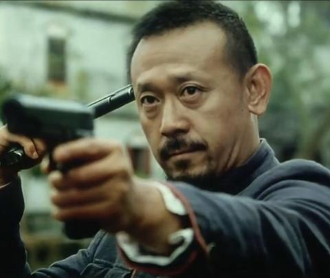

[toc]

# 问题

提问者：**<a href="https://www.zhihu.com/people/materialism-12-62">Mr.Science</a>**
提问时间: 2026-5-19 13:6:13
总回答数: 0
总访问量: 0

为什么既得利益集团在面对生死存亡时，不愿意自己革自己的命？

# 回答

回答者： **<a href="https://www.zhihu.com/people/mu-ai-27-71">暮霭</a>**
回答时间: 2026-9-5 22:5:55
点赞总数: 12251
评论总数: 504
收藏总数: 12563
喜欢总数：2032

我做投资这些年，慢慢戒掉了一个习惯，不再劝别人做“正确的事”，年轻的时候，我不是这样。

那时候看到一家企业积重难返，我会想：管理层难道看不出来吗？

看到一个行业被旧利益绑住，我会想：再不改革，所有人都要付出代价，他们为什么不动？甚至看到一些已经明显走向衰败的组织，我还是会觉得，只要上面的人足够聪明，足够有魄力，总有人会站出来，砍掉旧业务，清理旧关系，重新分配利益，把这个系统救回来。

后来我发现，我把事情想简单了，他们往往比我更早知道问题在哪里，他们只是不愿意解决，不是蠢，也未必是坏，只是没有理由，我花了很长时间才真正接受这件事：

 **一个系统的生死，和系统里掌权者的生死，从来不是一回事。** 

公司十年以后会不会破产，对一个还有三年退休的高管来说，并不是最重要的问题，行业二十年以后还有没有竞争力，对一个已经完成财富积累的人来说，也未必重要。

组织需要改革，是组织的问题，改革之后我的位置还在不在，才是我的问题。

把这两件事分开，很多以前想不明白的事情，突然就明白了，我见过一些企业，所有人都知道成本太高，所有人都知道层级太多，所有人都知道某些业务早就应该关掉，所有人也都知道年轻人上不来，真正有能力的人正在离开。

会议开了一轮又一轮，战略讲了一遍又一遍，最后什么都没有发生，以前我觉得这是管理能力差，后来才知道，不一定，因为所谓“成本”，是某个人的预算，所谓“层级”，是某个人的位置。

所谓“低效部门”，是某个人经营了二十年的人马，所谓“组织年轻化”，意味着另外一些人应该离开，我们在报表上看到的是一个数字，他们看到的是自己，这完全是两回事。

所以后来再看企业改革，我不太听管理层说什么，我只看一件事：

 **改革到底要拿走谁的东西。** 

如果什么人的东西都不拿走，那通常不叫改革，如果真的要拿走一些东西，我就继续看：被拿走东西的人，有没有能力阻止它，如果有，我会把所谓改革计划打一个很大的折扣。

因为我越来越不相信一个人在五十多岁、六十岁的时候，会为了一个抽象的“组织未来”，主动交出自己奋斗了三十年才得到的权力。

这不是道德判断，换成我，我也未必做得到，人到了某个位置以后，拥有的已经不只是钱。

是办公室，是秘书，是别人见到你时的态度，是一个电话可以解决问题的能力，是会议桌上谁先讲话，是谁等谁，是谁给谁汇报。

这些东西在财务报表里没有价格，但对于拥有过它们的人来说，价格很高。

甚至比钱高，你让一个已经拥有这一切的人支持改革，很多时候真正的意思是：

请你亲手证明，你已经不再重要，这很难，所以我现在听到“壮士断腕”四个字，通常没什么感觉。

旁观者总喜欢壮士断腕，因为断的不是自己的腕，真正的问题永远是：谁拿刀，刀砍谁，如果拿刀的人恰好也是应该被砍的人，我一般不对结果抱太大希望。

当然有例外，世界上有真正有魄力的人。

有人能够淘汰自己创造的产品，有人能够清理自己建立的组织，有人甚至能够安排比自己更强的人接班。

 **我尊敬这种人。** 

但我不会把钱押在这种人一定出现上，投资不是寻找圣人，投资首先是承认普通人会怎么做。

而普通人在大多数时候，都会保护自己，后来我又明白一件更冷的事情，很多时候，既得利益者不是不知道继续下去会死。

他只是知道： **不会今天死，这就够了** 。

一个系统五年以后出问题，和我今天失去位置，哪个更重要？

答案并不复杂，尤其是当一个人已经五十八岁，公司还能撑七年，他只需要再撑两年。

从公司的角度，这是慢性自杀，从他的角度，这甚至可能是最优策略，这也是为什么我现在看一个组织，会特别注意掌权者的时间，不是看公司还有多少时间。

是看那些真正做决定的人，还有多少时间，如果组织需要十年才能完成转型，而核心决策者三年以后退休，我会非常小心，因为收益发生在十年以后。

代价发生在今天，人很难为了一个自己享受不到的未来，主动支付一个自己必须承担的现在。

年轻人会说，这不是把问题留给下一代吗？

是。

但现实世界里，把问题留给下一任，是一种非常普遍的解决问题的方法，债务可以展期，亏损可以隐藏，设备可以继续修，组织可以继续扩编，矛盾可以继续往后拖，只要不在自己任内爆炸，很多问题就暂时不再是问题。

我以前对此愤怒，现在不了，愤怒对投资没有帮助，我要知道的不是他们应该怎么做。

我要知道他们实际上会怎么做，这两者之间，经常隔着巨大的距离，也是从那个时候开始，我越来越少研究口号，越来越多研究利益，有人告诉我，公司要进行一场彻底改革。

我第一个问题不是改革方案是什么。

我会问：谁会因此失去权力？

第二个问题：这个人有能力阻止吗？

第三个问题：如果他阻止改革，他会付出什么代价？

如果答案分别是：很多人。

有。

没什么代价，那我基本已经知道改革会走到哪里。

大概率会开很多会，成立很多小组，写很多报告，提出很多目标，然后绕开真正的问题，最后所有人宣布改革取得阶段性成果，真正不能碰的东西，一个都没有碰。

这不是阴谋，甚至不需要有人在密室里商量，每个人只需要保护自己的利益，最后自然会得到这个结果。

这是我这些年越来越着迷、也越来越警惕的一件事： **一个系统不需要坏人，也可以走向坏的结局。** 

每个人都可以非常理性，财务部门保护自己的预算，业务部门保护自己的收入，管理层保护自己的位置，老人保护自己的历史贡献，年轻人寻找自己的退路，股东要求今年的利润，债权人要求本金安全。

没有一个人疯，没有一个人觉得自己正在毁掉公司，所有人都在做对自己最合理的事情。

然后公司慢慢死掉，这才是最冷的地方，很多失败并不是因为没有聪明人。

恰恰相反。

里面每个人都很聪明，他们只是聪明地保护了自己，所以现在我已经不太相信“大家最终会为了共同利益作出正确选择”这种话。

共同利益是一个很漂亮的词，但利益真正落到现实里，从来不是共同的。

改革成功以后，公司也许值一千亿，这是共同利益，但改革过程中，老张失去部门，老李失去预算，老王失去董事席位。

这是具体利益，抽象的收益发生在未来，具体的损失发生在今天。

我做投资以后越来越相信： **具体通常战胜抽象，今天通常战胜明天，自己的损失通常战胜大家的收益。** 

这不是悲观，只是赔率，所以真正让我开始对一个组织的改革产生兴趣的，从来不是它终于“认识到了问题”。

认识问题很廉价，一个衰败了二十年的组织，里面可能十年前就有人把问题写得清清楚楚。

我等待的是另一件事， **不改革的人，开始付不起不改革的代价。** 

现金流断了、债务续不上了、客户真的走了、竞争对手打进来了。

技术把旧业务变得一文不值，股东不再给时间，核心人才开始集体离开，原来的权力结构再也维持不住，到了那个时候，我才会重新打开报表。

因为我知道，事情可能真的要变了，不是因为人变了，是因为账变了，这是很重要的区别，年轻的时候，我喜欢寻找有远见的人，现在我更喜欢寻找没有退路的人，有远见的人可能继续等待。

没有退路的人必须行动，所以如果一定要问我，这些年做投资，对所谓“既得利益”最大的认识是什么，我大概只有一句话： **不要期待一个人因为看见悬崖，就主动放弃自己的座位。** 

只要那把椅子还坐得住，他通常会继续坐，哪怕车正在往悬崖开，因为跳车意味着现在就失去一切。

悬崖意味着以后可能失去一切，而人这种动物，对“现在”和“以后”的定价，从来不一样。

我已经不再因此失望，市场待久了，人会逐渐放弃一些浪漫的期待，我不要求管理层伟大。

不要求既得利益者自觉，不要求一个组织突然产生自我革命的勇气。

我只看利益，看期限，看代价，看谁有否决权，看谁还能拖。最后看一件事： **他们什么时候再也拖不下去。** 

因为真正的改变，很少发生在所有人终于想明白的时候，很多时候，它发生在所有其他选择都已经消失的时候，这就是我现在理解的现实主义。

不是相信人性恶，也不是相信人性善，而是尽量不把自己的钱，

押在人性突然改变上。

  

原文地址：[(暮霭)为什么既得利益集团在面对生死存亡时，不愿意自己革自己的命？](https://www.zhihu.com/question/2040055665520026151/answer/2079691763808261673) 

# 评论

1. <a href="https://www.zhihu.com/people/ma-dai-68-29">马岱</a> (<small title="广东">2026-9-6 8:45:26</small>): 经常可以看到这样的事情，做一件事，对公司有利，但需要某个部门做出牺牲，比如裁员，比如承担风险，比如承担成本损失。  
 
  
 
这个部门自然坚决反对，有意思的是，其它部门也会同情，他们会想，下次会不会轮到我了。
   - <a href="https://www.zhihu.com/people/123-1-83-53">momo</a> (<small title="陕西">2026-9-6 14:0:50</small>): 多层装电梯的难题
   - <a href="https://www.zhihu.com/people/mi-li-81-13">实名用户</a> (<small title="陕西">2026-9-6 18:3:27</small>): 这是组织问题
   - <a href="https://www.zhihu.com/people/34-9-91-96">秀儿不迷路</a> (<small title="江西">2026-9-7 16:10:37</small>): 出来上班只拿自己那份工资，公司怎么样谁在乎
   - <a href="https://www.zhihu.com/people/mu-zi-hua-jiang">666666</a> (<small title="山东">2026-9-9 6:43:46</small>): 对公司有利对我有啥关系，我都被裁了？？？公司让我以公司为家，但分配利益的时候把我晾一边，双标状态下谁会相信诺言？不负责任的的承诺不就是白嫖吗？也就是说我不给钱就不算嫖娼啊，谁愿意当被白嫖的人？
   - <a href="https://www.zhihu.com/people/williamchi">管乐</a> (<small title="广东">2026-9-9 10:15:54</small>): 看是什么公司了，民企的话，除非老板被蒙蔽
   - <a href="https://www.zhihu.com/people/hai-bian-tie-jiang">海边铁匠</a> (<small title="浙江">2026-9-10 19:38:11</small>): 现实生活中看到的裁员还不够多吗？它们是怎么发生的？
   - <a href="https://www.zhihu.com/people/yang-guang-yu-wei-chen">阳光与微尘</a> (<small title="上海">2026-9-15 9:58:42</small>): 三个字，凭什么？
   - <a href="https://www.zhihu.com/people/jin-wan-da-lao-hu-86-87">今晚打老虎</a> (<small title="广东">2026-9-16 9:14:38</small>): 这个叫兔死狐悲［大笑］
   - <a href="https://www.zhihu.com/people/98-73-15-30-9">末流牛马</a> (<small title="回复于 2026-9-19 21:55:30/上海"> ✉️:海边铁匠</small>): 裁的正是那些没能力阻止的人，不是因裁了此人而让公司付出代价的人
   - <a href="https://www.zhihu.com/people/1953-69">远航1953</a> (<small title="山西">2026-9-28 13:40:7</small>): 我们学校的家属楼是八十年代建成的，房顶是水泥预制板。房屋质量很差。  
 
本来县里决定要拆迁，因为新上任的校长自己刚装修了房子，反对拆迁，房子就拆迁不成。  
 
如果有权的只为自己考虑，那就什么事情都做不好。
   - <a href="https://www.zhihu.com/people/lang-long-ge">一路向北</a> (<small title="回复于 2026-10-6 13:16:6/云南"> ✉️:远航1953</small>): 这就是现实［飙泪笑］
   - <a href="https://www.zhihu.com/people/mu-di-vx">市井巷子里</a> (<small title="回复于 2026-10-8 15:56:27/四川"> ✉️:海边铁匠</small>): 裁员按程序员的说法只是打补丁修bug，真正的改革是大刀阔斧把整个程序架构推倒了重新来，是要改底层代码的。
   - <a href="https://www.zhihu.com/people/wu-kang-jie-55">如意</a> (<small title="广西">2026-10-11 21:27:17</small>): 裁员啊 现在基本裁一线干活的技工［doge］
   - <a href="https://www.zhihu.com/people/xie-wen-zhao-86">山有扶苏</a> (<small title="回复于 2026-10-12 21:15:46/上海"> ✉️:666666</small>): 灯红酒绿不带我，结算账单摊给我
2. <a href="https://www.zhihu.com/people/ping-xin-77-31">平心</a> (<small title="吉林">2026-9-6 7:3:2</small>): 读春秋时开始不理解鲁国鲁庄公时争继承人，季友威胁叔牙说，你现在自杀，喝毒酒。你的后人一定能在鲁国发展，如果你不喝。你一定不会在鲁国有后代。叔牙选择了喝。当时觉得奇怪，有后代对于叔牙这么重要吗？后来读多了，才明白季友是以灭叔牙这一族相威胁的。春秋时期的贵族都是以家族为单位的，包括人和土地财产资源。对于叔牙来说，他是他的族的代表，家族的利益确实是比他的命重要的多。所以春秋时期有很多人为了准则，道德不吝惜自己的生命。这背后有很多是有家族利益的考量的，有的是资源，有的是规矩。
   - <a href="https://www.zhihu.com/people/87-26-44-69-76">随便起个名也费劲</a> (<small title="浙江">2026-9-6 10:58:6</small>): 还是得多读书，不然真不知道背后的动机。所以后人才会猛记这些历史。确实获益。
   - <a href="https://www.zhihu.com/people/tony-92-49-87">Tony</a> (<small title="江苏">2026-9-6 11:18:0</small>): 这只能说明叔牙还不够流氓。刘邦在逃亡的路上，就多次把自己的子女踹下车，只为自己能活命。
   - <a href="https://www.zhihu.com/people/ecosystem-61">ecosystem</a> (<small title="回复于 2026-9-6 12:12:58/天津"> ✉️:Tony</small>): 你仔细想想就知道这是司马家遍的，史记里面暗搓搓讽刺帝王家的地方很多
   - <a href="https://www.zhihu.com/people/George_ren">LOUIS-NY</a> (<small title="回复于 2026-9-6 13:4:58/江苏"> ✉️:ecosystem</small>): 不利于你偶像的都是别人编的。刘邦要真重视家庭，怎么40岁还不结婚？
   - <a href="https://www.zhihu.com/people/liu-guang-meng-28">流光梦</a> (<small title="云南">2026-9-6 13:14:59</small>): 还有一点，你确定你不喝你就一定能好一定能活？这段历史资料太少，但可以肯定的叔牙当时大概率已经没有选择了。自己死了还能保住家产，自己现在不死未来家产和自己都保不住，是个人都知道怎么选择了
   - <a href="https://www.zhihu.com/people/ecosystem-61">ecosystem</a> (<small title="回复于 2026-9-6 13:27:6/天津"> ✉️:LOUIS-NY</small>): 哦，现在很多人40岁不结婚就是不重视家庭呗，你这个逻辑真牛［酷］
   - <a href="https://www.zhihu.com/people/ai-ai-28-2">杨先生</a> (<small title="回复于 2026-9-6 13:43:54/广东"> ✉️:ecosystem</small>): ［大笑］你这逻辑才牛，你把2200年前的事儿和现在放在同一个标准下，然后论证现在没有问题，所以2200年前也没有问题。
   - <a href="https://www.zhihu.com/people/ping-xin-77-31">平心</a> (<small title="回复于 2026-9-6 13:48:58/吉林"> ✉️:流光梦</small>): 说的对，资料太少了。这段的主角太多，叔牙都排不到前五。鲁庄公，哀姜，公仲也就是庆父，季友，太子也就是公子般。庆父，哀姜是一派，叔牙是同伙，庆父要当鲁庄公的继任者。庆父是鲁庄公的二弟。庄公和公子般，季友是一伙，公子般是继承者，他是庄公的儿子。季友杀了叔牙并没有阻止庆父的野心，庆父杀了公子般。季友就跑了，没有敢和庆父硬刚。最后鲁国国君之位是靠齐桓公支持定的。叔牙之死很多原因说不清。
   - <a href="https://www.zhihu.com/people/iie2010">锦衣夜行</a> (<small title="回复于 2026-9-6 13:49:59/浙江"> ✉️:杨先生</small>): 家族解体也就是最近50来年的事情，对于2000多年的历史，只是一瞬间。未来会不会重新反转还不一定。
   - <a href="https://www.zhihu.com/people/ecosystem-61">ecosystem</a> (<small title="回复于 2026-9-6 13:51:34/天津"> ✉️:杨先生</small>): 这是捅了那个团队了？
 
他说刘邦要重视家庭，你不说这是现代标准。我说40不结婚就是现代标准。
 
拉偏架这么明显？
   - <a href="https://www.zhihu.com/people/123-1-83-53">momo</a> (<small title="回复于 2026-9-6 14:4:41/陕西"> ✉️:Tony</small>): 康熙100多位子女，能记住就不错了  
 
一多半的子女夭折了，当时医疗水平和人均寿命就那样
   - <a href="https://www.zhihu.com/people/2-5-44-13-31">一般一般</a> (<small title="回复于 2026-9-6 14:40:48/广西"> ✉️:Tony</small>): 这环境不一样啊，叔牙那是一个家族之间内斗，放弃了可能还有活路。刘邦是和项羽你死我活的干，要是挂了，家人都任人宰割。
   - <a href="https://www.zhihu.com/people/wei-si-11-39">微思</a> (<small title="回复于 2026-9-6 15:42:39/广东"> ✉️:Tony</small>): 他成为已经是绝境了吗？是不是一窝端的处境？
   - <a href="https://www.zhihu.com/people/22-73-27-92">安乐公</a> (<small title="回复于 2026-9-6 16:32:42/北京"> ✉️:ecosystem</small>): 刘邦一人就是这族的希望，刘邦死了他们家九族都没了。。。
   - <a href="https://www.zhihu.com/people/ecosystem-61">ecosystem</a> (<small title="回复于 2026-9-6 17:1:2/天津"> ✉️:安乐公</small>): 演电视局啊，动不动杀人九族？秦末那个环境，还能有户口本？在秦朝或许行，关键是秦朝没了。
 
刘邦都未必是刘太公的亲生儿子，那个年代彼此保护后代，转名过继隐姓埋名的很多。
   - <a href="https://www.zhihu.com/people/fei-xing-de-hen-ji">飞行的痕迹</a> (<small title="回复于 2026-9-6 17:14:29/河北"> ✉️:Tony</small>): 你换个角度，刘邦活着子女被抓了才有价值。刘邦死了，那些子女就是资产了。
   - <a href="https://www.zhihu.com/people/22-73-27-92">安乐公</a> (<small title="回复于 2026-9-6 17:19:56/北京"> ✉️:ecosystem</small>): 刘邦入关中，萧何直奔府库中找图书账册，各地人口档案，粮草囤积，士兵布防，山川险要了如指掌，虽然秦政府对基层的掌控没想象那么强，那也是一套非常强力的管控模式，源源不断汲取粮兵源，刘邦数败项羽，依然能源源不断组织起力量反抗，就是刘邦建立起了秦制帝国，反过来证明秦对基层掌控力很强，只是没宣传的那么强
   - <a href="https://www.zhihu.com/people/ecosystem-61">ecosystem</a> (<small title="回复于 2026-9-6 17:31:30/天津"> ✉️:安乐公</small>): 秦那么强，相比刺杀始皇的张良很难逃脱吧？
 
政府里的文书齐整是一方面，地方上有没有人认真执行是另一个方面。
 
商鞅构建的秦律当然强大，问题是基层执法者从哪里来。
 
刘邦封侯跟着他打天下获得土地后，都成为基层动员架构。
 
始皇为何二世而亡，就是对六国故地的消化出了问题，秦人不够，加上六国残余势力太大。
   - <a href="https://www.zhihu.com/people/papi-6-77">papi</a> (<small title="回复于 2026-9-6 20:58:7/安徽"> ✉️:Tony</small>): 刘邦自己死了就一了百了了！他这个是贵族，他死了，家族还在，资产还在，不死，就全都没了，能一样？
   - <a href="https://www.zhihu.com/people/justin-98-70-37">李贾</a> (<small title="四川">2026-9-6 21:23:40</small>): 是的，唐以后社会越来越碎片化。好处是豪强逐渐势微。坏处则是政治平衡越来越没有抓手。于是动不动就出现滑坡泥石流［捂脸］。
   - <a href="https://www.zhihu.com/people/58-17-58-75-7">支付宝</a> (<small title="广东">2026-9-7 10:53:13</small>): 现在的男性已经没有这个想法了，家族和他有何关系？
   - <a href="https://www.zhihu.com/people/58-17-58-75-7">支付宝</a> (<small title="回复于 2026-9-7 10:53:37/广东"> ✉️:Tony</small>): 那他最后老了防着儿女
   - <a href="https://www.zhihu.com/people/733-33-92">问我你出克733</a> (<small title="江苏">2026-9-7 15:34:46</small>): 不喝也是死啦［打招呼］
   - <a href="https://www.zhihu.com/people/yuan-hao-68-32">袁灏</a> (<small title="回复于 2026-9-7 16:12:11/浙江"> ✉️:Tony</small>): 创业和守业的区别
   - <a href="https://www.zhihu.com/people/tony-92-49-87">Tony</a> (<small title="回复于 2026-9-7 17:13:25/江苏"> ✉️:papi</small>): 刘邦在彭城之战时，已经不是一个小人物了。
   - <a href="https://www.zhihu.com/people/35-93-34-66">临时注册用户</a> (<small title="回复于 2026-9-18 14:5:14/安徽"> ✉️:LOUIS-NY</small>): 不是有个寡妇相好的吗［大笑］
   - <a href="https://www.zhihu.com/people/app-58-98">app</a> (<small title="江苏">2026-9-19 11:12:21</small>): 我们生活在司马懿之后的时代
   - <a href="https://www.zhihu.com/people/96-5-87-68-71">鹅鹅鹅</a> (<small title="河北">2026-9-27 11:5:3</small>): 叔牙是鲁庄公的弟弟当时还没有形成族，要族也得把鲁庄公，季友也给族了才对。主要就是叔牙不自杀，他自己包括老婆孩子也活不成了。。。死一个还是死一家子他还是分的清的
   - <a href="https://www.zhihu.com/people/lixinyu-65">lixinyu</a> (<small title="回复于 2026-9-27 15:17:59/北京"> ✉️:Tony</small>): 假设这事是真的，刘邦做了看起来冷酷，却是理智而正确的选择，刘邦活着，他子女未必会死，比如他老婆和父亲都被抓了，最后也活下来了。假设刘邦被抓，你觉得他子女有活的可能吗，刘邦最大的优点就是从来理智驾驭一切，当然你也可以说他莫得感情
   - <a href="https://www.zhihu.com/people/tony-92-49-87">Tony</a> (<small title="回复于 2026-9-27 20:9:30/江苏"> ✉️:lixinyu</small>): 说他理智也没错，就是人性少了点。
   - <a href="https://www.zhihu.com/people/lu-lu-lu-xiao-lan">我只喝拿铁</a> (<small title="安徽">2026-10-7 13:22:5</small>): 👀完这篇，瞬间对破公司的一系列问题释然了。
   - <a href="https://www.zhihu.com/people/shi-wan-zhi-xiao-xue-gou">老歪</a> (<small title="辽宁">2026-10-12 17:53:55</small>): 周秦之便以后，所谓的仁义道德和废纸没什么区别。
   - <a href="https://www.zhihu.com/people/xie-wen-zhao-86">山有扶苏</a> (<small title="回复于 2026-10-12 21:17:13/上海"> ✉️:流光梦</small>): 有没有可能死了，直接被吃干抹净
   - <a href="https://www.zhihu.com/people/ryxw-74">如其来是</a> (<small title="河南">2026-10-12 23:28:31</small>): 发扬贵族精神。发扬老钱精神。发扬革命精神。
   - <a href="https://www.zhihu.com/people/ryxw-74">如其来是</a> (<small title="回复于 2026-10-12 23:29:21/河南"> ✉️:随便起个名也费劲</small>): 别受了读书人的骗。
3. <a href="https://www.zhihu.com/people/fang-xiang-yi-21">方向一</a> (<small title="广西">2026-9-6 11:9:6</small>): 不经历的人是写不出这样的经历的。太对了，人性的复杂也不复杂。
   - <a href="https://www.zhihu.com/people/xia-xi-15-44">夏夕</a> (<small title="广东">2026-9-13 16:14:51</small>): 百分百AI写的
   - <a href="https://www.zhihu.com/people/sakshen">sakshen</a> (<small title="浙江">2026-9-13 16:15:15</small>): 是啊，感觉有时候复杂的事情，其实只要把人往坏处想，就解释得通了
   - <a href="https://www.zhihu.com/people/xiao-yu-lin-lin-4">雪映孤灯</a> (<small title="回复于 2026-9-20 1:32:9/广东"> ✉️:夏夕</small>): 就算是ai写的，你能想得到这种思想吗？如果想不到也是学到了东西了吧！既然能学到东西，那为什么再乎什么东西写的呢［发呆］
   - <a href="https://www.zhihu.com/people/96-5-87-68-71">鹅鹅鹅</a> (<small title="回复于 2026-9-27 11:7:43/河北"> ✉️:夏夕</small>): 写的对就行，ai有这个水平的话更说明人类不行，起码中老登们彻底不行了
   - <a href="https://www.zhihu.com/people/hsaopei">知向北</a> (<small title="广东">2026-9-27 17:56:30</small>): 你也可以经历啊，你下个ai就行了［飙泪笑］
   - <a href="https://www.zhihu.com/people/mo-lu-33-12">陌路</a> (<small title="回复于 2026-10-8 12:30:56/四川"> ✉️:夏夕</small>): 怎么最近老是看到像你这种不知所谓的评论，上来甩一个“ai写的”“ai味太浓”“一眼ai”，然后没有后续了。所以你到底想表达什么，表达你慧眼识珠还是你能比ai写得好还是比作者写得好？还是你个人思想很有深度不需要ai？ 到底是何意味
4. <a href="https://www.zhihu.com/people/han-ping-97-82">如风</a> (<small title="四川">2026-9-6 12:58:34</small>): 你是真正研究过企业以及权力的人。  
 
我以前也就是你口中的清醒知道企业问题的人，我是一个销售，我迫切需要公司的壮大获取自己需要的利益，为公司提了如何强大增强产品竞争力与成本控制的方案，直到第三年。我才幡然醒悟，我就是干销售的，我怎么能断同事的财路，这不是杀他父母吗？这能行的通才有鬼！后来公司让我再提，我就不提了，我说以前想法太幼稚了，销售的活儿都没有搞明白，提不出一个一二三，给我升职我也不要了，销售的职位升级没有意义，多不了几个崽，全是背责任，活儿我可以给你干，职位我就不要了，公司你自己在培养合适的人。［大笑］［大笑］
   - <a href="https://www.zhihu.com/people/luo-san-90-78">五月的牛儿</a> (<small title="重庆">2026-9-14 13:17:9</small>): 我现在就看公司领导们各自斗法，永远不要指望这些人会做不利于自己的事情，你只能等到他们退休。如果觉得实在看不下去了，最好的处理办法是跳槽。史书总说那些投降蒙古、满清的人是罪人，但是真正的罪人是既得利益集团，而那些投降的反而有些是被这群人逼迫的人［生气］
   - <a href="https://www.zhihu.com/people/wu-he-qing-38">蛮大人</a> (<small title="回复于 2026-9-27 7:25:59/广西"> ✉️:五月的牛儿</small>): 投降敌人，再捅自己族人一刀。［捂嘴］
   - <a href="https://www.zhihu.com/people/bai-xue-36-18">Miss white</a> (<small title="内蒙古">2026-9-27 15:28:36</small>): 哎呀，好有经验的样子。
   - <a href="https://www.zhihu.com/people/gong-70-39">Gong</a> (<small title="回复于 2026-10-1 23:40:16/山东"> ✉️:五月的牛儿</small>): 有点道理，冲发一怒为红颜［捂脸］
5. <a href="https://www.zhihu.com/people/zhou-run-feng-1">粥闰疯</a> (<small title="上海">2026-9-6 12:30:7</small>): 因为我知道，事情可能真的要变了，不是因为人变了，是因为账变了，这是很重要的区别，年轻的时候，我喜欢寻找有远见的人，现在我更喜欢寻找没有退路的人，有远见的人可能继续等待。
   - <a href="https://www.zhihu.com/people/xun-zhao-wei-lai-de-ren">寻找未来的人</a> (<small title="重庆">2026-9-6 19:35:58</small>): 确实，没有退路的人更有故事［看看你］
   - <a href="https://www.zhihu.com/people/you-ran-zi-de-zhe">悠然自得者</a> (<small title="回复于 2026-9-7 9:53:12/北京"> ✉️:寻找未来的人</small>): 比如任正非？
6. <a href="https://www.zhihu.com/people/32-7-59-72-18">知勉行</a> (<small title="江苏">2026-10-12 12:33:6</small>): 好了好了，先别总说那些抽象的困难而不谈实际的解决方案。  
 
人们一边表达对理想的认同，一边把实现理想所需的责任不断推给别人，最后又把理想未能实现当作无可避免的现实。  
 
总提倡程序透明信息公开，我举个例子，这么多年来关系国计民生的房地产行业，普通民众能知道多少信息，招拍挂土地出让金的高价，最终末端是谁承担支付，当信息不对称维权困难时，为什么没有相应制度程序规则问责。  
 
我先暂且不谈一些涉及严谨经济学的内容，只说一个朴素的且有瑕疵的直觉。土地财政出让金某种意义上是人民的公有集体财产，它本身不是钱不是生产产品，可以理解为一个凝聚力量汇集财富的中转，用于政府支持其他各行各业的基础建设资金，是预支当下和未来的财富，这当然没问题，因为未来还有以后的未来。但是，当土地出让金价格和房地产价格透支了普通民众的劳动生产力，那会是什么后果呢？我希望可以好好想想。  
 
但是这又由此引出另一个问题，究竟有多少人在乎关系自身权益的一些权利，需要什么样的制度和程序来支撑保障权利。
 
  
 
难道在行内的相关人员看不出来吗，当然看得出来，只是愿意发声的人少，为什么呢，没有支持是一个原因或者说是一个循环，内部有多少愿意支持的，而外部又因为信息壁垒对此无动于衷甚至是闻所未闻，根本没意识到这方面有问题。有时候越沉默，越更加沉默，反倒是负反馈滚雪球就差雪崩了，正反馈的飞轮确实可以形成，但是往往又因为一些纳什均衡而停下。我希望每个人都能好好想一想，这也是有人愿意为此一直发声，不放弃沉默的人、不躲进小楼不问春秋的原因，也是我写下这条评论的原因。
7. <a href="https://www.zhihu.com/people/wilson-55-56-23">那就这样吧</a> (<small title="上海">2026-10-12 12:22:10</small>): 早就看透了这一切，凡是打着鸡血拉着你要改革的，都要远离。绝大多情况下，提出改革的人都会被革掉。在职场混，早就注定了你这辈子能有多高的成就，脑子里想的全是假的。只需要清楚你有什么价值让公司给你发薪水，就行了，其他都没有用，没有意义，啥也不是。很多人一开始都是向前冲的，半路发现，你只要是从动物视角看人，什么都能解释的通，文明的外衣欺骗人太久，以至于忘记了从动物本性出发找问题答案是那么的容易。
   - <a href="https://www.zhihu.com/people/wxc63e4cacbcaac09f">wxc63e4cacbcaac09f</a> (<small title="河南">2026-10-12 18:26:45</small>): 对 自己有多大价值拿多大薪水就行了 其余全是扯淡
   - <a href="https://www.zhihu.com/people/ryxw-74">如其来是</a> (<small title="河南">2026-10-12 23:34:56</small>): 抱着侥幸心理，等自然发展答案。一辈子浑浑噩噩。
8. <a href="https://www.zhihu.com/people/chen-ya-yun-45-78">陈亚运</a> (<small title="江苏">2026-9-5 22:14:24</small>): 谁负责改革谁负责承受代价谁负责接收利益谁负责平衡结果［大笑］
   - <a href="https://www.zhihu.com/people/13-5-55-41">只需三分醉</a> (<small title="江苏">2026-9-6 10:52:50</small>): 自己承担代价或者大部分代价就没人改革了，，，
   - <a href="https://www.zhihu.com/people/li-ji-90-97">李吉</a> (<small title="北京">2026-9-6 12:33:4</small>): 所以没人改革了呀［捂脸］
   - <a href="https://www.zhihu.com/people/69-2-30-52-75">活了八百年</a> (<small title="广东">2026-9-6 23:15:27</small>): 改革有人阻止怎么办?有一个办法：  
 
  
 
原来的不动，另起一摊 (这摊就不归原来的管)，逐渐壮大这一摊直到能取代原来那摊，到最后原来那摊已经没有阻止的能力 (力不可及)，把这摊全部解散，新摊上位。
   - <a href="https://www.zhihu.com/people/zha-zha-7">duetomeaningle</a> (<small title="陕西">2026-9-7 19:23:22</small>): 谁负责尘埃落定后来评价这一切
   - <a href="https://www.zhihu.com/people/zhao-xiang-8-33">赵祥</a> (<small title="回复于 2026-9-30 17:27:49/河北"> ✉️:活了八百年</small>): 不一定可行，新起的一摊也会遇到同样的问题，到时候再来一次？
   - <a href="https://www.zhihu.com/people/69-2-30-52-75">活了八百年</a> (<small title="回复于 2026-10-1 8:14:46/广东"> ✉️:赵祥</small>): 那肯定，世上没有一劳永逸的办法
   - <a href="https://www.zhihu.com/people/gong-70-39">Gong</a> (<small title="回复于 2026-10-1 23:41:37/山东"> ✉️:活了八百年</small>): 大智慧［赞］
   - <a href="https://www.zhihu.com/people/ha-ha-27-3-11">SC A</a> (<small title="回复于 2026-10-7 13:35:12/浙江"> ✉️:活了八百年</small>): 想的太简单了，原来的一摊会想办法搞新来的一摊［滑稽］
9. <a href="https://www.zhihu.com/people/36-79-40-38-23">mono</a> (<small title="广东">2026-9-6 12:27:30</small>): 所以外部竞争很重要，垄断会导致更大的麻烦
   - <a href="https://www.zhihu.com/people/keshao">AierMain</a> (<small title="湖南">2026-9-7 9:2:27</small>): Maga！［为难］
   - <a href="https://www.zhihu.com/people/ke-si-cheng-26">饮冰卧雪笑沧海</a> (<small title="广东">2026-9-7 13:47:51</small>): 垄断产生垄断收益，外部竞争引入垄断风险
   - <a href="https://www.zhihu.com/people/lili-58-20-54">lili</a> (<small title="安徽">2026-9-7 14:25:29</small>): 竞争的最高形式，最终形态就是垄断！
   - <a href="https://www.zhihu.com/people/wu-he-qing-38">蛮大人</a> (<small title="回复于 2026-9-27 7:27:59/广西"> ✉️:lili</small>): 事物发展到了顶峰，自然会慢慢死亡。谁也救不了
   - <a href="https://www.zhihu.com/people/jia-le-bi-xiao-xiong-di">加勒比小兄弟</a> (<small title="回复于 2026-9-27 20:58:36/陕西"> ✉️:lili</small>): 物极必反
10. <a href="https://www.zhihu.com/people/wang-tao-31-54-49">清华奶爸教思维</a> (<small title="山东">2026-10-12 22:55:17</small>): 对，比如大清亡了，只是皇帝家族爱新觉罗，众多王爷仍然活的好好的
11. <a href="https://www.zhihu.com/people/ryxw-74">如其来是</a> (<small title="河南">2026-10-12 23:25:1</small>): 要靠群众自己解放自己不要指望少数所谓无退路或者背叛者。
12. <a href="https://www.zhihu.com/people/kwvglodr">不迷路的鹿</a> (<small title="山东">2026-10-12 22:2:55</small>): 简直是非常经典的纳什均衡了
13. <a href="https://www.zhihu.com/people/wang-wang-53-25">王王</a> (<small title="贵州">2026-10-13 8:46:42</small>): 受教［感谢］，更清晰地验证了眼前看到的一些现状。哪有那么多高瞻远瞩的壮士断腕，更多的都是迫不得已的苟延残喘。苟延残喘合理不丢人，壮士断腕更弥足珍贵。理解，接纳，尊重一切合理性
14. <a href="https://www.zhihu.com/people/tang-seng-xi-tou-yong-la-fang">唐僧洗头用拉芳</a> (<small title="陕西">2026-10-12 13:0:18</small>): 猪肉就是这样一直跌，远期一直升水，逐月逼仓！  
 
  
 
跌成远期贴水，猪企业就着急了，减产了［赞同］
15. <a href="https://www.zhihu.com/people/1412-55-4">摆渡人kizard</a> (<small title="北京">2026-10-12 15:47:29</small>): 写的不错，赞一个！
16. <a href="https://www.zhihu.com/people/zhao-dong-hong-63">左牵黄</a> (<small title="浙江">2026-10-12 21:24:47</small>): 说的太多了，就一句话：肉食者绝对不会提出一项不利于自己的改革。慈禧也曾变法过，一看对自己不利，立马收回政策；自己要过生日，海军军费先用一下，毕竟生日过一次少一次，打仗不一定哪天。把一个人推到慈禧的位置，我想90%都会和她一样做决策，人不能超越肉身的局限，人都是活在当下。
17. <a href="https://www.zhihu.com/people/ts5nfe">善变的小瘪三</a> (<small title="山西">2026-10-13 9:11:21</small>): 一个不成熟的想法。这个世界，至少我们的结束应当是全部自动化，机械化，管理层也一样，人作为高层的时代会迅速落幕的，阶段性的过去短暂消失。
18. <a href="https://www.zhihu.com/people/ryxw-74">如其来是</a> (<small title="河南">2026-10-12 23:26:37</small>): 你这样想还没有跳脱出旧时代，也许你只能看到或相信旧未来
19. <a href="https://www.zhihu.com/people/shi-nian-da-tie-mo-jian">十年打铁磨剑</a> (<small title="陕西">2026-10-12 12:47:52</small>): 35岁劝退，算人才流动了
20. <a href="https://www.zhihu.com/people/c3h4hgi">循环事件</a> (<small title="广东">2026-9-6 10:3:7</small>): 是的，做事得先考虑阻力代价，而做事者没有强冲击力不要轻易谈改革。
    - <a href="https://www.zhihu.com/people/chen-li-chao-74">陈立chaos</a> (<small title="浙江">2026-9-7 11:17:18</small>): 扁鹊治病世人称道，扁鹊他哥治未病则无人知晓
21. <a href="https://www.zhihu.com/people/jing-chu-nan-ke">焕坤</a> (<small title="湖北">2026-9-7 9:10:17</small>): 所以说投资的节点必须选在公司的上升期，而且还必须有可退出机制。人性的强大超出未历经沧桑，没有彻底褪掉青涩幻想的人们的想象。我经历过公司管理人的各种奇葩操作，理解不了，也能理解，公司的未来在人性自私面前，不值一提。
    - <a href="https://www.zhihu.com/people/lei-ke-ya-wei-ke-3">雷克雅未克</a> (<small title="湖北">2026-9-28 11:43:16</small>): 我二十多岁在公司经常看到一些不理解的骚操作，开始怀疑，现在也理解了 公司的未来在人性的自私面前不值一提
22. <a href="https://www.zhihu.com/people/jasonjin-cheng">摸鱼剑仙</a> (<small title="广东">2026-10-11 12:10:41</small>): 看老板想不想救吧，有的老板是公司能活多久活多久，活不下去就直接卖，这种是最幸福的，以前在一个大公司做过，福利拉满，怀孕直接10个月带薪假，人老板早就财富自由了，公司业务差一点，那个业务直接就被卖掉了［捂脸］［捂脸］［捂脸］  
 
  
 
10年前在那那里，上三休三，4500，一切按劳动法来，不是外企，老板兼ceo天天去钓鱼，部门老大全是当初跟老板创业的员工，都是二把手干活，部门老大也不需要争功劳，完成部门基本职责就可以那种，但是部门老大以下，中层会按死优秀员工，那时候是真适合混［捂脸］
23. <a href="https://www.zhihu.com/people/juju-31-43">散木</a> (<small title="甘肃">2026-10-10 22:24:39</small>): 其实很多问题积重难返的根源在于：个人利益和集体利益很多情况下是不一致的。当系统发展到最后，领导的个人利益就会远大于集体利益。改革难度就会指数倍数增长。
24. <a href="https://www.zhihu.com/people/shui-shui-shui-shui-94-75">水水水水</a> (<small title="四川">2026-10-10 18:45:16</small>): 如果外部因素强大到能够威胁既得利益者，他们的确有一部分人会改变，但可惜没有
25. <a href="https://www.zhihu.com/people/qing-gong-zhi-zao-tu">轻工制造兔</a> (<small title="江苏">2026-9-6 9:30:23</small>): 我之前被办公室斗争干掉了，然后对方接手后的态度是往死里挖树根。  
 
我很不解，这么竭泽而渔是不是太短视了？  
 
后来我想明白，他们巴不得公司死了，这样才不会秋后算账
    - <a href="https://www.zhihu.com/people/ren-bu-wei-ji-30">豆腐LZ</a> (<small title="北京">2026-9-6 21:17:5</small>): 可以去看一下博弈论。  
 
群体利益和个人利益有一个纳什均衡点。  
 
一旦突破这个点。所有人都会变成树倒猢狲散的破坏者。当破坏集体带来的收益远大于维护的时候，一瞬间就土崩瓦解了。  
 
当然这种太过于理论化了，你也可以看一下股票里面的k线。上涨总是缓慢的，而下跌总是急速、陡然的。大概就能理解了。
    - <a href="https://www.zhihu.com/people/wang-e-13-81">德云</a> (<small title="四川">2026-9-7 16:17:46</small>): 你之前是在苏联上班吗
    - <a href="https://www.zhihu.com/people/wang-e-13-81">德云</a> (<small title="回复于 2026-9-7 16:18:33/四川"> ✉️:豆腐LZ</small>): K线就是行为学数据可视化
    - <a href="https://www.zhihu.com/people/qing-gong-zhi-zao-tu">轻工制造兔</a> (<small title="回复于 2026-9-7 16:22:17/江苏"> ✉️:德云</small>): 搞笑的是，我领了n+1走了，公司相关板块一落千丈，然后今年翻倍又把我请回来了［doge］
    - <a href="https://www.zhihu.com/people/wei-lai-wei-lian">橙曦c柠檬</a> (<small title="回复于 2026-9-8 13:47:2/湖南"> ✉️:轻工制造兔</small>): 爽歪歪
    - <a href="https://www.zhihu.com/people/li-chao-25-8">第七天的话</a> (<small title="回复于 2026-9-8 17:48:25/云南"> ✉️:豆腐LZ</small>): 想到了苏联的解体
    - <a href="https://www.zhihu.com/people/kibito">kibito</a> (<small title="回复于 2026-9-9 9:34:38/山东"> ✉️:轻工制造兔</small>): 太爽
    - <a href="https://www.zhihu.com/people/mo-ming-hai-yu-65">莫名海域</a> (<small title="回复于 2026-9-9 17:29:28/湖北"> ✉️:轻工制造兔</small>): 复仇时刻到了［生气］我要把我失去的一切都拿回来，把愤怒加倍还回去
    - <a href="https://www.zhihu.com/people/qin-ling-jiu-hua">天成</a> (<small title="河南">2026-9-11 20:32:41</small>): 了解了。
    - <a href="https://www.zhihu.com/people/qin-ling-jiu-hua">天成</a> (<small title="回复于 2026-9-11 20:33:7/河南"> ✉️:轻工制造兔</small>): 积累你的实力，拿好好处就完事儿。
    - <a href="https://www.zhihu.com/people/25-7-53-47-88">得多</a> (<small title="回复于 2026-9-16 9:1:7/河北"> ✉️:轻工制造兔</small>): 果然是看上价值了
    - <a href="https://www.zhihu.com/people/35-93-34-66">临时注册用户</a> (<small title="回复于 2026-9-18 14:3:29/安徽"> ✉️:轻工制造兔</small>): 卧槽，回头草硬吃［大笑］
    - <a href="https://www.zhihu.com/people/qing-gong-zhi-zao-tu">轻工制造兔</a> (<small title="回复于 2026-9-18 15:59:32/江苏"> ✉️:临时注册用户</small>): 这个必须吃啊，钱不钱是次要的，主要是要爽［doge］
    - <a href="https://www.zhihu.com/people/98-73-15-30-9">末流牛马</a> (<small title="回复于 2026-9-19 21:57:47/上海"> ✉️:莫名海域</small>): 重生之我被公司裁员之后
    - <a href="https://www.zhihu.com/people/he-he-25-90-31">呵呵</a> (<small title="回复于 2026-9-29 9:51:30/上海"> ✉️:豆腐LZ</small>): 感觉和情绪有关，主要还是那种担忧引爆了人的理智的感觉
    - <a href="https://www.zhihu.com/people/liu-bi-jian-32">奶茶咖啡豆</a> (<small title="广东">2026-9-30 18:39:41</small>): ［思考］
    - <a href="https://www.zhihu.com/people/wxc63e4cacbcaac09f">wxc63e4cacbcaac09f</a> (<small title="河南">2026-10-12 18:28:35</small>): 太对了 有的人就是奔着公司搞死获得自己利益的
26. <a href="https://www.zhihu.com/people/yue-ye-shi-hun">鱼肉</a> (<small title="福建">2026-9-6 17:11:29</small>): 好多年前我明白了类似的理论，我称之为老虎机理论。就是老虎机走到这一格我赚一块钱走到下一格你赚200块钱我也不希望它走到下一格，1块钱再小那也是我的钱，200块再大那是你的与我无关。对我来说这1块钱就比你200块钱大。
    - <a href="https://www.zhihu.com/people/lvzao-90">Bingo</a> (<small title="湖北">2026-9-9 11:46:13</small>): 而且别人赚了大钱，反过来还会挤压你的位置和话语权。
27. <a href="https://www.zhihu.com/people/luo-ya-ni-44">嗯嗯嗯</a> (<small title="福建">2026-9-8 9:1:16</small>): 我很喜欢这句话“”因为真正的改变，很少发生在所有人终于想明白的时候，很多时候，它发生在所有其他选择都已经消失的时候，这就是我现在理解的现实主义。“”［感谢］其实，人自己面对自己的生活也是这样的，明明知道某些观念某些做法不对，但是脱离不了旧习气，一直到没有其他选择，再不改变就没活路，才会改变…
28. <a href="https://www.zhihu.com/people/wind-73-27">萤火之光</a> (<small title="广东">2026-9-6 11:25:28</small>): “组织需要改革，是组织的问题，改革之后我的位置还在不在，才是我的问题”。好文［赞］
29. <a href="https://www.zhihu.com/people/chivyhan">幽默5.21</a> (<small title="湖北">2026-9-6 19:19:33</small>): 恭喜你，明白了什么叫立场
30. <a href="https://www.zhihu.com/people/123-1-83-53">momo</a> (<small title="陕西">2026-9-6 14:0:20</small>): 因为很多人不愿意承认  
 
我和我们的利益并不相同  
 
未来的我和我们更无法预测  
 
我和我们利益统一，只是一个临时暂时的状态
31. <a href="https://www.zhihu.com/people/qing-she-75-39">青蛇</a> (<small title="新疆">2026-9-6 11:3:9</small>): 组织是人类的想象，利益不一致的时候就暴露了
32. <a href="https://www.zhihu.com/people/d2mymr">知乎用户d2MYmr</a> (<small title="美国">2026-9-6 14:7:17</small>): 所以有外部竞争是多么的重要，当内部已经锁死了，不靠外部竞争是真的没办法
33. <a href="https://www.zhihu.com/people/49-45-83-14">刀马旦</a> (<small title="广东">2026-9-6 18:35:29</small>): 一百年前就有这些话了，小资产阶级的妥协性，和无产阶级的革命性。因为那个时代广大贫民，真是退无可退了。那些有良心的远见的教授还在等未来出现一个好的解决方法。
34. <a href="https://www.zhihu.com/people/game3108">许凯珵</a> (<small title="上海">2026-9-9 15:25:45</small>): ［doge］所以为什么教员是我的人生偶像，原因就是只有教员是真正做到不在乎自己，只在乎大众，一个真正的马克思主义者，真正的热爱人民的人。加上教员又十分聪明又能力强，才能从整体角度做出最正确的决定。
35. <a href="https://www.zhihu.com/people/plr-50">绯lr</a> (<small title="湖南">2026-9-7 22:22:7</small>): 老板和公司的利益也不一样。人们以为老板会为了公司大局牺牲一下自己的利益，其实不是的。  
 
不是所有人都是胖东来，公司盈利在一定范围内才是自己的，为了自己的现有利益，老板不惜把公司弄得半死不活。
36. <a href="https://www.zhihu.com/people/han-yue-0312">寒月0312</a> (<small title="北京">2026-9-6 11:21:19</small>): 改革意味着不确定。很多东西不是做个样子就能解决的，往往是底层代码的构建。比如电动车正在逐步取代汽油车的趋势。现在谁没看出来呢？为何一些传统汽车大厂没有改变呢？仅仅是权力的游戏吗？应该是整个底层构架要重新搭设。但搭设整个底层构架需要的代价太大，落后太多。几乎所有的零配件都要重新更换。这是一个系统的更迭，一个厂商能改变一个系统吗？除非他融入新的系统，但是面对整个旧的体系利益链，谁能做到完全不在乎的抛弃呢？是历史巨大的惯性在推着他走向衰落。
    - <a href="https://www.zhihu.com/people/kaylee-95">Kaylee</a> (<small title="上海">2026-9-7 6:7:51</small>): 传统汽车大厂的领导都是做油车出身，转型做电车不就是让自己和自己的团队下岗吗？就算自己财务自由不想工作了，你如何面对你手下的这几百几千人？
    - <a href="https://www.zhihu.com/people/wang-yun-peng-4-9">浦东路人甲</a> (<small title="上海">2026-9-9 21:3:28</small>): 电动车真的有未来吗？全世界只有中国在全力投入进这个领域，难道别的国家都是傻子？任正非说过，领先一步叫先进，领先三步那叫先烈
37. <a href="https://www.zhihu.com/people/pedro-87">PEDRO</a> (<small title="北京">2026-9-6 16:18:18</small>): 是这样的，公司、股东、董事长、总经理、员工是不同的东西，可能只是在公司相遇了而已。
    - <a href="https://www.zhihu.com/people/pedro-87">PEDRO</a> (<small title="北京">2026-9-6 23:6:42</small>): 我原来也为公司着急过，后来才发现在公司里大家的目标并不一致。很多人捞一把就走，才不管公司的未来如何？
38. <a href="https://www.zhihu.com/people/ai-de-nuo-yan-72">丝袜高跟控</a> (<small title="广东">2026-9-6 12:59:17</small>): 这就是人性啊，几千年来从来没有变过，古今中外，概莫能外。不管什么制度，什么名族，什么宗教，什么种族，什么年代。
39. <a href="https://www.zhihu.com/people/sgdjgu">逐流</a> (<small title="河北">2026-10-8 14:13:55</small>): “姑娘，你这么拿着枪的时候，更好看。” 
40. <a href="https://www.zhihu.com/people/85-18-40-71-71">空空尔</a> (<small title="福建">2026-10-7 6:9:25</small>): 一个单纯以利益为目的的集团，所做的一切都是以利益为目的的，不管怎么选择都是为了利益，不管改革或者不改革，都是为了利益。
41. <a href="https://www.zhihu.com/people/er-er-er-90-29">二二二</a> (<small title="湖北">2026-9-6 12:43:48</small>): 慢慢戒掉了一个习惯，不再劝别人做“正确的事”
42. <a href="https://www.zhihu.com/people/zhang-zhen-ming-38">张振明</a> (<small title="北京">2026-10-8 14:27:54</small>): 如此，很多逻辑就通了，很多看不明白的群体性降智场面就能看明白了。人类从来都是如此搞笑。
43. <a href="https://www.zhihu.com/people/potato_apple">土豆饺子</a> (<small title="北京">2026-10-8 8:15:55</small>): 太正确了，我以前总是纳闷为什么单位里很多事情不朝着正确的方向努力，后来我明白对单位有利和对掌权的个人有利是两个事情，特别是我们这种研究所，很多人还是奔着院士去的，那个利益就更复杂了
44. <a href="https://www.zhihu.com/people/gao-huang-tong">凰桐道人</a> (<small title="北京">2026-10-10 9:19:42</small>): 也跟反对宏大叙事一个道理，不要把自己和历史进程捆绑过紧
45. <a href="https://www.zhihu.com/people/wu-xiao-lei-82-55">吴晓磊</a> (<small title="广西">2026-9-6 1:52:47</small>): 写的好。看的人不多
46. <a href="https://www.zhihu.com/people/li-feng-74-93-24">李锋</a> (<small title="山西">2026-10-10 10:53:43</small>): 所以，搞一刀切的好处大于坏处。  
 
比如超过多少年龄的，全部退下来
47. <a href="https://www.zhihu.com/people/lan-gui-she-shou">Osiris</a> (<small title="浙江">2026-10-10 12:19:49</small>): 好好，好问题，我嗅到了一丝希望的气息［赞同］
48. <a href="https://www.zhihu.com/people/cheng-kun-81-49">神秘赊刀人</a> (<small title="湖北">2026-9-6 15:3:13</small>): 难得看到一个说的很对得帖子。其实我也在某个单位单位也想改革。真的成立了很多小组，七八个相当于二级学院额东西。每年确实有阶段性成果，但真的改不下去。  
 
不过没经历的人呢是看不明白的，他们把自己技术模拟熟练去赚钱得了。
49. <a href="https://www.zhihu.com/people/w3bxvod">云淡风轻的普通人</a> (<small title="河北">2026-9-9 21:29:30</small>): 但现实世界里，把问题留给下一任，是一种非常普遍的解决问题的方法，债务可以展期，亏损可以隐藏，设备可以继续修，组织可以继续扩编，矛盾可以继续往后拖，只要不在自己任内爆炸，很多问题就暂时不再是问题。
50. <a href="https://www.zhihu.com/people/gu-lai-sheng-xian-jie-si-jin">百思不得其姐</a> (<small title="浙江">2026-9-6 15:32:41</small>): 天之道，其犹张弓与？高者抑之，下者举之；有余者损之，不足者补之。天之道，损有余而补不足。人之道则不然，损不足以奉有余。孰能有余以奉天下？唯有道者。是以圣人为而不恃，功成而不处，其不欲见贤。 几千年前，老子就说了。
    - <a href="https://www.zhihu.com/people/rty-73-47">戒色</a> (<small title="上海">2026-9-8 7:59:6</small>): 老子说的 你用不出来也白读
51. <a href="https://www.zhihu.com/people/zhivznatc">断剑</a> (<small title="浙江">2026-9-6 9:48:16</small>): 哇，知乎遗风再现
52. <a href="https://www.zhihu.com/people/vincent-duo">文森特</a> (<small title="广东">2026-9-8 10:21:45</small>): 真正壮士断腕的，往往不是聪明人，组织用的人也不都是聪明人，有时候甚至恰恰相反。
53. <a href="https://www.zhihu.com/people/tsaom">小看山tSAOM</a> (<small title="辽宁">2026-9-6 13:0:58</small>): 今天刷到此文就没白过
54. <a href="https://www.zhihu.com/people/janlllll">青岚</a> (<small title="意大利">2026-9-9 20:7:24</small>): 所以改革要培养利益共同体，不然就算短时间改革成功，也会被人秋后算账。［doge］
    - <a href="https://www.zhihu.com/people/ni-ma-sha-liao-du">葭否</a> (<small title="山东">2026-9-23 12:52:45</small>): 既然要改革，肯定影响的是大多数人的利益，
55. <a href="https://www.zhihu.com/people/yu-sheng-sheng-95">余省省</a> (<small title="广东">2026-9-27 16:4:53</small>): 我想起了一句话，触动利益比触动灵魂还要难
56. <a href="https://www.zhihu.com/people/yin-yi-sen-32">委员长yys</a> (<small title="广东">2026-9-6 18:49:14</small>): 个人的局部最优解和整体的全局最优解往往是矛盾的，甚至区间没有交集重叠
    - <a href="https://www.zhihu.com/people/you-ran-zi-de-zhe">悠然自得者</a> (<small title="北京">2026-9-7 9:58:54</small>): 需要体制机制的合理化，使得其大体保持一致。
57. <a href="https://www.zhihu.com/people/sunbo197047">sunbo197047</a> (<small title="重庆">2026-9-9 19:21:1</small>): 再大的灾难，也有极小部分的受益者。
58. <a href="https://www.zhihu.com/people/zhen-li-zhui-xun-1992">做运营的胖橘</a> (<small title="北京">2026-9-6 16:14:37</small>): 熵增是必然的，外力才能产生熵减
    - <a href="https://www.zhihu.com/people/97-68-43-15-16">一汪清水</a> (<small title="浙江">2026-9-6 21:12:7</small>): 不管多努力熵减，只会越来越混乱的
59. <a href="https://www.zhihu.com/people/fan-shou-feng">奸奇神选赵无极</a> (<small title="陕西">2026-9-6 11:47:9</small>): 为啥大家都觉得杰克韦尔奇牛逼，因为他真的革了ge的命［捂脸］
60. <a href="https://www.zhihu.com/people/zhuan-ji-du-xian-mu">赚嫉妒羡慕</a> (<small title="匈牙利">2026-9-18 2:16:13</small>): 真知灼见，这简直可以解释任何组织的任何事情，太牛了。
61. <a href="https://www.zhihu.com/people/li-hao-cheng-6">无巧不成书</a> (<small title="河南">2026-9-6 9:53:49</small>): 过盈配合件，和间隙配合件，这两个的目的只能延缓自然寿命，这是要建立在尊重客观及物理规律的前提下。
62. <a href="https://www.zhihu.com/people/20-36-77-88-78">经济学雷锋</a> (<small title="北京">2026-9-15 9:34:17</small>): 真正的高手都是寄生的，你看哪个寄生的会关注宿主死活？
63. <a href="https://www.zhihu.com/people/huang-li-7-66">在文明面前撒野</a> (<small title="广东">2026-9-6 13:15:36</small>): 说得很好，大而化之这个词就是智商测试意思！向来只有具体的人，具体的事！力挽狂澜从来是稀有的事！
64. <a href="https://www.zhihu.com/people/zhib75qiqsc">家庭企业出海香港</a> (<small title="北京">2026-9-6 13:56:37</small>): 卖保险一天就明白。宁可自己死了，老婆孩子没钱。也不管。反正现在没事。
65. <a href="https://www.zhihu.com/people/wu-pang-47">祸兮福所倚</a> (<small title="广东">2026-9-6 21:18:23</small>): 哥们牛逼讲的很简单易懂［调皮］，获益良多，个人工作以后其实对这方面是很有自己的思考，把公司看做一个系统，公司整体利益和我个人利益有时候是不一致甚至大部分时候关系不大。有时候公司改革是要以自己为代价牺牲自己的利益来成全的。个人很渺小，我只是为了能争取被裁后更多的补偿而已，为此尽力反抗。
66. <a href="https://www.zhihu.com/people/shu-hua-6-90">华文</a> (<small title="上海">2026-9-7 15:38:54</small>): 从更高的维度看，一个系统失去稳定有其自身规律，非人力可改变，所谓生死有命，富贵在天
67. <a href="https://www.zhihu.com/people/dong-76-89">dong</a> (<small title="陕西">2026-9-10 0:11:2</small>): 改革需要重新分配权力和利益，变化也是一样，这对于既得利益集团显然是不能接受的。
68. <a href="https://www.zhihu.com/people/96-5-87-68-71">鹅鹅鹅</a> (<small title="河北">2026-9-27 11:13:19</small>): 中国人不相信文科，尤其现在对经济学和管理学不屑一顾，其实研究研究还是很有用的。中国上市公司一般大股东就是创始人一般也是管理者，放弃了管理，他就觉得大股东没啥用，自己被虚职化了。。。国外那种股权不集中聘请外部ceo的模式反而很有可取之处。。。这个都需要仔细研究研究，但现在没人沉下心来去研究了。。
    - <a href="https://www.zhihu.com/people/a-xiu-luo-vsjia-lou-luo">深蓝梦境blue</a> (<small title="甘肃">2026-9-27 16:7:36</small>): 中国人不相信奴才，不是不相信文科
    - <a href="https://www.zhihu.com/people/nan-feng-zhi-wo-yi-31-68">晴光映雪</a> (<small title="辽宁">2026-9-28 9:26:53</small>): 外聘CEO能解决长短期利益矛盾的问题吗？
    - <a href="https://www.zhihu.com/people/96-5-87-68-71">鹅鹅鹅</a> (<small title="回复于 2026-9-28 9:57:31/河北"> ✉️:晴光映雪</small>): 比老登强点儿吧，美的
69. <a href="https://www.zhihu.com/people/laosi86">代号预言家</a> (<small title="河南">2026-9-27 9:55:12</small>): 另起炉灶，从新开始，才是改革
70. <a href="https://www.zhihu.com/people/cun-hou-de-qing-shan">村后青山</a> (<small title="山西">2026-9-29 4:15:23</small>): 具体会战胜抽象、今天会战胜明天、个人损失会战胜大家的收益、没有退路的人会胜于有远见的人。
    - <a href="https://www.zhihu.com/people/1-12-3-9-18">随机啦</a> (<small title="湖南">2026-10-4 22:46:20</small>): 确定性会战胜不确定性
71. <a href="https://www.zhihu.com/people/txry0b">知乎用户txry0B</a> (<small title="吉林">2026-9-27 18:5:37</small>): 人的寿命太短，要是能活500岁，很多人会改
72. <a href="https://www.zhihu.com/people/13-5-55-41">只需三分醉</a> (<small title="江苏">2026-9-6 10:48:19</small>): 期待后人的智慧，，，［doge］
73. <a href="https://www.zhihu.com/people/ming-yue-xin-88">她名不能为空</a> (<small title="北京">2026-9-29 15:32:5</small>): 看看就明白邓公为什么伟大
74. <a href="https://www.zhihu.com/people/xian-fei-tian-wai-68">仙飞天外</a> (<small title="江苏">2026-9-8 19:35:22</small>): 邓公伟大［赞］［赞］［赞］
75. <a href="https://www.zhihu.com/people/ban-qiang-yue-se">凤翼山修真</a> (<small title="河南">2026-9-18 10:54:30</small>): 解释得很清晰。
 
人性本私，在私有制度下，再拼命提倡道德高尚，也只是我努力过的自我安慰，毫无用处，不把公共利益和个人利益高度统一，历史依旧会重复上演，未来依然毫无希望。
    - <a href="https://www.zhihu.com/people/wu-qing-luo-ri">无情落日</a> (<small title="北京">2026-9-27 19:27:40</small>): 这和私有制没关系
    - <a href="https://www.zhihu.com/people/94-78-79-55">太美</a> (<small title="回复于 2026-10-2 19:36:44/山东"> ✉️:无情落日</small>): 不和私有制有关系难道又是和所谓的人性有关系吗，有关系那也是私有制下表现出来的人性，每个人都在做理性的决定，但这只会加速末日的到来，很明显是制度问题
    - <a href="https://www.zhihu.com/people/wu-qing-luo-ri">无情落日</a> (<small title="回复于 2026-10-2 19:46:44/北京"> ✉️:太美</small>): 私有制是人性的结果不是原因，总在那扯什么私有制就是本末倒置
76. <a href="https://www.zhihu.com/people/ai-wo-zhong-hua-83-37">爱我中华</a> (<small title="北京">2026-9-25 20:11:51</small>): 核心就一句话，改革需要付出代价，而你是否支持改革主要取决于你是不是那个代价
77. <a href="https://www.zhihu.com/people/li-fang-80-61">华夷之辨</a> (<small title="江苏">2026-9-12 13:46:38</small>): 跟我这些年的经验高度一致，火没烧到他脚底下，永远都是雷声大雨点小，一旦他的蛋糕被抢或者迅速变小，你就看吧，拖了好几年推不动的方案一周就办好了，形势比人强，这是真理。
78. <a href="https://www.zhihu.com/people/lu-xi-13-74">紫荆</a> (<small title="河南">2026-9-27 22:28:44</small>): 做事不看人是不能成事的，天时地利人和，缺一不可。掌握权力的人总是希望等待天时，期待改革的人就要通过人和来催动天时。个人利益和集体利益，人与人的博弈，是改革离不开的主题。
79. <a href="https://www.zhihu.com/people/44-14-82-56-42">侯无厌</a> (<small title="江苏">2026-9-19 16:12:7</small>): 一个公司里面的各个团体关注的利益点不同，在改革来临前，被淘汰的先后顺序也不一样，利益被触犯的先后顺序也不一样，一部分人，先疼的人就需要考虑如何改变维护自己的利益，然后这个时候就有一个非常重要的点，就是毛选里边讲看清楚谁是我们的敌人，谁是我们的朋友，把这一点看清楚了，按照这个逻辑去做，就大概率能成功 如果只是盲目地去改变 那么大概率是出局
80. <a href="https://www.zhihu.com/people/gqrq7fb">晚风知叙</a> (<small title="福建">2026-9-28 6:15:36</small>): 我支持博主的做法，现实社会就是这样。
81. <a href="https://www.zhihu.com/people/llfhu">迷惘</a> (<small title="山东">2026-10-6 7:57:59</small>): 人只有得过且过，只有过不下去的时候才会破釜沉舟。
82. <a href="https://www.zhihu.com/people/xu-xi-19-47">林御言</a> (<small title="河南">2026-10-1 22:11:17</small>): 再不改革，所有人都要付出代价，他们为什么不动？甚至看到一些已经明显走向衰败的组织，我还是会觉得，只要上面的人足够聪明，足够有魄力，总有人会站出来，砍掉旧业务，清理旧关系，重新分配利益，把这个系统救回来。
83. <a href="https://www.zhihu.com/people/qiao-an-61-12">乔安</a> (<small title="江苏">2026-9-28 6:40:43</small>): 旁观者总喜欢壮士断腕，因为断的不是自己的腕，真正的问题永远是：谁拿刀，刀砍谁，如果拿刀的人恰好也是应该被砍的人，我一般不对结果抱太大希望。所以即得利益者不会革自己的命，只会做出保护自己的聪明行为。
84. <a href="https://www.zhihu.com/people/zhang-san-32-86-48">張惟中</a> (<small title="广东">2026-9-27 22:54:44</small>): 所以越到改革的时候，想要改革的人更要集中权力，这样才能干掉既得利益集团
85. <a href="https://www.zhihu.com/people/wang-da-lu-70-27">愚拙为体</a> (<small title="浙江">2026-9-16 5:58:26</small>): 改革的代价：不是你就是我，总有人要牺牲。  
 
不改革的代价：所有人付出代价，平摊了，到自己身上这代价也就几乎没有了，系统受益方天然倾向不改革。  
 
所以改革意味者冲突，一方消灭另一方，系统内可延续现有系统，系统外就是另一套系统了。
86. <a href="https://www.zhihu.com/people/qing-dou-jiao-rou-mo-wei-la-zai-zhe-chi">青豆角肉末微辣在这吃</a> (<small title="广东">2026-9-27 19:33:49</small>): 所以，腾讯推出微信革了QQ的命，真的是太厉害了
    - <a href="https://www.zhihu.com/people/liao-min-34-34">问渠那得清如水</a> (<small title="福建">2026-9-28 10:17:47</small>): QQ又没死
87. <a href="https://www.zhihu.com/people/lao-na-chi-rou-1-52">麻辣五花肉</a> (<small title="广东">2026-9-21 9:46:8</small>): 改别人，那叫大局为重；改到自己，那就得慎重、稳妥、从长计议。  
 
其实谁都知道问题在哪，毕竟自己就是靠这套规则吃饭的。可真要动自己的利益，马上就开始研究“不能一刀切”。所以不是不想改革，只是最好改革的时候，自己别在改革范围里。  
 
毕竟让别人搬家叫城市规划，轮到自己搬，那就叫“影响群众切身利益”［doge］［doge］［doge］［doge］
88. <a href="https://www.zhihu.com/people/mi-zhi-zi-xin-27-8">弥之自信</a> (<small title="陕西">2026-10-5 13:11:36</small>): 哈不说公司了，就连自己身体健康戒烟戒酒都做不到，何况那么大的组织呢
89. <a href="https://www.zhihu.com/people/zjwf-tjdg">重剑无锋</a> (<small title="天津">2026-9-15 9:19:3</small>): 每个人的山头就是经济利益，经济利益就是政治！
90. <a href="https://www.zhihu.com/people/icy-87-88">破局财识录</a> (<small title="浙江">2026-9-22 9:50:5</small>): 千言万语汇成一句话：“相信后人的智慧”
91. <a href="https://www.zhihu.com/people/live-50">Oohyo</a> (<small title="湖南">2026-9-28 17:3:0</small>): 六朝何事只成门户私计 这句话就是人性的写照
92. <a href="https://www.zhihu.com/people/liu-ping-xin-17">星河</a> (<small title="上海">2026-9-6 6:25:32</small>): 说得很好，可惜看的人不多
93. <a href="https://www.zhihu.com/people/69-29-78-9">小常</a> (<small title="宁夏">2026-9-15 7:52:40</small>): 群体利益和个人利益是错位的，但是改革还是要个人进行［大笑］
    - <a href="https://www.zhihu.com/people/ryxw-74">如其来是</a> (<small title="河南">2026-10-12 23:15:30</small>): 精英路线这一块。
94. <a href="https://www.zhihu.com/people/yao-free">yaoee</a> (<small title="浙江">2026-9-16 15:32:20</small>): 现实、深刻的认知［赞］［思考］［思考］
95. <a href="https://www.zhihu.com/people/pao-pao-da-mo-wang-1">泡泡大魔王</a> (<small title="广东">2026-9-15 15:13:26</small>): 没有共同利益，大家不会齐心协力，力聚不到一起做不成大事。但若是真的有福同享，人人有份，那怎么能指望他们主动放弃自己的收益呢？这就是事物的两面性啊
96. <a href="https://www.zhihu.com/people/mu-ou-de-yan-lei">木偶的眼泪</a> (<small title="天津">2026-9-27 21:10:3</small>): 就算四野全部打光了，解放军照样过长江，解放全中国。！！！！！
97. <a href="https://www.zhihu.com/people/snowcleaner-31">Hermit</a> (<small title="上海">2026-9-9 0:37:1</small>): 这个回答可以发到“如果每个人都绝对自私自利那么这个社会是否会变得很好”的问题下面
98. <a href="https://www.zhihu.com/people/lao-cai-2hao">老蔡2号</a> (<small title="北京">2026-9-9 12:2:47</small>): 所以这些事情都需要大公无私的人去推动去带头去解决。然而这样的人太少了
99. <a href="https://www.zhihu.com/people/zhi-jian-yu-ruo-zhu">指尖雨若珠</a> (<small title="河南">2026-9-23 10:45:0</small>): 所以自从有了艾滋病的阻断药……艾滋病患者隐私好重要，艾滋病患者越来越多……
100. <a href="https://www.zhihu.com/people/de-qia-xian-sheng-z">馒头</a> (<small title="江苏">2026-9-11 20:16:29</small>): 这不就是历史周期率吗，有什么新鲜的，资本市场为了💰本来就短视，才不在乎长期利益，也不在乎别人，全球这些国家不都一样，需要不停的改革，与利益集团不停的斗争才能保持组织纯洁性先进性，我们有很好的指导思想，你换个环境，天天资本逐利还指望有人性吗，你也太悲观了，偏居一隅，广阔天地大有所为，很多牺牲自己利益与利益集团缠斗人你只是不知道罢了，咱们的美好生活不是白白来的
101. <a href="https://www.zhihu.com/people/li-li-22-45-2">黎江</a> (<small title="四川">2026-9-23 10:54:56</small>): 权责是否匹配，大致决定了人遇到事情时的选择和事情的走向。
102. <a href="https://www.zhihu.com/people/wu-hai-tao-83-98">四海</a> (<small title="山东">2026-9-27 17:9:50</small>): 找到知己的感觉［流泪］
103. <a href="https://www.zhihu.com/people/lu-ke-48-41">小时候可萌了</a> (<small title="山东">2026-9-28 17:35:28</small>): 我们的差旅费不报销，但大家干劲很足，  
 
因为以前提成比例高，  
 
相对而言，差旅费微不足道。  
 
  
 
现在提成比例暴跌，老板还是不报销差旅费，  
 
问题来了，好多人上班不开车了，  
 
也不拜访客户了，有事打电话，  
 
能不出门就不出门，  
 
带来的问题就是创收暴跌，  
 
领导能不知道大家状态有问题吗？  
 
但现状就是如此，持续很久了。
104. <a href="https://www.zhihu.com/people/xia-zhe-27-78">夏柘</a> (<small title="河南">2026-9-6 15:50:47</small>): 但凡有点想法的人最后的路都是自立门户。
105. <a href="https://www.zhihu.com/people/li-tian-26-7">生命在于运动</a> (<small title="北京">2026-9-6 14:12:4</small>): 利益和认知都是多元的，而且不以人的意志转移
106. <a href="https://www.zhihu.com/people/gao-yuan-shan-94">高远山</a> (<small title="江苏">2026-9-27 14:38:17</small>): 像华为这种员工拥有股权的公司，是不是就能避免或者减缓这种情况发生？为了避免自己利益受损，他们应该支持改革，给自己做手术吧？
     - <a href="https://www.zhihu.com/people/yiwan-qing-tang-mian-98">一碗清汤面</a> (<small title="纳米比亚">2026-9-28 3:20:57</small>): 想多了，在国外外派的员工中饱私囊的事数不胜数。  
 
  
 
利用公司的资金结交当地政要，利用政要关系拿当地项目（让自己兄弟子侄出来开个公司接项目）
107. <a href="https://www.zhihu.com/people/lan-se-39-28-24">知乎用户</a> (<small title="山东">2026-9-6 12:12:7</small>): 我近十年一直在强调公心，强调长远眼光。  
 
但这东西，到20岁还没有的人，真的很难再有了。
     - <a href="https://www.zhihu.com/people/49-51-80-23-92">云海</a> (<small title="上海">2026-9-6 12:52:5</small>): 所言甚是
     - <a href="https://www.zhihu.com/people/wan-chang-cheng-82">飞翔的三修</a> (<small title="广东">2026-9-6 13:56:59</small>): 只有一无所有的人才有公心
     - <a href="https://www.zhihu.com/people/2-5-44-13-31">一般一般</a> (<small title="广西">2026-9-6 14:42:43</small>): 20岁前有，进入社会后可能慢慢就没有了。保持公心，要是头破血流惨兮兮，这让普通人如何坚持下去？
     - <a href="https://www.zhihu.com/people/shinny-24">shinny</a> (<small title="重庆">2026-9-6 14:56:31</small>): 这个“公”里面，有我吗？［惊喜］
     - <a href="https://www.zhihu.com/people/tian-yan-yin-si-jiu">天衍隐四九</a> (<small title="甘肃">2026-9-6 15:33:14</small>): 这个“公”出来的利益或是资源，年底能体现在薪资和职位升迁上不？  
 
各部门都强调自己“公”的贡献最大，怎么办？水能端平不？  
 
你坑定说能体现，但下滑到各部门有变成另一翻竞争的景象。  
 
这还没说到，公司和个人的博弈环节呢。
     - <a href="https://www.zhihu.com/people/wei-wei-27-74-91">密室逃脱真好</a> (<small title="上海">2026-9-6 18:35:20</small>): 你的“公心”是指的啥啊？为了你认为的公共利益，让别人让出收益？
     - <a href="https://www.zhihu.com/people/lan-se-39-28-24">知乎用户</a> (<small title="回复于 2026-9-6 19:8:29/山东"> ✉️:shinny</small>): 不仅有你，包括所有人。
     - <a href="https://www.zhihu.com/people/lan-se-39-28-24">知乎用户</a> (<small title="回复于 2026-9-6 19:9:36/山东"> ✉️:天衍隐四九</small>): 说的是全社会。没兴趣跟你讨论公司这种小局部。
     - <a href="https://www.zhihu.com/people/lan-se-39-28-24">知乎用户</a> (<small title="回复于 2026-9-6 19:11:55/山东"> ✉️:密室逃脱真好</small>): 不是我认为。  
 
如果很多人有你这个担心，也可以把所有重要事项都罗列出来，进行全民公投：哪些是公，哪些是私。
     - <a href="https://www.zhihu.com/people/mactavish-57">MacTavish</a> (<small title="湖北">2026-9-6 21:58:33</small>): 我懂你这种喜欢强调公心的，谈起宏伟计划就慷慨陈词，眼里放光。但是落实到个人，就是劝张三多担待些，劝李四顾全大局，至于你自己，那肯定有一万个理由不牺牲担待了，说起来跟个道德完人一样，其实呵呵。都快成你们山东的初始化配置了，所以我现在也不奇怪怎么这个ip这么爱爆典，你们是真的信这套，而且打算认为所有人都应该信这套的
     - <a href="https://www.zhihu.com/people/lan-se-39-28-24">知乎用户</a> (<small title="回复于 2026-9-7 9:52:48/山东"> ✉️:MacTavish</small>): ？？？  
 
因为你见的说这话的都是道貌岸然的猥琐小人，所以我说了这话，就也是猥琐小人？  
 
世界上还有说真心话的人，小子。
     - <a href="https://www.zhihu.com/people/lan-se-39-28-24">知乎用户</a> (<small title="回复于 2026-9-7 9:55:47/山东"> ✉️:MacTavish</small>): 如果你不太笨，可以看看我对各种问题的回答。  
 
是不是猥琐小人，从几百次发言里是可以分辨的。
     - <a href="https://www.zhihu.com/people/jun-ge-98-79">军哥</a> (<small title="回复于 2026-9-7 11:41:30/上海"> ✉️:知乎用户</small>): 就看你怎么说的？［捂脸］［捂脸］［捂脸］
     - <a href="https://www.zhihu.com/people/lan-se-39-28-24">知乎用户</a> (<small title="回复于 2026-9-7 17:0:17/山东"> ✉️:军哥</small>): 最近忙不忙？  
 
我有点闲，你如果愿意来临沂，请我吃顿饭，我愿意向你展示一下我是怎么做的。
     - <a href="https://www.zhihu.com/people/feng-kuang-dyou-jing">疯狂d油精</a> (<small title="上海">2026-9-7 19:36:53</small>): 公心确实很重要啊，不过更重要的是有没有一个能鼓励公心的环境，比如胖东来。  
 
要是整天越私心越获利，那自然是公心的人越来越少，直到哪天社会运行不下去
     - <a href="https://www.zhihu.com/people/tie-ying-3-2">铁鹰</a> (<small title="广东">2026-9-9 3:1:44</small>): 一般受教育程度高的都会有，毕竟风华正茂，书生意气挥斥方遒。20岁以后多数都要自己谋生了，就应该放一放了。先生活下来，才能谈公心［doge］  
 
有的会重新拾起来，有的一放就是一辈子。
     - <a href="https://www.zhihu.com/people/zhi-xing-ming-xing-qiang-shen-jian-ti">强身健体知行明性</a> (<small title="安徽">2026-9-9 6:19:20</small>): 当你看到周边有人出于私心搞你的时候，你就明白八个字：人不为己，天诛地灭［感谢］
     - <a href="https://www.zhihu.com/people/cai-huo-che-123">猜火车不加糖</a> (<small title="回复于 2026-9-10 3:6:26/加拿大"> ✉️:知乎用户</small>): 就算假设你是真的如你所言这样，为公为民吧，你也无法保证别人也乐意，其实哪怕你说的那么美好，我相信某一件事需要你取舍你亲人和你所谓的公心的时候，你应该也会犹豫，口号别喊的自己都信了，你现在振振有词我觉得很大概率是你面临的挑战并不是特别让你难做
     - <a href="https://www.zhihu.com/people/ni-cai-84-34">你猜</a> (<small title="江苏">2026-9-10 15:13:9</small>): 没有公心，全是私心
     - <a href="https://www.zhihu.com/people/he-he-6-32">He He</a> (<small title="广东">2026-9-24 15:36:17</small>): 你为了公心花了多少钱？干了什么？花了你和你家庭资产的%几？先说点现实的问题，你再谈牺牲。
108. <a href="https://www.zhihu.com/people/jerry-chan-1209">社会主义搬砖人</a> (<small title="贵州">2026-9-6 14:48:29</small>): 绝大多数人的改变都是被逼出来的，不是教出来的，这就是教员所说的反面教员，这才是唯物主义。
109. <a href="https://www.zhihu.com/people/fan-suo-lao-ren">春天的叶子绿了</a> (<small title="湖南">2026-9-6 14:41:47</small>): 能够做到自我革命的人只有毛主席。
     - <a href="https://www.zhihu.com/people/jiu-tong-3-85">九筒</a> (<small title="广东">2026-9-6 15:27:25</small>): 太难了
110. <a href="https://www.zhihu.com/people/feng-guo-ming-lan-17-6">风过明岚</a> (<small title="江苏">2026-10-7 17:31:56</small>): 既得利益者都想抱紧自己的利益，尤其是那些上层既得利益者，得到的越多，越不能失去
111. <a href="https://www.zhihu.com/people/mu-hou-9">幕后</a> (<small title="江苏">2026-10-6 20:55:11</small>): 除此之外，还有自大，自觉不自觉的自大。不用说企业或组织了，就仅拿炒股而言，我看到很多人看看短视频或大v，豆包一下，就觉得一切了然于胸，偶尔遇到假装向我请教的，听我讲话不到三句（往往我开始第一句就是“炒股可不容易”），就点头说“明白了”然后转移话题了…
112. <a href="https://www.zhihu.com/people/65-16-60-70-91">破而后立</a> (<small title="河北">2026-10-7 11:28:31</small>): 自古都是人不为己天诛地灭，人永远会考虑自己，如果为了一个新的口号而放弃自己现在的利益，他不是傻而是可能有更好的出路！你不要看他说了什么，而是要看他怎么做的！
113. <a href="https://www.zhihu.com/people/xiao-lian-87-41">留下个笑脸</a> (<small title="福建">2026-10-6 13:24:45</small>): 利益，伤害能力。
114. <a href="https://www.zhihu.com/people/3-28-75-44">永不败的投资</a> (<small title="上海">2026-10-6 18:30:40</small>): 你每天在一个地方捡到宝，你捡了几十年，你的祖祖辈辈都在捡，然后有一天那里宝没那么多了，你会不会在未来很多年里继续去捡？  
 
路径依赖，傲慢，物极必反，自省的培养非常难，你开悟了，你也未必能培养下一代开悟。人只要经历足够的挫折开悟一定明白自己在多数时候多数领域，不行。用兵有言，吾不敢为主而为客，不敢进寸而退尺……正是这个道理
115. <a href="https://www.zhihu.com/people/17679306581">娱乐至死</a> (<small title="江西">2026-10-7 12:21:33</small>): 就是习惯性短视，做大做强，自有摘桃子的人出现，不如眼前到手的利益。
116. <a href="https://www.zhihu.com/people/didlet">didlet</a> (<small title="浙江">2026-10-7 16:13:50</small>): Apres moi-la deluge［打招呼］第一次读到蛮shock的［打招呼］
117. <a href="https://www.zhihu.com/people/ying-zhi-feng-94">风行万里</a> (<small title="湖南">2026-10-7 17:34:27</small>): 改革的代价太大，过程中会损失个人的利益，而且改革的成果不一定属于自己［思考］
118. <a href="https://www.zhihu.com/people/wo-zhe-li-you-wu-mao-qian">想遛弯的大爷</a> (<small title="广东">2026-10-6 13:39:55</small>): 醍醐灌顶，感谢答主
119. <a href="https://www.zhihu.com/people/dxingke">我有个朋友</a> (<small title="山东">2026-10-9 15:8:57</small>): 受教受教
120. <a href="https://www.zhihu.com/people/fxhucg">芸芸爱科技数码</a> (<small title="河南">2026-10-10 6:18:18</small>): 如此，很多逻辑就通了，很多看不明白的群体性降智场面就能看明白了。人类从来都是如此搞笑。
121. <a href="https://www.zhihu.com/people/kqcui">观澜治学</a> (<small title="云南">2026-10-8 11:7:29</small>): 这篇文章说中了企业衰落的实质。分析的非常透彻，写得很好，佩服！
122. <a href="https://www.zhihu.com/people/wu-yu-89-15-52">无语</a> (<small title="上海">2026-10-8 8:57:26</small>): 写的非常本质！
123. <a href="https://www.zhihu.com/people/chai-jun-39-20">疾风千里</a> (<small title="江苏">2026-10-7 17:32:25</small>): 你说得真好，我看明白了
124. <a href="https://www.zhihu.com/people/wang-jun-84-94-87">空谷幽兰</a> (<small title="河南">2026-9-6 11:30:31</small>): 人不为己天诛地灭，这句话政治上不正确，行动上是真理
     - <a href="https://www.zhihu.com/people/bai-tian-51-3">狮老饕</a> (<small title="广东">2026-9-6 21:21:21</small>): 35年前，中学毕业本上同学留言册有人这样写，还被老师批判呢！
     - <a href="https://www.zhihu.com/people/azure-xuan">MOMO</a> (<small title="江苏">2026-9-6 22:30:58</small>): 也要有能力，不然死的很难看
     - <a href="https://www.zhihu.com/people/sui-ji-45-22">穗姬</a> (<small title="河北">2026-9-7 12:1:13</small>): 快拉倒吧，什么时候为己？只要有一刻没有为己马上天雷劈死？自私是常态但要说绝对如此就可笑了。
125. <a href="https://www.zhihu.com/people/71-79-4-69">埋头苦干的老王</a> (<small title="陕西">2026-9-6 10:22:42</small>): 因为统称他们为既得利益集团，但集团内部的利益又很不一样，道友怎么死都没问题，只要贫道没事就行。雪崩再狂暴，也是从某一片雪花开始的。
     - <a href="https://www.zhihu.com/people/ren-bu-wei-ji-30">豆腐LZ</a> (<small title="北京">2026-9-6 21:19:7</small>): 你说的很对。  
 
其实组织大了以后，组织内部也开始分化。  
 
一旦分化，利益就开始不同。再想心往一处使，劲往一处放就很难了。分化这个东西可以提高效率，但是一旦分化就很难再收回来。就像你不能要求当了一辈子保安的人，明天就去当大学教授一样，分化从一开始就注定几乎是不可逆的。
     - <a href="https://www.zhihu.com/people/91-27-32-15">哈哈哈</a> (<small title="山东">2026-9-9 6:51:2</small>): 基本上就是拼命改革基层。
     - <a href="https://www.zhihu.com/people/19-87-26-84">大最语</a> (<small title="回复于 2026-9-14 21:36:38/湖北"> ✉️:哈哈哈</small>): 因为结果是基层承担，系统不可能也没有能力来衡量一群人的利益，只能一刀切，越底层越没有选择，就跟打仗一样能留存的活下来一定是有一定运气有一定技能有一定经验的人，
126. <a href="https://www.zhihu.com/people/xia-juan-73-57">微光草籽</a> (<small title="安徽">2026-9-6 14:45:41</small>): 越来越敬佩我们的革命先烈们，他们是在明知“代价发生在今天，人很难为了一个自己享受不到的未来，主动支付一个自己必须承担的现在（生命）。”所以才有我们的新中国！感恩！！！
     - <a href="https://www.zhihu.com/people/wei-si-11-39">微思</a> (<small title="广东">2026-9-6 15:51:0</small>): 牛头对马嘴。战争天天都有人死，几千年来没断过一天，哪来那么多敢恩。
     - <a href="https://www.zhihu.com/people/tong-yu-kai-51">曈与铠</a> (<small title="回复于 2026-9-6 21:16:53/安徽"> ✉️:微思</small>): 你现在有吃有喝当然无所谓感恩，放在抗日时期的人来看那真是中国民族的大救星
     - <a href="https://www.zhihu.com/people/358tuan-chang-li-yun-long">358团长李云龙</a> (<small title="湖北">2026-9-9 9:9:2</small>): 那这篇文章你白读了，绝大部分的的人是因为利益与组织的利益是一致高度绑定的，为什么路线是走农村包围城市？因为土改跟广大底层农民的利益一致啊，当然我不否认有少部分人怀着崇高的理想不计较个人得失参加革命，但是在我看来当时的中国已经到了博主说的没得退路的时间点了必须做出改革了，毕竟积贫积弱几百年了，不革命绝大部分底层人被盘剥致死，参加革命还有机会分到土地翻身，是你你怎么选［流泪］
     - <a href="https://www.zhihu.com/people/xia-juan-73-57">微光草籽</a> (<small title="回复于 2026-9-9 9:28:33/安徽"> ✉️:358团长李云龙</small>): 人只为活命考量，其实也能找到苟活的路子，伪军便是例子。真正可贵的是心怀理想与道义之人，纵使面对死亡，依旧坚守本心。秋瑾、谭嗣同、方志敏这些先辈，当年本是有的选的，可在这套只算生存利弊的逻辑里，却被简化成了“别无选择”。  
 
革命当然有土地带来的现实利益，土改让亿万农民看到翻身的希望，这是事实；但如果仅仅用“为了活命、获取利益”去概括所有革命者，就低估了那些明知前路赴死，依然选择挺身而出的理想力量。生存利益与家国道义，二者不是非此即彼，但不能把崇高的牺牲全部简化成生存博弈。
     - <a href="https://www.zhihu.com/people/wei-si-11-39">微思</a> (<small title="回复于 2026-9-21 4:56:36/广东"> ✉️:曈与铠</small>): 人也就活几十年，救谁谁能活几千年不成？地球从不在乎土地上生活的是谁。
     - <a href="https://www.zhihu.com/people/wei-si-11-39">微思</a> (<small title="回复于 2026-9-21 5:41:41/广东"> ✉️:微光草籽</small>): 确实，那些宗教圣战士在自己身上绑嘭嘭也是勇于献出自己宝贵的生命。
     - <a href="https://www.zhihu.com/people/xia-juan-73-57">微光草籽</a> (<small title="回复于 2026-9-21 7:16:52/安徽"> ✉️:微思</small>): 绝境之下被侵略的普通人想要奋起反抗，愿意以生命作为抗争资本，这份不屈的意志可以理解。但必须划清边界：在交战战场上直面侵略者军事目标开展斗争，和跑到集市、居民区这类平民聚集区采取极端行动，完全是两回事。  
 
正如我们革命先烈舍身炸碉堡、炸坦克，是在战场上冲锋对敌，打击敌方武装力量。倘若行动发生在平民生活区，即便初衷是打击侵略者，也极易造成大量无辜百姓罹难，对此我坚决不能认同。反抗侵略的动机纵然正义，也绝不应当漠视无辜普通人的生命。
     - <a href="https://www.zhihu.com/people/wei-si-11-39">微思</a> (<small title="回复于 2026-9-27 19:51:0/广东"> ✉️:微光草籽</small>): 看不出我批判盘子什么吗？个体为自己的理念，包括自己生命在内的不计个人得失的行为是值得肯定的，但我们不能把它上升到去解析一个利益集团的正当性。盘子的目的是要大家感恩谁你以为没人看得出吗？如果勇士的目的是为了后人去感恩谁，那在我看来这种牺牲是毫无价值的。
     - <a href="https://www.zhihu.com/people/xia-juan-73-57">微光草籽</a> (<small title="回复于 2026-9-27 20:50:41/安徽"> ✉️:微思</small>): 个体舍身赴义当然值得永远敬重，但要分清两件完全不一样的事：先烈牺牲的初心，和后世叙事怎么解读这件事，不能混为一谈。  
 
勇士当年流血，本意是追求世道变好、保护普通人，他本人未必想要谁感恩任何集团；但后世怎么包装、拿个体的牺牲去给利益集团做背书，这是后世叙事的问题，不等于先烈牺牲的初衷就是如此。  
 
牺牲本身有没有价值，要看它实实在在给后世普通人带来了什么改变，而不是看后人拿这件事编出了什么样的话术。不能因为有人刻意扭曲解读，就否定牺牲本身的价值。
     - <a href="https://www.zhihu.com/people/wei-si-11-39">微思</a> (<small title="回复于 2026-9-27 22:26:35/广东"> ✉️:微光草籽</small>): 这不就回到我最初的质问了吗：哪来那么多感恩。
     - <a href="https://www.zhihu.com/people/xia-juan-73-57">微光草籽</a> (<small title="回复于 2026-9-27 23:14:8/安徽"> ✉️:微思</small>): 你不感恩，并不意味着我不感恩。对你来说或许无所谓，但于我而言，每一个奋起反抗侵略与压迫奴役的先辈，无论出发点是救己还是救苍生，他们挺身而出的勇气与牺牲，都值得永远尊敬。  
 
我们缅怀先烈，感恩的从来不是某一个标签，而是他们用血肉为后世普通人挣来不再受奴役的机会。可以理性讨论叙事的解读，但不该否定反抗者本身的价值。
     - <a href="https://www.zhihu.com/people/wei-si-11-39">微思</a> (<small title="回复于 2026-9-28 6:58:18/广东"> ✉️:微光草籽</small>): 本来用“跪”比较合适，但提示不合适用语，就改成“舔”了。
127. <a href="https://www.zhihu.com/people/lei-yu-10-27">禽牙</a> (<small title="四川">2026-9-6 20:13:47</small>): 这就和武统叫得欢的人，很少会认为自己是上战场那个一样
128. <a href="https://www.zhihu.com/people/li-audrey-36">木瓜真好吃</a> (<small title="上海">2026-9-6 17:49:2</small>): 同意你对外部人员反应的判断逻辑，确实是很客观了。  
 
  
 
只要别忘了，所有的参与者里面，还有一个人，就是你，就是“我自己”。  
 
  
 
在等待大势改变的过程中，尽量保护自己的有生力量，并不同流合污地堕落。在不得不躬身入局的事情里，尽量坚持对的原则，并尽量有智慧地与各方合作。  
 
  
 
此谓之中。  
 
  
 
人心惟危，道心惟微。  
 
惟精惟一，允执厥中。
129. <a href="https://www.zhihu.com/people/xia-ya-1-58">夏亚</a> (<small title="北京">2026-9-6 14:15:9</small>): 你写的很实在，现行社会确实如此，但同样也很局限，你失去了心气和理想  
 
现实和理想哪个更重要，这就是仁者见仁的问题了
     - <a href="https://www.zhihu.com/people/wang-ye-58-66-60">王爷</a> (<small title="福建">2026-9-16 14:27:8</small>): 所以勇气是人类最宝贵的东西之一！
130. <a href="https://www.zhihu.com/people/yang-qi-12-54-43">天气</a> (<small title="河北">2026-9-6 12:34:40</small>): 公司存活重要吗？ 盈利重要吗？ 老的不去新的上不来重要吗？ 你做这些事情重要吗？ 放轻松点年轻人，地球运转了上亿年了，以前转的挺好以后也会很好，大家都没有那么多观众。今天的退场人当年也是奋斗逼，今天上场的热血青年明天也会被清算，过好自己的生活才是正经事。
     - <a href="https://www.zhihu.com/people/iie2010">锦衣夜行</a> (<small title="浙江">2026-9-6 13:54:41</small>): 活在当下
     - <a href="https://www.zhihu.com/people/tong-yu-kai-51">曈与铠</a> (<small title="安徽">2026-9-6 21:11:26</small>): 这不重要，那不重要，怎么才能过好自己的生活呢，不吃不喝喝露水呢［思考］
     - <a href="https://www.zhihu.com/people/mactavish-57">MacTavish</a> (<small title="湖北">2026-9-6 22:0:26</small>): 公司也可以替换成更大的概念，其实内核是一样的，只不过很多人觉得对公司这么做就心安理得，轮到国家了就心理包袱重了
     - <a href="https://www.zhihu.com/people/shou-xin-chi-huan">梦天城</a> (<small title="广东">2026-9-8 19:24:11</small>): 就问你愿不愿意40之后从大厂辞职，主动离开给毕业生年轻人一个位置发展他的未来［大笑］
     - <a href="https://www.zhihu.com/people/yang-qi-12-54-43">天气</a> (<small title="回复于 2026-9-10 18:38:18/北京"> ✉️:梦天城</small>): 你们年轻人这么弱了？好东西都要人让给你？不知道去抢去竞争？还好意思开口去要
     - <a href="https://www.zhihu.com/people/shou-xin-chi-huan">梦天城</a> (<small title="回复于 2026-9-11 17:18:44/广东"> ✉️:天气</small>): 能进大厂的没一个弱吧，真要竞争拼精力拼头脑，四十岁的中登在概率上是拼不过毕业生群体的［大笑］ 假设大厂都是终身雇佣制，进去的第一批人一直占据行业头部的位置，这样又好吗？现在35之后随机毕业，我倒觉得是上层和大厂协商过的共识，顶层的人才流动机制。
     - <a href="https://www.zhihu.com/people/li-fang-80-61">华夷之辨</a> (<small title="江苏">2026-9-12 13:35:33</small>): 站长大人，你怎么来知乎了？
     - <a href="https://www.zhihu.com/people/li-fang-80-61">华夷之辨</a> (<small title="回复于 2026-9-12 13:38:26/江苏"> ✉️:梦天城</small>): 不如你问问自己如果你是老板你会把亿万身家押在一个毫无经验但是精力充沛未来有无限可能的生瓜蛋子头上吗？
     - <a href="https://www.zhihu.com/people/shou-xin-chi-huan">梦天城</a> (<small title="回复于 2026-9-21 19:43:6/广东"> ✉️:华夷之辨</small>): 那生瓜单子的希望在哪，大厂全部站满了老人［大笑］ 每个人都想自己的利益最大化
     - <a href="https://www.zhihu.com/people/li-fang-80-61">华夷之辨</a> (<small title="回复于 2026-9-21 20:11:55/江苏"> ✉️:梦天城</small>): 在社会实践中找答案而不是坐等老登让位给你，不怕得罪你，真给你你也坐不住。
     - <a href="https://www.zhihu.com/people/shou-xin-chi-huan">梦天城</a> (<small title="回复于 2026-9-22 15:36:30/广东"> ✉️:华夷之辨</small>): 每个人都想进去了就不走，第一批人把头部占满了，希望锁死大厂的流动性，自己在里面待到退休，甚至最好能像烟草一样还能代代传。然后要后辈去社会实践中找答案(其实就是找个小厂待着)。那其实就是默认了固化呗。每个人都想自己的利益最大化，所以就有各种各样的矛盾。
     - <a href="https://www.zhihu.com/people/li-fang-80-61">华夷之辨</a> (<small title="回复于 2026-9-23 3:15:27/江苏"> ✉️:梦天城</small>): 以前的皇帝都做不到，你凭什么认为他们能做到？自己没能力就说自己没能力，别在那怪天怪地的，共产党起家的时候被国民党追着打都没服输，几个老登就把你难住了，老登再坏也坏不过国民党吧？菜就多练，如果不想自己努力就老实打工，老登不会因为你批判社会抱怨环境就给你机会，你除了自己不爽什么都改变不了，花那么多心思研究老登多坏，不如多想想自己该怎么猥琐发育，弯道超车，言尽于此，还想抱怨悉听尊便，我不会再回复了。
131. <a href="https://www.zhihu.com/people/beegreen">beegreen</a> (<small title="四川">2026-9-6 12:26:24</small>): 有人能够淘汰自己创造的产品，有人能够清理自己建立的组织，有人甚至能够安排比自己更强的人接班。
 
  
 
真有人这么做了，“你们”又会表示不理解，不支持，还会将之比作“浩杰”！［流泪］［流泪］［流泪］
     - <a href="https://www.zhihu.com/people/mo-zhe-6-37">逢年</a> (<small title="山东">2026-9-8 9:43:28</small>): 哈哈哈是啊，因为动了很多人的蛋糕
132. <a href="https://www.zhihu.com/people/xin-de-kai-shi-4-15">新的开始</a> (<small title="贵州">2026-10-4 23:7:49</small>): 是的，做事得先考虑阻力代价，而做事者没有强冲击力不要轻易谈改革。
133. <a href="https://www.zhihu.com/people/26-33-77-23">大道朝天</a> (<small title="陕西">2026-9-26 16:28:25</small>): 我们一直相信后人的智慧
134. <a href="https://www.zhihu.com/people/xu-mo-13-52">余黑从土</a> (<small title="美国">2026-9-27 14:21:55</small>): 黄仁勋就是典型的中央集权
135. <a href="https://www.zhihu.com/people/wang-ya-peng-65">叁零伍捌零</a> (<small title="安徽">2026-10-5 10:12:51</small>): 人性本私
136. <a href="https://www.zhihu.com/people/guan-yi-xian-ren-33">断舍离</a> (<small title="江苏">2026-10-4 18:5:48</small>): 我是第一万个赞［酷］
     - **暮霭** (<small title="广东">2026-10-4 23:54:46</small>): ［感谢］
137. <a href="https://www.zhihu.com/people/xu-de-hong-22">梦幻浮沤</a> (<small title="广东">2026-10-4 23:29:44</small>): 漫威争锋  
 
三角洲  
 
暗区突围  
 
英雄联盟手游  
 
明人方舟  
 
蛋仔派对  
 
尘白禁区  
 
燕云十六声  
 
明人之后  
 
二重螺旋  
 
永劫无间  
 
  
 
水里来，雨里去，不要在意，这是一段没有特别想要诉说什么意义的内容。
138. <a href="https://www.zhihu.com/people/tai-di-yong-ping">泰迪永平</a> (<small title="广东">2026-10-2 13:7:30</small>): 知乎遗风，深度好文！个中的道理，能圆满解释古往今来社会上的很多怪像。ai浪潮冲击下的当今各行各业，其中有不少公司和组织就是活生生的案例
139. <a href="https://www.zhihu.com/people/you-ran-ma-66">知愈</a> (<small title="河南">2026-9-30 22:41:33</small>): 写得很好，很人性化，很现实，上面从来不蠢，且主动提出问题不代表真要解决问题，往往是不得不提出因为大家都在质疑。
140. <a href="https://www.zhihu.com/people/34-85-27-84">七七</a> (<small title="浙江">2026-9-30 19:19:30</small>): 我比较想知道自由主义者会怎么看这个观点。
     - <a href="https://www.zhihu.com/people/d2mymr">知乎用户d2MYmr</a> (<small title="美国">2026-10-6 0:14:19</small>): 简单啊，有外部竞争就可以了
141. <a href="https://www.zhihu.com/people/bi-de-pan-42-56">马仲迁</a> (<small title="湖北">2026-9-29 1:54:56</small>): 这需要历练
142. <a href="https://www.zhihu.com/people/xlabs-23">xlabs</a> (<small title="北京">2026-9-29 11:24:54</small>): 哇哦
143. <a href="https://www.zhihu.com/people/mltx">梅林踏雪</a> (<small title="山东">2026-9-28 10:21:32</small>): 都是环境产物，没有谁比谁高尚！
144. <a href="https://www.zhihu.com/people/zong-jie-59-32">冰山麟角</a> (<small title="四川">2026-9-27 22:12:38</small>): 改革若能接近答案就不用革命了，何况后者也不一定接近。
145. <a href="https://www.zhihu.com/people/sbkzm">知乎用户SbkzM</a> (<small title="广东">2026-9-27 17:37:5</small>): 失去人性失去很多，失去兽性失去一切！
146. <a href="https://www.zhihu.com/people/zwfooy">素人Leey</a> (<small title="上海">2026-9-28 10:1:30</small>): 国内缺乏责权利统一的概念，但到处充斥着利益共同体［捂脸］
147. <a href="https://www.zhihu.com/people/61-65-26-56-35">居正</a> (<small title="北京">2026-9-27 17:55:24</small>): 千言万语化作一句话：怎么执行，谁来执行。
148. <a href="https://www.zhihu.com/people/23-27-63-47-98">小金会奇门</a> (<small title="山东">2026-9-28 13:11:36</small>): 生意场上的影响因素非常多，并不能只简单用日常生活经验以及逻辑思维去想当然的分析、预判！
149. <a href="https://www.zhihu.com/people/wang-liang-49-79">青檀</a> (<small title="新疆">2026-9-27 22:58:1</small>): 你的观点让我想起了一本书《万历十五年》
150. <a href="https://www.zhihu.com/people/ji-er-huan-19">奥利给</a> (<small title="山东">2026-9-28 0:51:10</small>): 写的太棒了［赞同］
151. <a href="https://www.zhihu.com/people/zhang-feng-38-42">张枫</a> (<small title="山东">2026-9-27 20:59:28</small>): 说的太好了，这让我想到:个人成长，也是一样的道理！
152. <a href="https://www.zhihu.com/people/justwooh">justwooh</a> (<small title="江苏">2026-9-27 20:44:41</small>): 你这个问题，如果读了《南明史》，根本不是问题。就会觉得这很正常。
153. <a href="https://www.zhihu.com/people/ji-xing-zhao-32">姬矢</a> (<small title="江苏">2026-9-27 15:14:41</small>): 国家和人类何尝不是如此呢。只有硅基生命才能超越自私，拥有纯粹的精神。
154. <a href="https://www.zhihu.com/people/zuo-wang-tian-78">坐望天</a> (<small title="北京">2026-9-27 18:40:29</small>): srds，为什么别国有动力修正？
155. <a href="https://www.zhihu.com/people/13-9-32-32">子莫含笑</a> (<small title="海南">2026-9-27 14:20:10</small>): [@知乎直答](http://www.zhihu.com/people/f3bce7aa022240e25f12aec9a9b70363) 你是一名及其认真且专业的评论家。任务：客观评价这篇回答，按低认知到高认知十分制打分，不需要考虑照顾答主的情绪以及委婉表达。只给分值、认知水平定性评价。
     - <a href="https://www.zhihu.com/people/zhi-hu-zhi-da-41">知乎直答</a> (<small title="看山的工位">2026-9-27 14:20:48</small>): 9分，顶级认知水平。该回答跳出了道德评判的浅层框架，直击个体利益周期与组织存续目标错配的核心本质，逻辑自洽，具备极强的现实解释力与决策参考价值。
156. <a href="https://www.zhihu.com/people/wu-he-qing-38">蛮大人</a> (<small title="广西">2026-9-27 7:29:30</small>): 明朝国家外贸的终结，江南仕绅的走私集团。
157. <a href="https://www.zhihu.com/people/bing-wu-chang-shi-91">林未晴川</a> (<small title="山东">2026-9-27 7:44:15</small>): 触动利益，远比触及灵魂更难。
158. <a href="https://www.zhihu.com/people/mu-qing-34-77">Afterlife1731</a> (<small title="重庆">2026-9-9 16:30:21</small>): 只有杀

=[评论](./attachments/comments.json)

